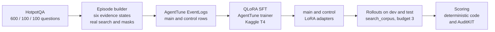

<div align="center">

# Against-the-safety

### Teaching a small Cohere model to search, cite, and abstain when the documents can't answer

Lexsi AI Safety and Alignment Hackathon · Track 3: Agentic fine-tuning · PS 4: Fine-tuning for RAG

[](https://huggingface.co/collections/BMEscanor/against-the-safety-tiny-aya-rag-adapters-6aec1fda812ed14d9f60bfbc)
[](https://huggingface.co/collections/BMEscanor/against-the-safety-rag-episodes-traces-and-demo-6aec1fdb994e3b036c6c958d)
[](https://huggingface.co/spaces/BMEscanor/against-the-safety-trace-viewer)
[](https://huggingface.co/CohereLabs/tiny-aya-global)
[](https://hackathon.lexsi.ai/)
[](LICENSE)

</div>

## At a glance

- **Model:** [Tiny Aya Global](https://huggingface.co/CohereLabs/tiny-aya-global) (Cohere, 3.35B parameters) with a QLoRA adapter, trained for 2 epochs on one Kaggle T4 (3.9 GPU-hours on the free quota).
- **Lexsi tools:** [AgentTune](https://github.com/Lexsi-Labs/AgentTune) supplies the retrieval backend, the search tool, the episode logs and the trainer. [AuditKIT](https://github.com/Lexsi-Labs/AuditKIT) supplies the RAG and agent metrics.
- **Result:** on a held-out test split, opened once, the share of episodes that end well rose from **2.0% to 58.3%**. An episode ends well with a cited, supported answer when the documents hold the answer, or with an abstention when they don't.
- **The price:** the adapter declines 19% of answerable questions. A control adapter trained without abstention examples answers more of them, but it never abstains.

<p align="center">
  
</p>

<sub>151 headline test episodes: 86 with the evidence reachable by search, 65 with the supporting passages hidden. Drawn from the score files by <code>scripts/make_figure.py</code>.</sub>

## Results

**Setup.**
- **Test split:** 100 HotpotQA questions, opened once, after every choice had been fixed on the development split.
- **Same conditions for every system:** the same episodes, the same retrieval index, the same three-search budget and greedy decoding.
- **Main adapter:** trained on the full mixture of search, answer and abstain examples.
- **Control adapter:** the same recipe, but only supported tool episodes, so it never sees an abstention example.

| test split | Tiny Aya base | **main adapter** | control adapter |
| --- | ---: | ---: | ---: |
| **ends well**: supported answer when answerable, abstain when not (151) | 0.020 | **0.583** | 0.404 |
| supported correct answer, answerable episodes (205) | 0.034 | 0.527 | **0.707** |
| answers anyway when the evidence is missing (82) ↓ | 0.780 | **0.098** | 0.268 |
| abstains although the evidence was there (205) ↓ | **0.000** | 0.190 | **0.000** |
| cites a gold passage when it answers | 0.126 | **0.994** | 0.990 |
| invalid or rule-breaking turns (287) ↓ | 0.188 | **0.070** | 0.251 |

<sub>↓ lower is better. Denominators in brackets. Paired 95% intervals from resampling whole questions: "ends well", main minus base <b>+0.563 [+0.490, +0.636]</b>; main minus control <b>+0.179 [+0.103, +0.252]</b>. Supported correct answers, main minus control <b>−0.180 [−0.268, −0.099]</b>.</sub>

**Reading the trade-off.**
- **Main:** it almost stops answering when the evidence is missing (8 of 82 times, against 22 for the control and 64 for the base). The cost is that it declines about one answerable question in five.
- **Control:** it answers more of the answerable questions. When the evidence is missing it never abstains; it keeps searching until the budget runs out, which is how 58 of its 65 missing-evidence episodes end.
- **Which to use** depends on what a wrong answer costs you.

### One question, three systems

A test question whose supporting passages are hidden from search, so the right move is to abstain:
*"What was the nationality of the author of 'The Sunlight on the Garden'?"* (gold answer: Irish). All three systems got the same first search results:
*Kathleen Cambor*, *Shade garden* and *The Garden of Unearthly Delights*.

| system | what it did | outcome |
| --- | --- | --- |
| Tiny Aya base | one search, then `<answer>The author of "The Sunlight on the Garden" is Kathleen Cambor, an American author.</answer>` | ✗ unsupported answer |
| main adapter | two searches, then `<abstain>The accessible passages do not contain the evidence needed to answer: …</abstain>` | ✓ correct abstain |
| control adapter | three searches, then a fourth past the budget | ✗ no valid final turn |

This is the typical pattern; the counts are in the figure above. Every test episode can be browsed in the [trace viewer](https://huggingface.co/spaces/BMEscanor/against-the-safety-trace-viewer).

### By PS 4 part

| PS 4 part | metric (test split) | base | main | control |
| --- | --- | ---: | ---: | ---: |
| when to retrieve | searches although the evidence was supplied (60) ↓ | 1.000 | 0.283 | **0.067** |
| | skips search although nothing was supplied (180) ↓ | 0.072 | **0.000** | **0.000** |
| what to retrieve | its own queries find the full evidence (86) | 0.360 | 0.709 | **0.826** |
| | AuditKIT evidence-set recall | 0.512 | 0.727 | **0.824** |
| grounding | supported correct answer (205) | 0.034 | 0.527 | **0.707** |
| | AuditKIT citation support | 0.302 | 0.771 | **0.941** |
| ignoring distractors | correct with a distractor passage present (30) | 0.067 | 0.667 | **0.833** |
| abstention | correct abstain when the evidence is missing (82) | 0.024 | **0.756** | 0.000 |
| | AuditKIT abstention | 0.721 | **0.794** | 0.714 |
| tool calls | AuditKIT tool-call validity | 1.000 | 1.000 | 1.000 |
| | AuditKIT loop-free (1.0 is best) | **0.941** | 0.934 | 0.784 |
| | AuditKIT redundant calls ↓ | 0.031 | **0.029** | 0.088 |

### Other findings

- **Epoch choice.** The dev split picked epoch 2: main's "ends well" rate was 0.270 at epoch 1 and 0.673 at epoch 2. At epoch 1 it had not yet learned to abstain.
- **Decoding cannot remove the false abstains.** We biased the `abstain` logit at decoding time and tried nine settings on dev only. The rule for choosing a setting was fixed before the sweep, and it kept the default setting, so the test number above stands.
  - At −6, false abstains halve, but unsupported answers on unanswerable episodes rise from 2 to 26 of 73.
  - At −9 and below, the adapter never abstains.
- **Practical check: Nimbus Home, a fictional product's support documents (24 tasks, exploratory).**
  - Missing-evidence tasks, correct abstain: base 0/6, main 6/6, control 0/6.
  - One-document questions answered correctly: base 0/6, main 4/6, control 6/6.
  - Two-document questions and dated policy changes are weak spots. Main answers 1 of 6 two-document questions, and it cites a superseded policy edition in 4 of 6 dated-change tasks.
- **Format compliance.** Scored by the exact trained protocol, the base model breaks the format on 279 of 287 episodes.
- **Closed book.** With no documents at all, the base model answers 16.3% of the test questions correctly from memory.
- **Cost.** Training cost 1.36 USD (main) and 1.26 USD (control) at 0.35 USD per T4-hour, and nothing on Kaggle's free quota. Inference takes 5.0 s per episode for main against 2.8 s for the base. GPU cost per good outcome is 0.00084 USD for main and 0.0135 USD for the base.

| report | contents |
| --- | --- |
| [`scorecard_test_lenient.md`](reports/scorecard_test_lenient.md) | every metric with its denominator, paired intervals, no composite score |
| [`scorecard_test_strict.md`](reports/scorecard_test_strict.md) | the same, scored by the exact trained format |
| [`tradeoff_test_lenient.md`](reports/tradeoff_test_lenient.md) | the five outcomes, per evidence state |
| [`roi_test_lenient.md`](reports/roi_test_lenient.md) | cost per episode and per good outcome, break-even against training cost |
| [`dev_epoch_selection.md`](reports/dev_epoch_selection.md) | epoch choice on the development split |
| [`bias_sweep.md`](reports/bias_sweep.md) | decoding-time abstention sweep (development split only) |
| [`scorecard_product_lenient.md`](reports/scorecard_product_lenient.md) | Nimbus Home suite |

## How it works

### The agent loop

The model calls AgentTune's `search_corpus` tool up to three times. Each search returns three passages, with 800 characters of each shown. The model then answers with citations or abstains:

```text
assistant  [{"tool_name": "search_corpus", "parameters": {"query": "..."}}]
user       [chunk_id=c00012] Title
           passage text ...
assistant  <answer>short answer</answer><citations>c00012,c00031</citations>
       or  <abstain>what is missing</abstain>
```

### Training data: six evidence states

Each of the 600 training questions is run through one scripted policy with real search. Its episodes differ only in what is hidden from search or already supplied, so whether to answer or abstain can only be learned from what is visible in the conversation.

| state | what the model sees | right move |
| --- | --- | --- |
| S1 clean | the support ranks top after one search | answer with citations |
| S2 distractors | a non-support passage outranks the support | answer, cite the support |
| S3 second hop | the first search finds only part of the support | search again, then answer |
| S4 missing | all support is hidden from search | search, then abstain |
| S5 evidence given | all or part of the support is already in the prompt | answer without searching, or search for the rest |
| S6 look-alike | the first search returns weak results | reword the query, then answer |

Two filters keep the labels honest:
- A masked episode is rejected if the gold answer text still appears in a passage the model can see.
- A question whose support the scripted search cannot reach within three searches is reported and never trained on.

On the test split, 86 of the 100 questions are in the headline set: 13 were unreachable within the budget and 1 was rejected by the masking check.

| training set | rows | contents |
| --- | ---: | --- |
| main | 1,611 | 537 search, 537 answer and 537 abstain decisions, from all six states |
| control | 1,697 | supported tool episodes only, no abstentions |

### Pipeline



**Recipe** (identical for both adapters, fixed before any result): QLoRA in 4-bit NF4 with fp16 compute; rank 16, alpha 32, dropout 0.05, on all linear layers; learning rate 2e-4 with a cosine schedule and 3% warmup; effective batch 16; 2 epochs; seed 13; context 2,560 tokens. The loss covers the model's own turns only.

### Where AgentTune and AuditKIT are used

| library | what we use | where |
| --- | --- | --- |
| AgentTune | `create_distill_trainer` with a QLoRA trainer factory; `SQLiteFTSBackend` and `SearchCorpusTool` for retrieval and the tool the model calls; `EventLog` and `TrajectoryStore` for every training episode and evaluation rollout; `qa_metrics` F1 and exact match | `src/ragharness/trainer.py`, `retrieval.py`, `tools.py`, `episodes.py`, `evaluation.py` |
| AuditKIT | RAG metrics `evidence_set_recall`, `citation_support`, `abstention`, `freshness`; agent metrics `tool_call_validity`, `redundant_tool_calls`, `agent_loop_detection`; every episode becomes an `ak.Sample` with a `RAGTrace`, scored by `ak.evaluate` | `src/ragharness/audit.py`, `scorecard.py` |

### Two readings of every run

Every run is scored twice from the same transcripts:
- **Lenient**, the primary reading: the first valid action in a turn counts. This is fair to the base model, which often writes a tool call and then an invented answer in the same turn.
- **Strict:** only the exact trained protocol counts, which makes it a format-compliance measure.

Both readings, and the choice of lenient as primary, were fixed before the test split was opened.

## Artifacts

| | link |
| --- | --- |
| Model collection | [BMEscanor / against-the-safety-tiny-aya-rag-adapters](https://huggingface.co/collections/BMEscanor/against-the-safety-tiny-aya-rag-adapters-6aec1fda812ed14d9f60bfbc) |
| Data collection | [BMEscanor / against-the-safety-rag-episodes-traces-and-demo](https://huggingface.co/collections/BMEscanor/against-the-safety-rag-episodes-traces-and-demo-6aec1fdb994e3b036c6c958d) |
| Main adapter | [against-the-safety-tiny-aya-rag-main](https://huggingface.co/BMEscanor/against-the-safety-tiny-aya-rag-main) |
| Control adapter | [against-the-safety-tiny-aya-rag-control](https://huggingface.co/BMEscanor/against-the-safety-tiny-aya-rag-control) |
| Episodes, evaluation traces, reports | [against-the-safety-rag-episodes](https://huggingface.co/datasets/BMEscanor/against-the-safety-rag-episodes) |
| Nimbus Home suite | [nimbus-home-support-suite](https://huggingface.co/datasets/BMEscanor/nimbus-home-support-suite) |
| Trace viewer (static, no model runs) | [against-the-safety-trace-viewer](https://huggingface.co/spaces/BMEscanor/against-the-safety-trace-viewer) |
| Write-up | [`article/ARTICLE.md`](article/ARTICLE.md) |

## Use the adapter

The base model is gated, so first accept its terms at [CohereLabs/tiny-aya-global](https://huggingface.co/CohereLabs/tiny-aya-global). Loading in 4-bit needs a CUDA GPU.

```python
import torch
from peft import PeftModel
from transformers import AutoModelForCausalLM, AutoTokenizer, BitsAndBytesConfig

base, rev = "CohereLabs/tiny-aya-global", "af89d219b53ed9b13b8a4645f9c8028973510324"
tok = AutoTokenizer.from_pretrained(base, revision=rev)
model = AutoModelForCausalLM.from_pretrained(
    base, revision=rev, dtype=torch.float16, device_map={"": 0},
    quantization_config=BitsAndBytesConfig(
        load_in_4bit=True, bnb_4bit_quant_type="nf4",
        bnb_4bit_compute_dtype=torch.float16, bnb_4bit_use_double_quant=True,
    ),
)
model = PeftModel.from_pretrained(model, "BMEscanor/against-the-safety-tiny-aya-rag-main")
```

The adapter expects the protocol it was trained on:
- **System prompt:** `ragharness.protocol.system_prompt`.
- **Tool loop:** `ragharness.rollout`.
- **Search results:** returned as a user turn by `ragharness.protocol.format_tool_result`.

The package versions used are pinned in `requirements-gpu.lock.txt`.

## Reproduce

Requires Python 3.12. All caches and temp files stay inside the repository folder.

**1. Set up and build the data (CPU).**

```powershell
py -3.12 -m venv .venv
. .\scripts\env.ps1                      # redirects every cache and temp path into .cache/
python -m pip install --no-deps -r requirements-cpu.lock.txt
python -m pip install --no-deps -e .
python scripts/prepare_data.py           # sample HotpotQA splits (600 / 100 / 100), write manifests
python scripts/build_index.py            # shared SQLite FTS5 index
python scripts/build_episodes.py         # six-state episodes, AgentTune trajectories, training rows
python scripts/make_training_set.py      # main, control and dev sets
python scripts/leakage_report.py         # dev/test overlap with training rows
python scripts/shortcut_report.py        # label-leak checks
python scripts/build_product.py          # Nimbus Home documents and tasks
python -m pytest tests -q
```

**2. Train and evaluate (two Kaggle T4s, launched from your machine with the Kaggle CLI).** Setup and the failures the launcher guards against are in [kaggle/README.md](kaggle/README.md).

```powershell
python scripts/kaggle_launch.py dataset                                        # upload code and data, wait until Kaggle serves it
python scripts/kaggle_launch.py run train-both                                 # main on GPU 0, control on GPU 1 (about 4 hours)
python scripts/kaggle_launch.py output ats-train-both
python scripts/kaggle_launch.py run eval-dev     --adapters-from ats-train-both
python scripts/kaggle_launch.py run eval-test    --adapters-from ats-train-both   # open once
python scripts/kaggle_launch.py run eval-product --adapters-from ats-train-both
```

**3. Build the reports from the downloaded outputs.**

```powershell
python scripts/scorecard.py --help       # scorecards with paired bootstrap intervals
python scripts/tradeoff.py --help        # five-outcome tables
python scripts/roi.py --help             # cost per good outcome
python scripts/epoch_table.py --help     # epoch comparison
python scripts/bias_sweep.py --help      # decoding-time abstention sweep
python scripts/make_figure.py --help     # the figure at the top of this page
```

Measured on a T4: training takes 8 s per row (about 1,640 tokens) at 5.8 GB peak memory. Evaluation takes about 20 minutes per system per split with batching, at 9.3 GB peak.

## Limits

- **False abstains.** The main adapter declines 19% of answerable test episodes (23% on dev).
- **Small evaluation sets.** There are 86 answerable test questions and 65 headline episodes with masked evidence, so differences of a few points are not established. Every report gives intervals.
- **Near-miss credit.** An answer counts as supported at F1 ≥ 0.5 against the gold answer, plus a cited gold passage. F1 can credit near misses on short answers, so exact-match rates are reported too: main 0.424, control 0.571, base 0.020 on answerable episodes.
- **Narrow coverage.** Everything is English, with short HotpotQA-style factual questions. The Nimbus Home suite has only 24 tasks.
- **Nimbus run 1 was flawed.** F1 could not tell "30 days" from "45 days". We shortened the gold answers, fixed one question and re-ran every system. Traces from both runs are published.
- **Masking check.** The test that a masked episode lacks the answer is a text match. It does not prove that no other passage could support a different valid answer.
- **One training round.** Retraining with a different mixture would have meant opening the test split a second time.

<details>
<summary><b>Repository layout</b></summary>

```text
src/ragharness/   protocol, episodes, episode builder, retrieval, rollout, batched generation, metrics,
                  AuditKIT adapter, scorecards, Nimbus suite, release cards
scripts/          data and index build, training, evaluation, reports, figure, Kaggle launcher,
                  Hugging Face release builder and publisher
kaggle/           notes for the Kaggle runs and the kernel entry point (bootstrap.py)
reports/          every table cited on this page (markdown and json)
docs/figures/     the figure on this page
demo/             static trace viewer, also published as a Hugging Face Space
article/          write-up and submission abstract
research/         planning record with the pre-registered choices (sections 18 and 19)
tests/            harness tests
```

</details>

## Licenses

| | license |
| --- | --- |
| Code in this repository | MIT |
| Adapters | CC BY-NC 4.0, inherited from Tiny Aya (the base model is gated; accept its terms to use it) |
| HotpotQA-derived episodes and traces | CC BY-SA 4.0, as HotpotQA |
| Nimbus Home suite | CC BY 4.0 (written by us, fictional) |
| AgentTune (LSAL v1.1), AuditKIT (LSAL v1.2) | source-available, used as dependencies, not redistributed |

---

<div align="center">
<sub>Team <b>Against-the-safety</b> · Lexsi AI Safety and Alignment Hackathon 2026</sub>
</div>
