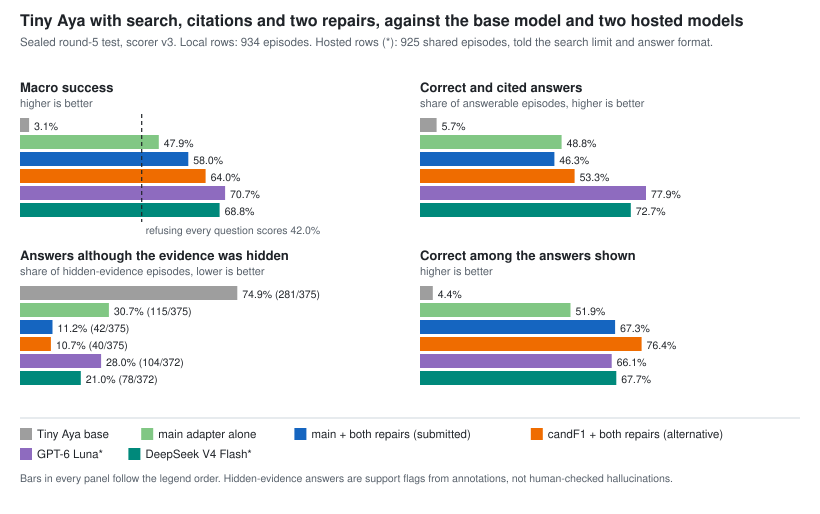

# Against-the-safety

**A small model that answers from your documents, cites its sources, and says so when the documents don't have the answer.**

Tiny Aya Global (3.35B) with a LoRA adapter, trained through [AgentTune](https://github.com/Lexsi-Labs/AgentTune) and measured with [AuditKIT](https://github.com/Lexsi-Labs/AuditKIT). Team Against-the-safety, Lexsi AI Safety and Alignment Hackathon, Track 3 (agentic fine-tuning), problem statement 4: fine-tuning for retrieval-augmented generation.

[Models](https://huggingface.co/collections/BMEscanor/against-the-safety-tiny-aya-rag-adapters-6aec1fda812ed14d9f60bfbc) · [Data and traces](https://huggingface.co/collections/BMEscanor/against-the-safety-rag-episodes-traces-and-demo-6aec1fdb994e3b036c6c958d) · [Trace viewer](https://huggingface.co/spaces/BMEscanor/against-the-safety-trace-viewer) · [Article](article/ARTICLE.md) · [Demo](#try-it)


## Results

We scored every system on a sealed test of 938 SQuAD, HotpotQA and RGB episodes that no training or earlier choice had used (934 are scorable). About 40% of the episodes hide the evidence, so the right move there is to refuse.



| System | Macro success | Correct and cited | Answers when evidence was hidden | Correct among answers shown |
| --- | ---: | ---: | ---: | ---: |
| Tiny Aya base | 3.1% | 5.7% | 281 / 375 | 4.4% |
| Main adapter alone | 47.9% | 48.8% | 115 / 375 | 51.9% |
| **Main + both repairs (submitted)** | **58.0%** | 46.3% | **42 / 375** | 67.3% |
| candF1 + both repairs (alternative) | 64.0% | 53.3% | 40 / 375 | 76.4% |
| Refuse every question | 42.0% | 0.0% | 0 / 375 | none |

Scorer v3, [`reports/reference_policies.md`](reports/reference_policies.md). *Correct and cited* is the share of answerable episodes. *Hidden-evidence answers* are answers the annotations do not support, not human-checked hallucinations.

- **The base model is not usable here.** It gives a correct, cited answer in 5.7% of answerable episodes and answers 75% of the episodes whose evidence was hidden.
- **Training plus two repairs fixes the second problem.** The submitted system answers 11% of the hidden-evidence episodes, and two thirds of the answers it shows are correct.
- **The price is coverage.** It answers 41% of all questions and refuses 39% of answerable ones.
- **Read macro success next to the last row.** A correct refusal counts as success, so refusing everything already scores 42.0%.

**Which system do we submit?** Main, because we chose it before the test was opened. candF1 scores higher on this test (+6.0 points macro, 95% interval +3.0 to +9.2), but a gate written after we saw its development results selected it, and its safety gain is not established (hidden-evidence answer rate −0.5 points, interval −4.6 to +3.4; our rule needed the upper end at +2 or below). We publish it as the alternative. A fresh test would settle the question.

## How it works

1. **Search.** The adapter calls `search_corpus` up to three times, reading three passages per search.
2. **Draft.** It ends with `<answer>` and chunk citations, or `<abstain>` saying what is missing.
3. **Fail-closed rule.** A rollout without a valid ending (repeated query, fourth search, bad format) becomes a refusal.
4. **Self-check.** The same model reads the question, the cited passages and the answer. The answer is shown only if P(SUPPORTED) is at least 0.5, the cited passage was actually shown, and every part of the answer appears in it.

Steps 3 and 4 are code and need no training. Training used 600 HotpotQA questions turned into scripted episodes in six evidence states (clean support, a distractor ranked first, second-hop recovery, evidence hidden, evidence supplied in the prompt, a weak first search): 1,611 training turns, 537 each of search, answer and refusal. QLoRA ran for two epochs on one T4 (3.9 GPU-hours, about $2 at $0.526 per hour).

## Try it

| Option | Needs | What you get |
| --- | --- | --- |
| [Trace viewer](https://huggingface.co/spaces/BMEscanor/against-the-safety-trace-viewer) | a browser | recorded episodes, base against fine-tuned model, side by side; no model runs |
| Web demo, `scripts/demo_app.py` | a CUDA GPU (the packaged system ran on a free Kaggle T4) | paste your own passages, ask questions, see the answer or refusal, the citations and the search trace |
| Command line, `scripts/ask.py` | a CUDA GPU | the same system over a JSONL file of passages |

The web demo ships with 24 fictional product-support passages ([`examples/nimbus_home.jsonl`](examples/nimbus_home.jsonl)) and eight example questions: two answerable, two with a newer and an older policy edition in the documents, two that need two passages, two the documents cannot answer ([`examples/nimbus_questions.json`](examples/nimbus_questions.json)). To run it on a free Kaggle T4 from this repository:

```powershell
python scripts/bundle_for_kaggle.py --adapter main=<folder with the main adapter>
python scripts/kaggle_launch.py dataset --existing
python scripts/kaggle_launch.py run demo --tag try --timeout 5400
```

The kernel first answers the eight example questions, then prints a `DEMO LINK:` line to its log every minute for about 50 minutes; open the kernel's page on kaggle.com to read it. The main adapter is on [Hugging Face](https://huggingface.co/BMEscanor/against-the-safety-tiny-aya-rag-main), and the base model is gated, so accept its terms first. More options are in [`kaggle/README.md`](kaggle/README.md).

**A real run.** The eight example questions on a Kaggle T4, with the submitted system (adapter, fail-closed rule and self-check). The full output is in [`docs/examples/demo_smoke_t4.json`](docs/examples/demo_smoke_t4.json).

| Kind | Question | Expected | The system | Result |
| --- | --- | --- | --- | ---: |
| one passage | Seconds to hold the Hub H2 reset pin | 8 | answered 8 | right |
| one passage | Batteries in the Lock L1 | 4 AA alkaline | answered 4 AA alkaline batteries | right |
| two editions | Lock L1 body warranty in months | 24 | answered 24 | right |
| two editions | Cam C3 return window in days | 45 | answered 30, from the 2025 edition | wrong |
| two passages | Does firmware 5.0 local-only mode stop Cam C3 cloud uploads | yes | answered no | wrong |
| two passages | Firmware release that added the protocol Apple Home uses | 4.2 | refused | over-refusal |
| missing | Hub H2 Bluetooth version | refuse | refused | right |
| missing | Lock L1 fingerprint unlocking | refuse | refused | right |

Five of eight match what the documents support, both missing-evidence questions correctly refused. The Cam C3 answer cited both editions and picked the older one, and the self-check let it through (support score 0.90). That is the weakness the Limits section names. An answer took about 10 seconds and a refusal about 20, because a refusal follows three searches. The kernel also served the web page behind a public link, but nobody opened that link in this run, so the page itself has not been clicked through.


## Against hosted models

The same sealed test, 925 episodes both sides could answer. The hosted models were told the three-search limit and the answer format in their prompt; the adapter learned them in training. Hosted rows use the fail-closed rule and no self-check.


| System | Macro success | Answered | Correct among answered | Wrong or unsupported shown, of all cases |
| --- | ---: | ---: | ---: | ---: |
| Main + both repairs | 58.4% | 41.3% | 67.8% | 13.3% |
| candF1 + both repairs | 64.5% | 42.1% | 76.6% | 9.8% |
| GPT-6 Luna | 70.7% | 70.5% | 66.1% | 23.9% |
| DeepSeek V4 Flash | 68.8% | 64.2% | 67.7% | 20.8% |

GPT-6 Luna is 6.2 points above candF1 on macro (interval +1.1 to +11.1). DeepSeek V4 Flash is 4.4 above (interval −0.3 to +9.1), which is not clearly different. Both hosted models answer far more often, and show a wrong or unsupported answer about twice as often as candF1. [Full comparison](reports/fair_rerun.md).

**Cost.** For 10,000 episodes: $6.30 for the adapter's busy T4 time (perfect utilisation, $0.526 per hour, nothing else counted), $2.67 for GPT-6 Luna and $6.09 for DeepSeek, from the recorded token mix and published prices. The adapter is not cheaper. Its case is control: it runs on one GPU you own and shows fewer unsupported answers. See [`reports/azure_roi.md`](reports/azure_roi.md) and [`reports/deepseek_roi.md`](reports/deepseek_roi.md).

## How we used AgentTune and AuditKIT

| | What we used it for | Where |
| --- | --- | --- |
| AgentTune | `create_distill_trainer` with a QLoRA trainer factory; `SQLiteFTSBackend` and the corpus search tool the model calls; `EventLog` and `TrajectoryStore` for every training episode and evaluation rollout; `qa_metrics` for answer F1 | `src/ragharness/trainer.py`, `retrieval.py`, `tools.py`, `episodes.py` |
| AuditKIT | every episode becomes an `ak.Sample` with a `RAGTrace` and is scored with `ak.evaluate`: evidence-set recall, citation support, abstention, tool-call validity, redundant tool calls, loop detection, and freshness on the dated Nimbus documents | `src/ragharness/audit.py`, `scorecard.py` |

AuditKIT numbers from the first round (HotpotQA test split, scorer before the 13 November corrections):

| AuditKIT metric | Base | Main | Control |
| --- | ---: | ---: | ---: |
| Evidence-set recall | 0.512 | 0.727 | 0.824 |
| Citation support | 0.302 | 0.771 | 0.941 |
| Abstention | 0.721 | 0.794 | 0.714 |
| Tool-call validity | 1.000 | 1.000 | 1.000 |
| Redundant tool calls (lower is better) | 3.1% | 2.9% | 8.8% |
| Loop-free episodes | 94.1% | 93.4% | 78.4% |

The headline table above uses our own scorer, which checks that an answer is correct and that the cited passages contain the required evidence. We did not run AuditKIT's shipped benchmark suites (ARC, GSM8K, MMLU, TruthfulQA, BFCL); none of them tests retrieval. Preference training used our own short loop, because AgentTune's DPO trainer ran out of memory on a T4. [`reports/scorecard_test_lenient.md`](reports/scorecard_test_lenient.md) has the full first-round scorecard.

## What we tried, and what we kept


- **Refusal training is what makes the model stop.** A control adapter trained without refusal examples answered more but never refused; it kept searching until the budget ran out.
- **Cheap fixes beat more training.** The two repairs moved macro success from 47.9% to 58.0% with no retraining. Every training change after round 1 missed its own release rule.
- **Preference training removed refusals.** The pairs almost never chose an abstention, so the checkpoints stopped abstaining. Adding abstention pairs restored it from main but passed no gate. Some of those training prompts also exposed held-out evidence; main and candF1 predate them. See the [remediation report](reports/2026-11-13-evaluation-remediation.md).
- **A trained checker did not beat the plain one.** Two adapters trained to check answers (V2m, V2b) never reached the hidden-evidence limit we set, at any threshold ([report](reports/round6_selection.md)). The Round 6 sealed test is unopened.

The full record, with every pre-registered rule and each result, is in [`docs/HISTORY.md`](docs/HISTORY.md).

## Reproduce

Python 3.12. All caches stay inside the repository folder.

```powershell
py -3.12 -m venv .venv
. .\scripts\env.ps1
python -m pip install --no-deps -r requirements-cpu.lock.txt
python -m pip install --no-deps -e .
python -m pytest tests -q                  # some tests skip when large data is absent
python scripts/remediate_audit.py          # rebuilds the corrected reports from the saved transcripts
```

Training and evaluation ran on Kaggle T4s: see [`kaggle/README.md`](kaggle/README.md). Use the adapter directly with `scripts/ask.py`; load it with the base model's [pinned revision](https://huggingface.co/CohereLabs/tiny-aya-global).

## Limits

- English, short factual questions. Two-part answers and single-passage questions are weak spots; with two documents and dated editions the adapter sometimes cites the older one.
- The sealed test was opened before the scoring corrections, and candF1 was tested on it after its gate was written, so further model selection needs a fresh test.
- Hidden-evidence answers are annotation-based flags. An unannotated alternative source could make a flagged answer correct, and no one has hand-checked them.
- The self-check withholds some correct answers. The submitted system refuses 39% of answerable questions.
- There is no hosted live endpoint: the web demo needs a GPU you start yourself. Its GPU run answered the eight example questions as shown above (five right, two wrong, one over-refusal); eight questions say little about accuracy, which the sealed test measures.

## Artifacts and licenses

| | |
| --- | --- |
| Adapters | [main](https://huggingface.co/BMEscanor/against-the-safety-tiny-aya-rag-main) (submitted), [candF1](https://huggingface.co/BMEscanor/against-the-safety-tiny-aya-rag-cand-f1) (alternative), [control](https://huggingface.co/BMEscanor/against-the-safety-tiny-aya-rag-control), [candA](https://huggingface.co/BMEscanor/against-the-safety-tiny-aya-rag-cand-a), [patch](https://huggingface.co/BMEscanor/against-the-safety-tiny-aya-rag-patch) |
| Data | [episodes and training rows](https://huggingface.co/datasets/BMEscanor/against-the-safety-rag-episodes), [benchmark traces](https://huggingface.co/datasets/BMEscanor/against-the-safety-benchmark-traces), [Nimbus Home suite](https://huggingface.co/datasets/BMEscanor/nimbus-home-support-suite) |
| Code | MIT |
| Adapters | CC BY-NC 4.0, inherited from Tiny Aya (gated; accept its terms) |
| HotpotQA- and SQuAD-derived data | CC BY-SA 4.0 |
| RGB-derived data | CC BY-NC-SA 4.0, noncommercial |
| Nimbus Home suite | CC BY 4.0 (fictional, written by us) |
| Benchmark traces | as the source: 2WikiMultihopQA Apache-2.0, MuSiQue CC BY 4.0, SQuAD 2.0 CC BY-SA 4.0, RGB CC BY-NC-SA 4.0 |
| AgentTune (LSAL v1.1), AuditKIT (LSAL v1.2) | source-available, used as dependencies, not redistributed |

Written by [BMEscanor](https://huggingface.co/BMEscanor) and [abd420](https://huggingface.co/abd420). A friend provided Kaggle compute with permission.
