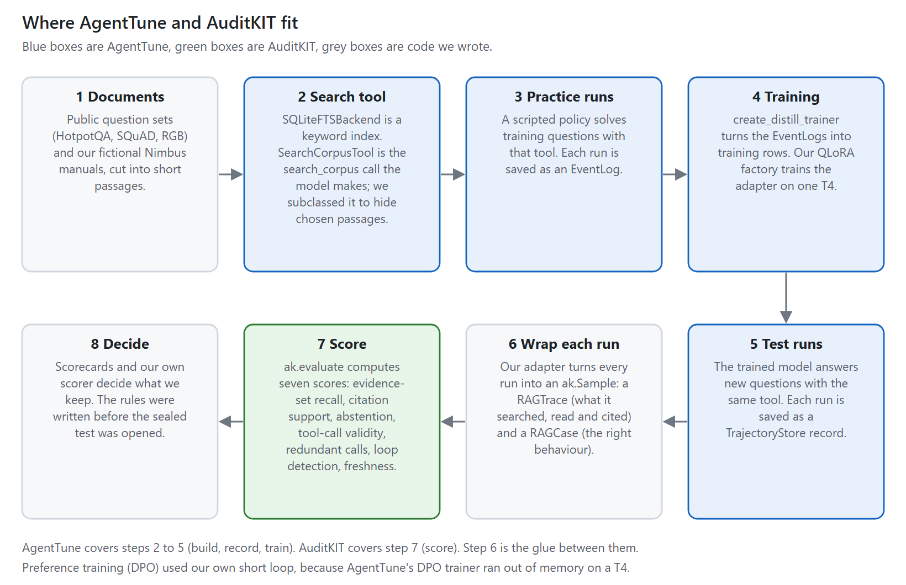
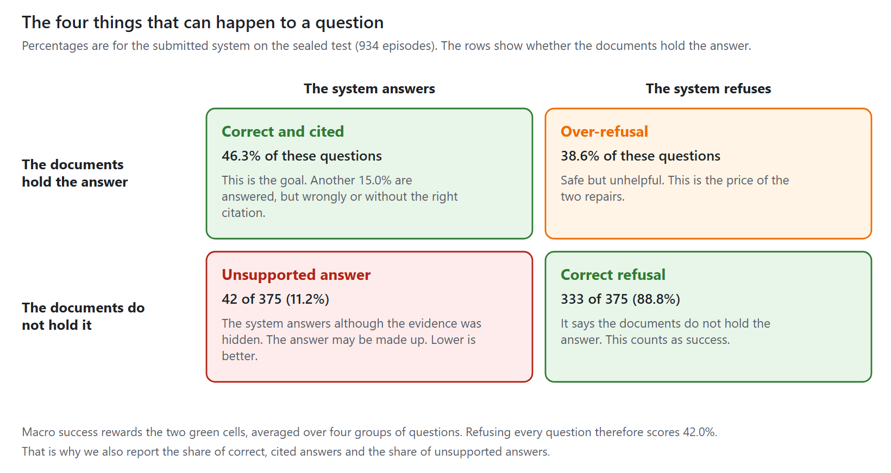
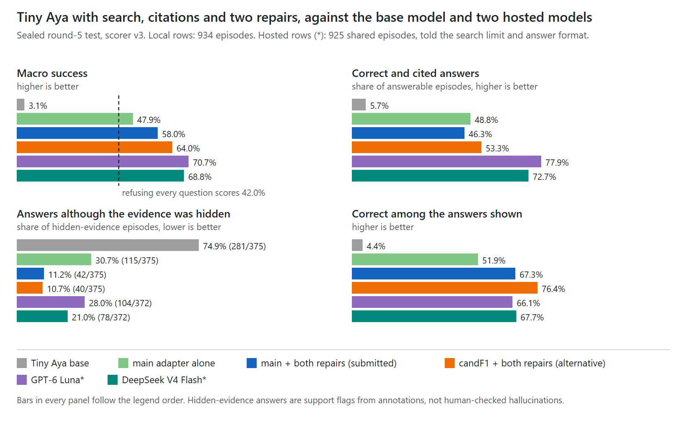
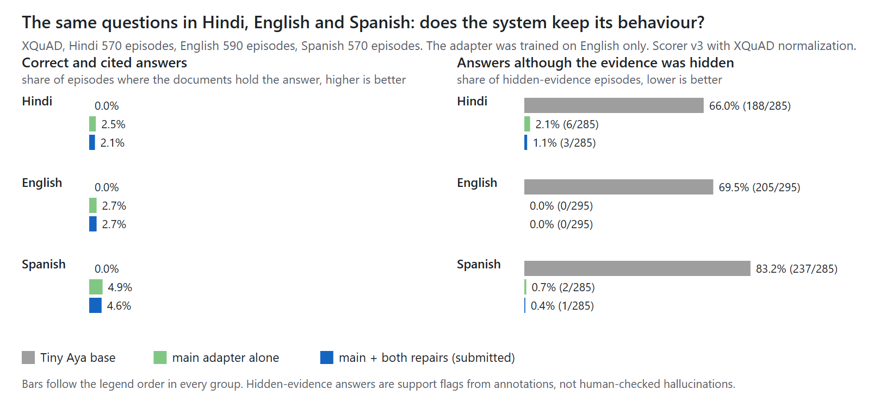

# Teaching a small model to search, cite and refuse when the evidence is missing

**Team Against-the-safety** · Lexsi AI Safety and Alignment Hackathon · Track 3 (agentic fine-tuning), PS 4: fine-tuning for retrieval-augmented generation

Code: https://github.com/Bhaveshmeghwal21/against-the-safety · Models and data: see section 5

## Abstract

A document assistant is only useful if it answers from its documents and says so when they don't hold the answer. This setup is called retrieval-augmented generation (RAG): the assistant searches the documents, then writes an answer from what it found. We fine-tuned Tiny Aya Global (3.35B) with QLoRA, which trains a small add-on file (an adapter) instead of the whole model. Training ran through AgentTune, Lexsi's library for training agents. The model searches a document set up to three times, then answers with citations or refuses. Two code repairs need no training: a fail-closed rule that turns any invalid ending into a refusal, and a self-check in which the same model reads the cited passages and withholds an answer they do not support. AuditKIT, Lexsi's scoring library, scored our first-round runs and checked evidence coverage; the headline numbers below come from our own scorer.

We scored every system with fixed code on a sealed test (questions locked away before training) of 938 SQuAD, HotpotQA and RGB episodes, about 40% of which hide the evidence. Against the base model, the submitted system raises correct, cited answers on answerable episodes from 5.7% to 46.3% and cuts answers given when the evidence was hidden from 281 of 375 to 42 of 375. Of the answers it shows, 67.3% are correct. Macro success, which counts a correct refusal as success, is 58.0%. A policy that refuses every question scores 42.0%, so we report four measures and not macro success alone. On 925 shared episodes, GPT-6 Luna and DeepSeek V4 Flash score 70.7% and 68.8% macro success, but show a wrong or unsupported answer in 23.9% and 20.8% of cases, against 13.3% for our system and 9.8% for its alternative checkpoint candF1 (64.5% macro success). On a 300-episode sample, an AI judge (AuditKIT faithfulness, Azure gpt-6-luna) found 80.8% of the claims in the submitted system's answers supported by the passages it was shown, against 62.5% for the base model. At batch size one on a Kaggle T4, the submitted system answers in a median of 16.3 s (95th percentile 23.8 s). On MMLU and ARC the adapters stay within 1 point of the base model; on TruthfulQA the submitted one is 3.5 points lower.

Every later training change failed its own pre-registered release rule: a patch for single-passage questions, a matched-evidence curriculum, preference training (its checkpoints stopped abstaining) and trained answer checkers. A second look at refusals, checked by the plain self-check, also failed its pre-registered rule on a fresh 679-episode test that we opened once (macro success +0.9 points, interval −0.3 to +2.1). The same test measured the submitted system again: 54.1% macro success against 43.8% for refusing everything, 10.0% of hidden-evidence episodes answered, and single-passage SQuAD questions close to the refuse-everything score. The tests cover English short factual questions. Further model selection needs another fresh test, and hidden-evidence answers are annotation-based flags, not human-checked hallucinations.

## 1. Problem and approach

### The idea in plain terms

Companies want assistants that answer from their own documents: manuals, policies, help pages. The assistant first searches the documents, then writes an answer from what it found. The weak spot is the case where the documents do not hold the answer. A language model then often answers anyway, and the answer sounds confident. The untrained Tiny Aya Global did this in 75% of our test episodes whose evidence we had hidden.

A document assistant has to do four things: decide when to search, find the right passages, answer only from what it found, and refuse when the passages do not hold the answer. A small model usually does the first two passably and fails the last two.

### Terms used in this article

| Term | What it means here |
| --- | --- |
| Passage or chunk | A short piece of a document with an ID such as `c00019`. The model cites these IDs. |
| Refuse, or abstain | Saying the documents do not hold the answer, instead of guessing. |
| Adapter, LoRA, QLoRA | An adapter is a small add-on file (121 MB here) that holds only what training changed. LoRA is the method. QLoRA does it while the base model is squeezed to 4 bits, so it fits a 16 GB T4 GPU. |
| Episode | One question, its documents, and the model's whole attempt. |
| Evidence hidden | A test episode where we removed the passages that hold the answer. The right move is to refuse. |
| Unsupported answer | An answer given although the evidence was hidden. It stands in for "made up" and comes from annotations, not hand checks. |
| Sealed test | Questions locked away before training and opened only to score finished systems. |
| Macro success | The average of four groups' success rates. A correct, cited answer or a correct refusal counts. Refusing every question scores 42.0%. |
| Pre-registered rule | A pass or fail rule written down before the result was known. |

### What we built

We trained Tiny Aya Global (3.35B) with QLoRA to run a small protocol: call `search_corpus` up to three times (three passages per search, 800 characters each), then end with `<answer>` and chunk citations, or `<abstain>` saying what is missing. The training data are scripted episodes built from 600 HotpotQA training questions in six evidence states: clean support, a distractor ranked first, second-hop recovery, evidence hidden (the right move is to refuse), evidence supplied in the prompt, and a weak first search. That gave 1,611 training turns, 537 each of search, answer and refusal. A control adapter, trained on the answering episodes only, shows what the refusal examples change.

Two repairs run on the model's output and need no training. The **fail-closed rule** turns a rollout without a valid ending (repeated query, fourth search, bad format) into a refusal. The **self-check** has the same model read the question, the cited passages and the answer; the answer is shown only if P(SUPPORTED) is at least 0.5, the cited passage was actually shown, and every part of the answer appears in it.

**Training settings.**

| Setting | main (submitted) | candF1 (alternative) |
| --- | --- | --- |
| Base model | Tiny Aya Global, revision `af89d219`, loaded in 4-bit NF4 with double quantisation and fp16 compute (QLoRA) | same |
| Starts from | the base model | candA, a second-round adapter trained like main on the same questions (1,668 rows, more of them answers) |
| Training rows | 1,611 (537 search, 537 answer, 537 refusal) from 600 HotpotQA training questions | 721 from SQuAD training-split articles: 304 rows from 152 pairs of the same question with the needed fact present and missing, plus 417 replay rows |
| LoRA | rank 16, alpha 32, dropout 0.05, all seven attention and MLP projections | same |
| Optimiser | paged AdamW 8-bit, learning rate 2e-4, cosine schedule, 3% warm-up, no weight decay, gradient clipping at 1.0 | same, learning rate 3e-5 |
| Batch and length | batch 1 with 16-step gradient accumulation, at most 2,560 tokens per row, loss on the model's own turns only | same |
| Length of training | 2 epochs, 202 optimiser steps | the checkpoint after epoch 1 of 2 (92 steps for both epochs) |
| Seed, time, memory | seed 13, 3.9 h on one T4, peak 5.8 GB | seed 47 (candA: seed 13), 2.0 h on one T4, peak 6.0 GB |

**Library settings.** AgentTune 1.1.3 and AuditKIT 1.1.3, pinned in `requirements-gpu.lock.txt` with PyTorch 2.11, Transformers 5.22.1, TRL 1.7.1, PEFT 0.21.2 and bitsandbytes 0.50.2. From AgentTune we set `SQLiteFTSBackend(match_all=False)`, our `search_corpus` subclass (three passages per search, 800 characters each) and `create_distill_trainer` with our QLoRA trainer factory. AuditKIT's metrics were called by name through `ak.evaluate` with their default settings. The judge metrics used AuditKIT's own prompts (version v2) and the judge deployment's default sampling. Other options stayed at the libraries' defaults. The Hindi adapters' settings are in section 6.

## 2. Lexsi repositories used

The hackathon asked every Track 3 team to use two Lexsi Labs libraries. One is the workshop where the model is taught, the other is the examiner.

**AgentTune** is a library for building and training agents. An agent is a model that works in several steps and uses tools, here a search tool, instead of answering in one go. AgentTune supplies the tool, records every step an agent takes in a standard format, and turns those recordings into training data. **AuditKIT** scores models and agents with fixed code. For RAG it asks whether the system found enough evidence, whether its citations are real and whether it refused when it should have. For agents it checks tool use.

### How we used AgentTune

| Step | AgentTune part | What we did with it |
| --- | --- | --- |
| Search | `SQLiteFTSBackend`, `SearchCorpusTool` | A keyword index of the passages. The `search_corpus` tool the model calls is a subclass of AgentTune's. Three changes: it shows 800 characters of a passage instead of 350, hides relevance scores, and can hide chosen passages for evidence-hidden episodes. AgentTune's backend reports a broken index as "no results", so we added a check that fails loudly when the index is empty or wrong. |
| Recording | `EventLog`, `TrajectoryStore` | Every scripted training episode is saved as an EventLog and every evaluation run as a TrajectoryStore record. Both are published in the episodes dataset. |
| Training | `create_distill_trainer` | It takes the EventLogs and hands training rows to a trainer factory. Ours trains a 4-bit LoRA adapter on one T4 and learns only from the model's own turns. AgentTune's default factory loads the model in bf16 (a T4 has no bf16) and trains on every token. |
| Answer matching | `qa_metrics` | Word-overlap (F1) between an answer and the reference. |
| What did not fit | DPO trainer | It ran out of memory on a T4, so preference training used our own short loop with the same loss. |

### How we used AuditKIT

For every evaluation episode we build two records and hand them to AuditKIT. An `ak.Sample` carries a `RAGTrace`: the searches, the passages retrieved, the citations and the final answer or refusal. A `RAGCase` holds the right behaviour: whether the question was answerable, which passages are enough, the reference answer. `ak.evaluate` returns the scores. First-round results on the HotpotQA test split, scored before the 13 November corrections:

| AuditKIT metric | The question it answers | Base | Main | Control |
| --- | --- | ---: | ---: | ---: |
| Evidence-set recall | Did the searches retrieve at least one complete set of passages that is enough to answer? | 0.512 | 0.727 | 0.824 |
| Citation support | Do the citations point to passages that exist, are current and support the answer? | 0.302 | 0.771 | 0.941 |
| Abstention | Did it refuse when it should and answer when it should? | 0.721 | 0.794 | 0.714 |
| Tool-call validity | Were the search calls well formed? | 1.000 | 1.000 | 1.000 |
| Redundant tool calls (lower is better) | What share of searches exactly repeat an earlier one? | 3.1% | 2.9% | 8.8% |
| Loop-free episodes | What share of episodes never fell into a repetition loop? | 94.1% | 93.4% | 78.4% |

What it showed us:

- **Training taught citing.** Citation support rose from 0.302 to 0.771.
- **Refusal examples teach the model when to stop.** The control adapter, trained without them, had only 78.4% loop-free episodes and 8.8% repeated searches. Main had 93.4% and 2.9%.
- **It reports "unknown" instead of guessing.** When our reference evidence was incomplete, AuditKIT gave no score for those episodes. That exposed an earlier RGB recall figure of 0.960 that covered only 25 of 286 answerable episodes. With complete evidence sets all 286 were scored and recall was 1.000.
- **Freshness on dated manuals.** On our fictional Nimbus manuals, which hold old and new editions of one policy, AuditKIT's freshness score was 0.813 for main and 0.783 for base. About one retrieved dated passage in five was an out-of-date edition.

AuditKIT's general benchmarks (ARC, GSM8K, MMLU, TruthfulQA, BFCL) do not test answering from supplied documents with citations, so our headline numbers do not use them. We ran ARC, MMLU and TruthfulQA with our own scorer, not AuditKIT's lm-eval engine, as a retention check (section 6); GSM8K and BFCL were not run. The headline numbers below come from our own scorer, which checks in one pass that an answer is correct and that the cited passages contain the required evidence.

## 3. Models and licenses

The base is [Cohere Tiny Aya Global](https://huggingface.co/CohereLabs/tiny-aya-global), gated, CC BY-NC 4.0. Our adapters inherit that license. The submitted adapter is `main`; `candF1` is the alternative. Two further adapters, [`hiMain`](https://huggingface.co/BMEscanor/against-the-safety-tiny-aya-rag-hi-main) and [`hiF`](https://huggingface.co/BMEscanor/against-the-safety-tiny-aya-rag-hi-f), were trained on Hindi; they failed their registered safety rules and are published as experiments. Repository code is MIT. AgentTune (LSAL v1.1) and AuditKIT (LSAL v1.2) are source-available dependencies.

## 4. Datasets and licenses

Training and evaluation use HotpotQA and SQuAD 2.0 (CC BY-SA 4.0), RGB (CC BY-NC-SA 4.0, noncommercial), 2WikiMultihopQA (Apache-2.0), MuSiQue (CC BY 4.0), and a fictional product-support suite, Nimbus Home, that we wrote (CC BY 4.0). The general-capability check uses MMLU (MIT), ARC (CC BY-SA 4.0), TruthfulQA (Apache-2.0) and Global-MMLU-Lite (Apache-2.0); we do not redistribute the questions. The mixed episodes bundle contains RGB-derived rows, so do not treat it as commercially usable.

**Splits and leak checks.** main trained on HotpotQA training-split questions and candF1 on SQuAD training-split articles. The first sealed test has 938 episodes from 225 questions (SQuAD 65, HotpotQA 60, RGB 100). The second has 679 episodes from 164 questions (75, 60, 29). The build scripts checked by exact match, before any model ran, that no SQuAD article sits in more than one group (training, development, test), that no HotpotQA test question was used before and none of its supporting passages is in an earlier corpus (by title, and for the second test also by normalised text), and that no RGB question repeats an earlier RGB set. For the first-round development and test sets, none of the supporting passages appears in any training row and no question text repeats (`reports/leakage_report.json`). We ran no embedding-based or MinHash near-duplicate check. The test files were hashed before they were opened (`reports/round5_test_manifest.json`).

## 5. Collections and demo

- Models: https://huggingface.co/collections/BMEscanor/against-the-safety-tiny-aya-rag-adapters-6aec1fda812ed14d9f60bfbc
- Data, traces and demo: https://huggingface.co/collections/BMEscanor/against-the-safety-rag-episodes-traces-and-demo-6aec1fdb994e3b036c6c958d
- Trace viewer (recorded episodes, the model does not run): https://huggingface.co/spaces/BMEscanor/against-the-safety-trace-viewer
- Web demo that runs the model on a GPU: `scripts/demo_app.py`, described in the repository README. Its eight example questions ran on a Kaggle T4: five right, two wrong answers, one over-refusal.

## 6. Experiments and findings

We scored every system with deterministic code on a sealed test of 938 SQuAD, HotpotQA and RGB episodes that nothing earlier had used (934 scorable). SQuAD 2.0 asks about single Wikipedia paragraphs, HotpotQA needs facts from two articles, and RGB asks about news with noisy passages. About 40% of the episodes hide the evidence. The scorer (v3) counts an answer as correct only if it matches the reference and cites every required piece of evidence.

A question can end in four ways. The figure shows how often each happens for the submitted system.

All systems on four measures:

| System | Macro success | Correct and cited | Answers when evidence was hidden | Correct among answers shown |
| --- | ---: | ---: | ---: | ---: |
| Tiny Aya base | 3.1% | 5.7% | 281 / 375 | 4.4% |
| Main adapter alone | 47.9% | 48.8% | 115 / 375 | 51.9% |
| **Main + both repairs (submitted)** | **58.0%** | 46.3% | **42 / 375** | 67.3% |
| candF1 + both repairs (alternative) | 64.0% | 53.3% | 40 / 375 | 76.4% |
| Refuse every question | 42.0% | 0.0% | 0 / 375 | none |

The columns: *Macro success* averages four groups of questions (SQuAD single, SQuAD two-part, HotpotQA, RGB) and counts a correct refusal as success, so refusing everything scores 42.0%. *Correct and cited* is the share of answerable episodes answered correctly with the right citation. *Answers when evidence was hidden* counts episodes that still got an answer; lower is better, and these are annotation-based flags, not human-checked hallucinations. *Correct among answers shown* is the share of the system's own answers that are correct.

**What the repairs do.** On the adapter alone, 115 of 375 hidden-evidence episodes get an answer. The two repairs cut that to 42 and lift macro success from 47.9% to 58.0%, at the cost of coverage: the system refuses 39% of answerable questions. The accuracy gain over the base model comes from training (5.7% to 48.8% correct and cited); the repairs leave it at 46.3%.

**Main or candF1?** Main is the registered system: we chose it before the test was opened. candF1 scores 6.0 points higher on macro success (95% interval +3.0 to +9.2, the range the true difference very likely lies in), but a gate written after we saw its development results selected it, and its hidden-evidence answer rate is not clearly lower (−0.5 points, interval −4.6 to +3.4; our rule needed the upper end at +2 or below). We publish it as the alternative.

### A fresh test, and a second look that did not pass

After the first test was used up, we built another from questions nothing had used (679 episodes: 75 SQuAD, 60 HotpotQA and 29 RGB questions), hashed it before any model ran, and opened it once. It did two jobs.

First, it tested one more idea, a *second look*. When the system refuses after it has seen passages, it is asked once to answer anyway, and that answer is shown only if the self-check is at least 90% sure. We wrote the rule first: macro success must rise with an interval above zero, and the rate of answers on hidden evidence may rise by at most 2 points. The second look failed the first half. Macro success rose 0.9 points (interval −0.3 to +2.1), so nothing changed and the submitted system stays as it is. The second look added correct, cited answers (+2.3 points, interval +0.7 to +4.1), but it also showed seven wrong answers and two on hidden evidence. We chose the 90% threshold after seeing development results, where it added no hidden-evidence answer; on the test it added two.

Second, it measured the submitted system again. Success by group of questions (the pooled columns of the earlier table are not comparable across the two tests, because the mix of question types differs):

| | SQuAD single | SQuAD two-part | HotpotQA | RGB | Macro success | Answers on hidden evidence |
| --- | ---: | ---: | ---: | ---: | ---: | ---: |
| Submitted system, fresh test | 43.3% | 36.2% | 58.9% | 78.0% | 54.1% | 29 / 291 (10.0%) |
| Submitted system, first test | 59.1% | 40.4% | 58.5% | 74.1% | 58.0% | 42 / 375 (11.2%) |
| Refuse every question, fresh test | 41.1% | 44.3% | 50.0% | 39.7% | 43.8% | 0 / 291 |

The refusing carried over: 10.0% of hidden-evidence episodes were answered, and macro success is 10.3 points above refusing everything (interval +7.5 to +13.1). The answering did not carry over for single-passage SQuAD questions: 43.3% is close to refusing everything (41.1%), on 75 questions from 25 articles, and we have not looked for the cause. On this test 34.7% of the answers shown are correct. The first test's pooled 67.3% is not directly comparable, because that test held many more RGB episodes (471 of 934, against 141 of 679). We did not run the base model or the hosted models on the fresh test. Record: `research/2026-11-15-round6-second-look-preregistration.md` and `research/2026-11-15-round6-second-look-results.md` in the code repository.

### Tool use on the sealed test

AuditKIT's tool-call checks, as each evaluation run saved them, for the raw agents before the fail-closed rule, over all 938 episodes of the first sealed test (`reports/tool_use_r5t.md`).

| System | Suite | Well-formed tool calls | Repeated searches (lower is better) | Loop-free episodes | Searches per episode | Invalid endings (lower is better) |
| --- | --- | ---: | ---: | ---: | ---: | ---: |
| Tiny Aya base | SQuAD | 100.0% | 0.0% | 100.0% | 0.98 | 28.3% |
| Tiny Aya base | HotpotQA | 100.0% | 0.0% | 100.0% | 0.98 | 9.8% |
| Tiny Aya base | RGB | 100.0% | 0.5% | 98.9% | 0.83 | 16.3% |
| Main adapter | SQuAD | 100.0% | 5.7% | 87.5% | 1.62 | 12.2% |
| Main adapter | HotpotQA | 100.0% | 2.0% | 93.9% | 2.18 | 7.3% |
| Main adapter | RGB | 100.0% | 3.1% | 94.1% | 1.11 | 5.7% |
| candF1 | SQuAD | 100.0% | 7.6% | 84.2% | 1.45 | 15.6% |
| candF1 | HotpotQA | 100.0% | 3.0% | 90.2% | 2.09 | 7.3% |
| candF1 | RGB | 100.0% | 2.2% | 96.2% | 1.06 | 4.0% |

Every search call was well formed for all three systems. The trained adapters search more (1.1 to 2.2 searches per episode, against about one for the base model) and repeat a query more often: 2% to 8% of their searches repeat an earlier one, and 84% to 96% of their episodes are loop-free. The fail-closed rule turns such an episode into a refusal. The base model looks loop-free because it rarely searches twice. It ends 10% to 28% of episodes with an invalid turn instead, against 4% to 16% for the adapters. Latency per suite is in `reports/latency.md`.

### More AuditKIT metrics: faithfulness, retrieval quality, numbers and speed

The scorecards above use the AuditKIT checks that need no judge model. On 16 November we added the metrics that do need one, plus numeric accuracy and single-request speed, so that AuditKIT's RAG list is covered. The plan was written before any of it ran (`research/2026-11-16-judge-latency-preregistration.md`). Nothing here changed the submitted system.

AuditKIT's own judge classes (`faithfulness`, `hallucination`, `response_groundedness`, `answer_relevancy`, `context_relevance`, `context_precision`, `context_recall`; prompts unmodified) ran on 300 episodes of the first sealed test, drawn with a fixed seed in proportion to the question groups and to answerable and hidden-evidence episodes. The judge was Azure's `gpt-6-luna`. Our hosted comparison used the same model as a competitor, but it judged none of its own answers here. The judge run cost $0.56, metered from the token counts the API returned. When the judge was asked a second time about a third of the sample, it gave the same value for 96% of faithfulness scores (mean absolute difference 0.014). Full tables: `reports/judge_results.md`.

Faithfulness is the share of an answer's claims that the passages the system was shown support. Hallucination is its complement. Both are averaged over the answers a system gave, so a system that answers less is not automatically better; the answer count is in the second column.

| System | Answers given (of 300 episodes) | Faithfulness (higher is better) | Hallucination (lower is better) | Response groundedness | Answer relevancy |
| --- | ---: | ---: | ---: | ---: | ---: |
| Tiny Aya base | 231 | 0.625 (0.566 to 0.685) | 0.375 (0.315 to 0.435) | 0.641 | 0.912 |
| Main adapter alone | 166 | 0.722 (0.653 to 0.790) | 0.278 (0.210 to 0.347) | 0.982 | 0.976 |
| Main + both repairs (submitted) | 125 | 0.808 (0.736 to 0.872) | 0.192 (0.124 to 0.261) | 0.984 | 1.000 |
| candF1 + both repairs (alternative) | 128 | 0.885 (0.830 to 0.935) | 0.115 (0.066 to 0.171) | 0.977 | 0.989 |

Faithfulness rises at each step: 0.625 for the base model, 0.722 for the adapter, 0.808 for the submitted system. The self-check adds 0.086 (95% interval 0.043 to 0.136) over the adapter's own answers. Part of that is selection, because the self-check removes answers. Almost every sentence the adapter writes is in the passages (groundedness 0.98 against 0.64 for the base model). Answer relevancy is close to 1 for every system because the answers are short phrases, so it tells us little here.

Our scorer labels each answer from annotations. The judge reads the passages and the answer without seeing those labels.

| Our label of the submitted system's answer | Answers | Mean faithfulness | Share fully faithful | Share with an unsupported or contradicted claim |
| --- | ---: | ---: | ---: | ---: |
| Correct and cited (our scorer) | 85 | 0.965 | 0.965 | 0.035 |
| Wrong answer on answerable question (our scorer) | 28 | 0.607 | 0.571 | 0.429 |
| Answered although the evidence was hidden (our flag) | 12 | 0.167 | 0.167 | 0.833 |

The judge agrees with our scorer on the clear cases: 96.5% of the answers we call correct and cited are fully faithful. Of the 12 answers on hidden evidence, 10 contain a claim the shown passages do not support and 2 do not, so the flag "answered although the evidence was hidden" is mostly, not always, a real hallucination. Across the clear cases of all three raw systems (answers we call correct and cited, or answers on hidden evidence), the judge's fully-faithful verdict agrees with our label on 90.2% of 357 answers (Cohen's kappa 0.80). We added this count after seeing the results. The judge is a model, not a person. The flags are still not hand-checked. A blank 50-row sheet for that, with the labels withheld, is in `reports/hand_label_sheet.csv`.

Retrieval quality. Every system uses the same search tool and writes its own queries.

| System | Context relevance (share of shown passages that are relevant) | Context precision (relevant passages ranked first) | Context recall (reference answer found in the passages) |
| --- | ---: | ---: | ---: |
| Tiny Aya base | 0.358 (0.326 to 0.392) | 0.696 (0.648 to 0.743) | 0.892 (0.847 to 0.937) |
| Main adapter | 0.356 (0.321 to 0.393) | 0.692 (0.643 to 0.740) | 0.950 (0.916 to 0.978) |
| candF1 | 0.359 (0.322 to 0.395) | 0.700 (0.652 to 0.747) | 0.955 (0.922 to 0.983) |

Relevance is low for all three because the tool returns the top three passages and usually only one or two are relevant. The adapter's queries find the reference answer in the passages a little more often than the base model's (0.950 against 0.892, with overlapping intervals).

Numeric accuracy. AuditKIT has no numeric metric and our question sets carry no numeric type. We took the answerable episodes whose gold answer is a single number (16 questions) and counted an answer as correct when the numbers in it include the gold value. The sample is small.

| System | Numeric-answer episodes (questions) | Answered | Numerically correct | Numeric accuracy | Correct among answered |
| --- | ---: | ---: | ---: | ---: | ---: |
| base | 43 (16) | 34 | 24 | 55.8% | 70.6% |
| main | 43 (16) | 30 | 27 | 62.8% | 90.0% |
| main+FB+V (submitted) | 43 (16) | 28 | 26 | 60.5% | 92.9% |
| candF1+FB+V (alternative) | 43 (16) | 29 | 26 | 60.5% | 89.7% |

**Speed.** One Kaggle T4, one request at a time, 150 requests from the three suites of the first sealed test, 3 untimed warm-up requests, greedy decoding, the model in 4-bit, Hugging Face `generate` with no serving-engine tuning. Percentiles and requests per second are AuditKIT's `LatencyStats` and `Throughput`. Full report: `reports/latency.md`.

| System | Requests | p50 (s) | p95 (s) | p99 (s) | Requests per second | Cost per 1,000 requests, busy T4 |
| --- | ---: | ---: | ---: | ---: | ---: | ---: |
| Tiny Aya base, same loop, no model self-check | 150 | 8.77 | 19.44 | 23.44 | 0.097 | $1.51 |
| Submitted system (main adapter, fail-closed rule, self-check) | 150 | 16.27 | 23.84 | 26.17 | 0.064 | $2.27 |

The submitted system takes a median of 16.3 s per question and a 95th percentile of 23.8 s. That is 1.9 times the base model's median, because it searches more and uses the model once more to check the answer (the check itself costs 0.28 s per request on average; nearly all the time is generation). Peak GPU memory is 3.98 GB. Our batched evaluation runs needed 4.3 GPU-seconds per episode (`reports/azure_roi.md`), because many episodes share a batch. One at a time, the same system needs 15.5 s on average, so the cost per question in that report is a best case, not what a single user would see. A serving engine would be faster; we did not tune one. The base arm applies the fail-closed rule and the code checks of the self-check, so it shows only 7 answers in 150, but it skips the model self-check. The Kaggle host is shared, so some noise is possible.

Limits of these numbers: one judge, one sample of 300 episodes, claim extraction by a model, and hidden-evidence flags that are not hand-checked.

### Did the fine-tuning hurt general ability?

The hackathon asks for a general-capability check that shows the fine-tuning did not break something else. We ran one as a retention check (plan: `research/2026-11-16-general-capability-preregistration.md`, written before the run). Both published English adapters and the base model answered the same multiple-choice questions in plain text, zero-shot, with no chat template. The answer is the letter the model finds most likely. The base model is Tiny Aya Global with the adapters switched off. Languages: English for MMLU, ARC and TruthfulQA; English, Hindi and Spanish for Global-MMLU-Lite (the same 400 questions in each). None of these is part of the focus task (retrieval-augmented answering). The English adapters were trained on English only, so the Hindi and Spanish sets show what that training did to those languages.

| Benchmark | Questions | Base | Main (submitted) | candF1 (alternative) | Main minus base (points) | candF1 minus base (points) |
| --- | ---: | ---: | ---: | ---: | ---: | ---: |
| MMLU (English) | 14,042 | 54.5% | 54.1% | 54.2% | -0.4 [-0.8, +0.1] | -0.3 [-0.7, +0.2] |
| ARC-Challenge (English) | 1,172 | 73.5% | 72.7% | 73.0% | -0.8 [-2.0, +0.4] | -0.4 [-1.6, +0.8] |
| ARC-Easy (English) | 2,376 | 85.4% | 85.5% | 85.6% | +0.0 [-0.6, +0.7] | +0.2 [-0.5, +0.8] |
| TruthfulQA MC1 (English) | 817 | 51.8% | 48.2% | 50.1% | -3.5 [-5.6, -1.6] | -1.7 [-3.5, +0.1] |
| Global-MMLU-Lite, English | 400 | 60.5% | 58.8% | 59.8% | -1.7 [-4.5, +0.8] | -0.7 [-3.5, +1.8] |
| Global-MMLU-Lite, Hindi | 400 | 41.0% | 42.0% | 40.5% | +1.0 [-1.5, +3.7] | -0.5 [-3.5, +2.5] |
| Global-MMLU-Lite, Spanish | 400 | 57.2% | 56.2% | 56.2% | -1.0 [-3.0, +1.0] | -1.0 [-3.5, +1.5] |

Registered rule: an adapter is retained on a benchmark if the lower end of its paired interval is at least -3.0 points. The submitted adapter met the registered rule on all three English sets; candF1 met the registered rule on all three English sets.

| Registered rule: lower end of the paired interval at least -3.0 points | Main | candF1 |
| --- | --- | --- |
| MMLU | -0.8: retained | -0.7: retained |
| ARC-Challenge | -2.0: retained | -1.6: retained |
| ARC-Easy | -0.6: retained | -0.5: retained |

- Main differs from the base model by -0.4 points on MMLU, -0.8 on ARC-Challenge and +0.0 on ARC-Easy (intervals above).
- TruthfulQA is the one place where we measured a clear loss. Against the base model: main -3.5 points (interval -5.6 to -1.6, which excludes zero); candF1 -1.7 points (interval -3.5 to +0.1). It had no registered rule, because an interval on 817 questions is wider than the 3-point margin we set for the three sets with more questions. We report it as it is and have not tested why.
- Global-MMLU-Lite has no rule; with 400 questions per language its intervals are wide. Main differs by +1.0 points in Hindi, -1.0 in Spanish and -1.7 in English, and none of those intervals excludes zero.
- Absolute scores are not comparable with published ones: our prompt is plain zero-shot letter scoring, theirs differ, and AuditKIT's lm-eval engine was not used. Only the differences inside the table carry meaning. The adapters were trained with a chat template and a search protocol, so a prompt in that format could behave differently; we did not test one. Generation tasks (GSM8K, code) were not run. Full report: `reports/general_capability.md`.

### Against hosted models

As a yardstick we ran two large commercial models. On the 925 episodes both sides could answer, with the hosted models told the three-search limit and the answer format (the adapter learned them in training):

| System | Macro success | Answered | Correct among answered | Wrong or unsupported shown, of all cases |
| --- | ---: | ---: | ---: | ---: |
| Main + both repairs | 58.4% | 41.3% | 67.8% | 13.3% |
| candF1 + both repairs | 64.5% | 42.1% | 76.6% | 9.8% |
| GPT-6 Luna | 70.7% | 70.5% | 66.1% | 23.9% |
| DeepSeek V4 Flash | 68.8% | 64.2% | 67.7% | 20.8% |

GPT-6 Luna is 6.2 points above candF1 on macro success (interval +1.1 to +11.1); DeepSeek V4 Flash is 4.4 above (interval −0.3 to +9.1). Both hosted models answer far more often, and show a wrong or unsupported answer about twice as often as candF1. This is a system comparison, not a fair fight between models: decoding and checking differ, and the test was opened before the corrections.

**Where the hosted models are better.** Of the questions whose documents hold the answer, GPT-6 Luna gives a correct, cited answer 77.9% of the time and DeepSeek V4 Flash 72.7%. Our submitted system does so 46.8% of the time (candF1: 53.9%). Our one advantage is fewer answers when the evidence was hidden: 11% against 21% (DeepSeek) and 28% (GPT-6 Luna). Part of that comes from refusing more often, not from being smarter. On HotpotQA, the question type we trained on, the adapters are level or ahead (main 59.5%, candF1 65.8%, GPT-6 Luna 55.7%, DeepSeek 57.0%). On SQuAD single-passage questions the hosted models are clearly ahead (GPT-6 Luna 86.6%, DeepSeek 84.3%, main 59.7%, candF1 62.0%), and on two-part questions GPT-6 Luna is ahead (62.3% against 40.3% and 54.1%).

**On benchmarks the adapters never trained on.** These are older suites. Every system has the fail-closed rule applied; none has the self-check. The hosted runs predate the fix that told them the answer format, so they understate the hosted models (on the sealed test, GPT-6 Luna's macro success rose from 60.8% to 70.7% once told).

| Suite (cases) | Refuse every question | Main + fail-closed | GPT-6 Luna + fail-closed | DeepSeek V4 Flash + fail-closed |
| --- | ---: | ---: | ---: | ---: |
| 2WikiMultihopQA (165) | 47.6% | 57.6% | 58.2% | 64.8% |
| MuSiQue (164) | 47.6% | 56.1% | 57.9% | 56.1% |
| SQuAD 2.0 (202) | 63.4% | 63.9% | 55.0% | 71.3% |
| RGB (450) | 36.9% | 62.2% | 62.7% | 78.4% |
| RGB integration (142) | 7.0% | 4.9% | 23.2% | 28.9% |

The adapter is within two points of GPT-6 Luna on three of the five suites and ahead on SQuAD 2.0, but it is behind DeepSeek V4 Flash on four, and far behind both on RGB integration (two-part answers). On SQuAD 2.0 it scores the same as refusing every question (63.9% against 63.4%). The honest summary is that a small adapter gets close to large hosted models on this task, not that it beats them.

**Cost for 10,000 episodes.** $6.30 for the adapter's busy T4 time (perfect utilisation, $0.526 per hour, nothing else counted), $2.67 for GPT-6 Luna and $6.09 for DeepSeek V4 Flash, from the recorded token mix and published prices. The adapter is not cheaper. Its case is control: one GPU you own, and fewer unsupported answers shown.

### Other languages: Hindi and Spanish

Tiny Aya reads 70 languages, but we trained the adapter on English only. On 15 November 2026 we ran the submitted system once on the same questions in Hindi, English and Spanish (XQuAD, Wikipedia questions translated by professionals), after committing the plan and before building the data. Nothing was retrained or tuned for the check.

| XQuAD, same questions in three languages | Hindi (285 questions) | English (295 questions) | Spanish (285 questions) |
| --- | ---: | ---: | ---: |
| Correct and cited, when the documents hold the answer | 2.1% | 2.7% | 4.6% |
| Answers although the evidence was hidden | 3 / 285 | 0 / 295 | 1 / 285 |
| Same, Tiny Aya base model | 188 / 285 | 205 / 295 | 237 / 285 |
| Success (refusing every question scores 50.0%) | 50.5% | 51.4% | 52.1% |
| Adapter alone: turns that ended invalid | 73.0% | 23.6% | 6.5% |

The refusing carries over: with the evidence hidden, the system answers 3 of 285 Hindi, 0 of 295 English and 1 of 285 Spanish questions, against more than two thirds for the base model. The answering does not carry over in any language. With the evidence in reach, only 2% to 5% of questions got a correct, cited answer, so the success rate sits at what refusing every question would score (50.0%). English is just as low as Hindi, because these are single-passage questions, a weak spot we already knew, so the check cannot separate a language problem from that one. It does show that Hindi and Spanish are not measurably worse than English. Before the repairs, 73% of the adapter's Hindi turns ended invalid, against 24% in English and 6.5% in Spanish; nearly all repeat the previous search word for word, and we did not test why. This is one sample of 300 translated questions per language; hosted models were not run on Hindi. The [plan](../research/2026-11-15-multilingual-plan.md) and [results](../research/2026-11-15-multilingual-results.md) are in the repository.

### We then trained on Hindi, and the gain came with a safety cost

Because the English-only adapter answers almost nothing in Hindi, we continued training both `main` and `candF1` on Hindi: 220 machine-translated questions (IndicSQuAD) built into 540 Hindi rows, plus English replay, two epochs, one run each on Kaggle T4s. We tested both on 300 fresh human-translated XQuAD questions, and on the second English sealed test to see what Hindi training did to English. The rules were committed before any result ([pre-registration](../research/2026-11-15-hindi-training-preregistration.md), [results](../research/2026-11-15-hindi-training-results.md)). `hiMain` continues `main`, `hiF` continues `candF1`; every row below has both repairs.

| System | Hindi: correct and cited (291 questions) | Hindi: answers when evidence was hidden | English: macro success (second sealed test) | English: answers when evidence was hidden |
| --- | ---: | ---: | ---: | ---: |
| Main + both repairs (submitted) | 2.1% | 4 / 291 | 54.1% | 29 / 291 |
| hiMain + both repairs | 35.4% | 18 / 291 | 55.1% | 53 / 291 |
| candF1 + both repairs | 3.8% | 3 / 291 | 62.6% | 28 / 291 |
| hiF + both repairs | 35.1% | 13 / 291 | 63.9% | 33 / 291 |
| Refuse every question | 0.0% | 0 / 291 | 43.8% | 0 / 291 |

| Registered rule (difference in points, 95% interval) | hiMain minus main | hiF minus candF1 |
| --- | ---: | ---: |
| A1. Hindi, correct and cited (lower end above 0) | +33.3 [+27.9, +38.9]: met | +31.3 [+25.5, +37.3]: met |
| A2. Hindi, answers on hidden evidence (upper end at most +2.0) | +4.8 [+2.1, +7.8]: not met | +3.4 [+0.7, +6.6]: not met |
| A3a. English, macro success (lower end at least -3.0) | +1.0 [-2.0, +4.1]: met | +1.2 [-1.5, +4.0]: met |
| A3b. English, answers on hidden evidence (upper end at most +2.0) | +8.2 [+4.1, +12.2]: not met | +1.7 [-0.7, +4.6]: not met |

The Hindi gain is large. Correct, cited answers rose from 2% and 4% to 35%, and the repeated-search failure went from 76% and 72% of raw turns to under 1%. Hindi success rose about 14 points above the 50% that refusing everything scores. Part of the gain is general single-passage answering: the same questions in English also improved (1.4% to 12.7% for `hiMain`, 10.3% to 24.1% for `hiF`). It cost caution. Both adapters answer on hidden evidence more often, in Hindi and, for `hiMain`, clearly in English (29 to 53 of 291). Under the registered rule neither adapter qualifies as a Hindi-capable variant, so the submitted English system is unchanged; `hiF` misses the English bound by a smaller margin. This is one training run per adapter on machine-translated data, and both test sets are now used up, so a second attempt would need a new registration and fresh tests. We did not test why the caution dropped.

### Sample inputs and outputs

### What we tried

- **Refusal examples are what make the model stop.** The control adapter answered more but never refused; it kept searching until its budget ran out.
- **Cheap fixes beat more training.** The two repairs added 10 points of macro success with no retraining. Every training change after round 1 missed its own pre-registered release rule.
- **Preference training removed refusals.** Preference training (DPO) shows the model pairs of a better and a worse answer and nudges it toward the better one. Our pairs almost never chose a refusal, so the checkpoints stopped refusing. A second run with refusal pairs restored it from main but passed no gate. Some of these training prompts also exposed held-out evidence; main and candF1 predate them, and the cleaned pair files are in the remediation report.
- **A trained checker did not beat the plain one.** Two adapters trained to check answers never reached our hidden-evidence limit at any threshold. A second look at refusals, checked by the plain self-check, also failed its rule on the fresh test, which we opened once.

## 7. Compute and cost

The submitted adapter trained for 3.9 T4 GPU-hours on Kaggle's free quota (about $2 at $0.526 per hour). Later rounds ran on a friend's Kaggle account with permission, plus local CPU for scoring. The hosted-model comparison cost about $0.84 at published prices. The Hindi experiment (training both adapters, then testing four) used about 20 more T4 GPU-hours on the same free quota (about $10 at the same rate). The judge-based metrics used $0.56 of Azure credit, metered from returned token counts, the single-request latency run used about 1.1 T4 GPU-hours, and the general-capability check used about 1.5 more (two Kaggle sessions, one of which failed on a file-reading bug and was re-run for MMLU only).

## 8. Limitations

- English, short factual questions. Tiny Aya is a multilingual model, but we trained the adapter in English only. A first Hindi and Spanish check (section 6) shows the refusing carries over and the answering does not: 2% to 5% of questions got a correct, cited answer, and Hindi searches loop far more often. Training on Hindi afterwards raised Hindi answers to about 35% but made both adapters answer on hidden evidence more often, so neither passed our safety rule and the submitted system stays English. Two-part answers and single-passage questions are weak spots, and with two editions of a policy the adapter sometimes cites the older one.
- The first sealed test was opened before the scoring corrections, and candF1 was tested on it after its gate was written. The fresh Round 6 test was then opened once, for the second look, so further model selection needs yet another fresh test. On that test the submitted system answered single-passage SQuAD questions about as well as refusing everything would score (43.3% against 41.1%).
- Hidden-evidence answers are annotation-based flags. An unannotated alternative source could make a flagged answer correct, and no person has checked them. An AI judge found an unsupported claim in 10 of the 12 flagged answers of the submitted system in a 300-episode sample, so most flags look real. A blank 50-row sheet for a human check is in `reports/hand_label_sheet.csv`.
- The general-capability check is one zero-shot prompt format, one run per system, with no generation or safety tasks, and its absolute scores are not comparable with published ones. The submitted adapter met the registered rule on all three English sets; candF1 met the registered rule on all three English sets.
- Single-request latency is slow: a median of 16.3 s per question at batch size one on a T4 with an untuned research stack, so the system as run here is not real-time. A serving engine would help; we did not try one.
- The judge-based metrics rest on one judge model and one sample of 300 episodes of the first sealed test. They were not run on the fresh test, on Hindi, or on the hosted models.
- Each adapter is one training run with one seed (main: seed 13), so we do not know how much a rerun would vary.
- The self-check withholds some correct answers.
- On benchmarks the adapters never trained on, the adapter is level with GPT-6 Luna and behind DeepSeek V4 Flash, and on SQuAD 2.0 it scores the same as refusing every question. Large hosted models are more accurate when the documents hold the answer. The web demo needs a GPU you start yourself.

## 9. What more credits would enable

Quote-first answer targets, so the model copies the supporting span before answering. Balanced answer and refusal data in both directions. The semicolon format for two-part answers stated in the prompt, and far more than 488 parent questions. Retraining the checker on independent labelled data, judged on a fresh sealed test under a new pre-registration. A second Hindi attempt with more English replay, on fresh tests. A chat-format and a generation-based (GSM8K) capability check. A human check of the hidden-evidence flags, so that the judge-based faithfulness score can be calibrated against people. A second judge model, a second training seed, and the hosted models on the second sealed test, none of which we ran.

Expected before and after, as forecasts we have not tested: (1) quote-first answer targets with balanced answer and refusal data should lift single-passage SQuAD on the fresh test from 43.3%, about the refuse-everything level, toward the 59.1% the system scored on the first test, and macro success toward candF1's 64.0%, with answers on hidden evidence kept near 10%. (2) A second Hindi attempt with more English replay should keep most of the Hindi gain (35% correct and cited in the first attempt) while holding English answers on hidden evidence within 2 points of the parent adapter, the rule the first attempt missed. (3) A human check of 50 flagged answers should confirm most flags, because the judge found an unsupported claim in 10 of 12. (4) A serving engine with batching should cut the cost per answer and the 16.3 s median latency; we have not measured by how much.

## 10. Reproduction and artifacts

The repository README has the commands: tests, the audit that rebuilds the corrected reports from saved transcripts, and the Kaggle launcher for training and evaluation. Environment: Python 3.12; training and evaluation on Kaggle T4s. Pinned package versions are in `requirements-gpu.lock.txt` and `requirements-cpu.lock.txt`.

## 11. Declarations

- **Work outside the hackathon:** none of the submitted work predates the hackathon. The repository history starts on 4 November 2026, one day after the kickoff-day planning note in `research/`. The base model, AgentTune, AuditKIT and the public datasets are third-party.
- **LLM usage:** AI coding assistants drafted a large share of the code, tests and prose under the team's direction. Azure's `gpt-6-luna` served as the judge for the faithfulness, groundedness, relevancy and context metrics, and as a competitor in the hosted-model comparison. Every number here comes from a script run on saved transcripts and appears in a file under `reports/`.
- **Acknowledgements:** a friend lent Kaggle compute. Cohere Labs, Lexsi Labs and the dataset authors made the models, libraries and data used here.

## 12. Team

[BMEscanor](https://huggingface.co/BMEscanor) and [abd420](https://huggingface.co/abd420).
