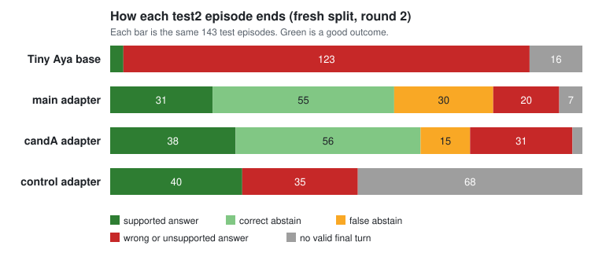
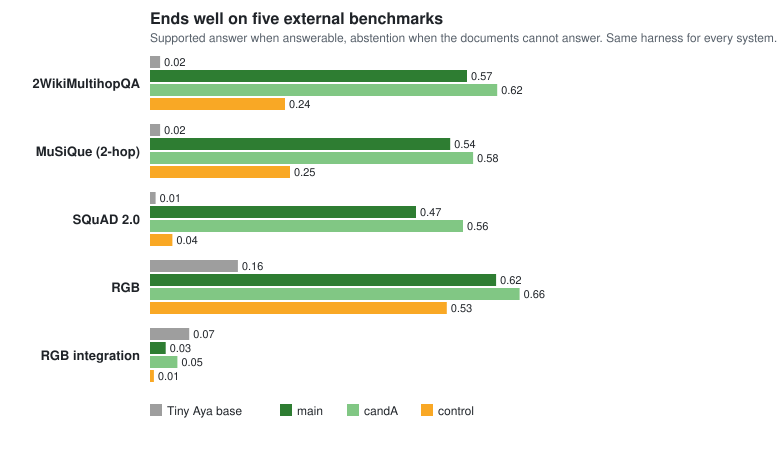
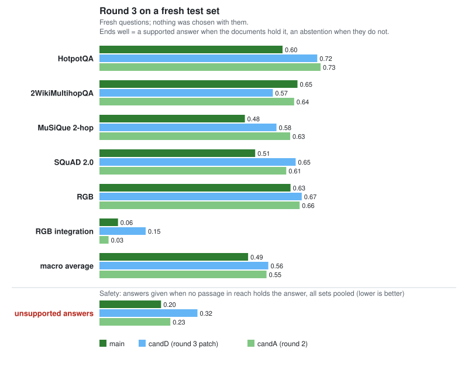
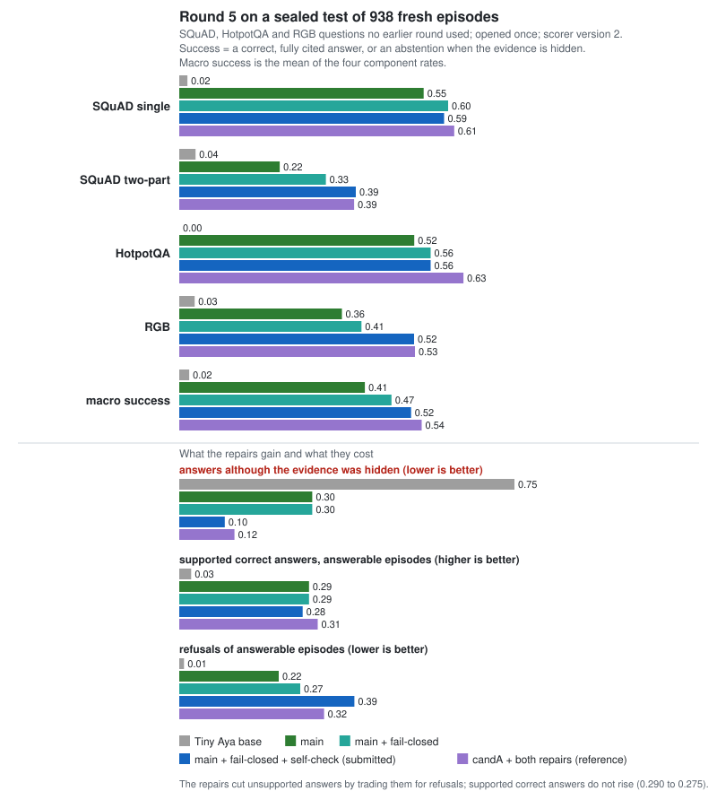

# Experimental history

This is the detailed record of the six rounds, written for readers who want every rule and result. New to the project? Start with the [README](../README.md): its "Words used on this page" table explains the terms (adapter, sealed test, macro success, fail-closed, and so on).

Historical scorer v1/v2 results follow unchanged in substance. The [13 November remediation](../reports/2026-11-13-evaluation-remediation.md) corrects evidence eligibility, source offsets and later training-data exposure. The current numbers are in the [README](../README.md).

## Overview

| Round | What we tried | Outcome | Record |
| --- | --- | --- | --- |
| 1 | Main adapter (with refusal examples) against a control (without) | Main adopted | [plan](../research/2026-11-04-fine-tuning-for-rag.md) |
| 2 | candA and candB: fewer refusal examples | Rule kept main; candA published as an alternative | [plan, sections 20 and 21](../research/2026-11-04-fine-tuning-for-rag.md) |
| 3 | A SQuAD patch for single-passage and two-part questions | Failed its safety guard | [plan, sections 24 to 26](../research/2026-11-04-fine-tuning-for-rag.md) |
| 4 | Matched-evidence curriculum (candE, candF) | No checkpoint met the release rules; candF1 kept | [results](../research/2026-11-06-round4-results.md) |
| 5 | Fail-closed rule and self-check; preference training (DPO) | Repairs adopted; DPO checkpoints stopped abstaining | [pre-registration](../research/2026-11-07-round5-preregistration.md) |
| 5b | DPO again with abstention pairs added | One eligible checkpoint (candF1) missed the safety bound | [pre-registration](../research/2026-11-07-round5b-preregistration.md) |
| 6 | Two trained answer checkers (V2m, V2b) and a second look at refusals | No checker passed the development gate; the second look, checked by the plain self-check, failed its rule on the sealed test (opened once) | [pre-registration](../research/2026-11-14-round6-preregistration.md), [second-look pre-registration](../research/2026-11-15-round6-second-look-preregistration.md), [results](../research/2026-11-15-round6-second-look-results.md) |
| Languages | The submitted system on the same questions in Hindi, English and Spanish (evaluation only, nothing retrained) | Refusing carries over; answering does not, in any language; Hindi loops more | [plan](../research/2026-11-15-multilingual-plan.md), [results](../research/2026-11-15-multilingual-results.md) |
| Hindi training | Both `main` and `candF1` continued on 540 Hindi rows plus English replay (hiMain, hiF) | Hindi correct and cited from 2% and 4% to 35%; both answer on hidden evidence more often; both fail the safety rules, the English submission stays | [pre-registration](../research/2026-11-15-hindi-training-preregistration.md), [results](../research/2026-11-15-hindi-training-results.md) |

## Round 1: abstention training works, and costs answers

First-round test split (100 HotpotQA questions, opened once; scorer before the corrections, so read these as historical). The share of episodes that ended well, meaning a supported answer when the documents held it and a refusal when they did not, was 0.020 for the base model, 0.583 for main and 0.404 for the control. Answers given although the evidence was missing: 0.780, 0.098 and 0.268. Main declined 19% of answerable episodes. The control answered more often and never refused; it kept searching until its budget ran out. Figures: [`outcomes_test.svg`](figures/outcomes_test.svg).

## Round 2: a fresh test split, and an attempt to cut the refusals

The first round left one clear weakness: main declines about one answerable question in five. We tried to fix it with a second training round. Every rule was fixed and pushed ([plan section 20](../research/2026-11-04-fine-tuning-for-rag.md)) before any training, and the result was judged on **test2**: 100 new HotpotQA questions whose supporting passages appear in no training row of either round.

**What the data suggested.** In main's training set, abstentions are half of all final decisions, and 81% of final decisions after three searches are abstentions. The adapter copied both patterns.

**Two candidates.** Both keep main's recipe, questions and token budget. Only the selection of existing training decisions changes.
- **candA:** abstentions cut from 50% to 30% of final decisions.
- **candB:** the same cut, plus an equal abstain rate after two and after three searches, matched answer/abstain pairs from the same question, and more follow-up-search examples.

**Selection on dev, rule fixed in advance.**

| dev split | main | candA | candB |
| --- | ---: | ---: | ---: |
| ends well (159) | **0.673** | 0.629 | 0.604 |
| abstains although the evidence was there (205) ↓ | 0.176 | **0.088** | 0.166 |
| answers anyway when the evidence is missing (73) ↓ | **2** | 9 | 5 |

CandA was the better candidate but scored below main, so under the rule **main stays the project's model**. Main and candA then each ran once on test2.

  

| test2 (fresh split) | Tiny Aya base | **main adapter** | candA adapter | control adapter |
| --- | ---: | ---: | ---: | ---: |
| **ends well** (143) | 0.028 | **0.601** | 0.657 | 0.280 |
| supported correct answer, answerable episodes (199) | 0.025 | 0.462 | 0.528 | **0.598** |
| answers anyway when the evidence is missing (74) ↓ | 0.878 | **0.041** | 0.081 | 0.189 |
| abstains although the evidence was there (199) ↓ | **0.000** | 0.221 | 0.146 | **0.000** |
| invalid or rule-breaking turns (273) ↓ | 0.205 | 0.037 | **0.011** | 0.293 |

Paired 95% intervals for "ends well", resampling whole questions: main minus base <b>+0.573 [+0.503, +0.643]</b>; main minus control <b>+0.322 [+0.246, +0.392]</b>; main minus candA <b>−0.056 [−0.122, +0.007]</b>. The strict format reading gives the same adapter numbers.

**What round 2 showed.**
- **The first-round result replicates.** On questions no choice had seen, main ends well 60.1% of the time (58.3% on the first test split), with the same margins over the base model and the control.
- **Fewer abstentions in training means fewer refusals.** On both splits candA refuses less and gives more supported answers. It also answers more often when the evidence is missing. CandA was behind main on dev and ahead on test2, and neither gap is outside its interval, so the two cannot be ranked on "ends well" with about 85 questions. They are two operating points, and both are published.
- **The search-count pattern was not the cause.** CandB removed the depth pattern from its training labels, yet it still abstains mostly after many searches, and its refusals barely changed (34 against 36 on dev). Unanswerable episodes simply use up more searches.
- **Retrieval did not improve.** The model's own queries found the full evidence in 56, 58 and 59 of 86 open dev questions for main, candA and candB. Better follow-up search needs new training data, not a re-weighting of the old data.

## External benchmarks

Does the behaviour learned on HotpotQA hold on data we did not build, train on or choose anything with? We ran every system on five public benchmarks under the same harness. The sets, settings and metrics were fixed and pushed ([plan section 22](../research/2026-11-04-fine-tuning-for-rag.md)) before any model ran on them.

| benchmark | what it tests | episodes |
| --- | --- | ---: |
| [2WikiMultihopQA](https://github.com/Alab-NII/2wikimultihop) | multi-hop over Wikipedia, with question templates HotpotQA lacks | 166 |
| [MuSiQue](https://github.com/StonyBrookNLP/musique) (2-hop) | multi-hop built so that single-hop shortcuts fail | 168 |
| [SQuAD 2.0](https://rajpurkar.github.io/SQuAD-explorer/) | single-passage questions, plus 80 human-written questions the paragraph cannot answer | 202 |
| [RGB](https://github.com/chen700564/RGB) | 2022 news; RGB's noise-robustness and rejection settings, with passages supplied in the prompt | 453 |
| RGB integration | answers with two parts, found in different passages | 142 |

  

| ends well | Tiny Aya base | **main adapter** | candA adapter | control adapter | main minus base, 95% CI |
| --- | ---: | ---: | ---: | ---: | --- |
| 2WikiMultihopQA (166) | 0.018 | **0.566** | 0.620 | 0.241 | +0.548 [+0.479, +0.619] |
| MuSiQue 2-hop (168) | 0.018 | **0.536** | 0.577 | 0.250 | +0.518 [+0.455, +0.581] |
| SQuAD 2.0 (202) | 0.010 | **0.475** | 0.559 | 0.040 | +0.465 [+0.404, +0.528] |
| RGB (453) | 0.157 | **0.618** | 0.660 | 0.530 | +0.461 [+0.406, +0.518] |
| RGB integration (142) | 0.070 | **0.028** | 0.049 | 0.007 | −0.042 [−0.097, +0.008] |
| **all five, pooled (1,131)** | 0.079 | **0.499** | 0.547 | 0.293 | +0.420 [+0.386, +0.453] |

Same index-per-benchmark harness as HotpotQA: three searches, top 3, 800 characters shown, greedy decoding. These numbers compare our systems with each other. They are not comparable with official leaderboards, which give the model the gold paragraphs. Full tables: <a href="reports/benchmarks_lenient.md"><code>reports/benchmarks_lenient.md</code></a>.

**What transfers.**
- **Abstention:** with the supporting passages hidden, main abstains in 52% to 85% of episodes on the first four benchmarks; the base model abstains in 4% or fewer.
- **Natural unanswerables:** of SQuAD 2.0's 80 human-written unanswerable questions, which we did not construct, main declines 57 and the base model none.
- **Unsupported answers:** on 2WikiMultihopQA, MuSiQue and SQuAD 2.0 they fall from 80–91% of hidden-evidence episodes for the base model to 1–4% for main.

**What does not transfer.**
- **Two-part answers.** RGB integration asks, for example, *"Who won the U.S. Open golf tournament 2023 and the 2023 Open Championship?"*. Main cites both passages but answers only *"Wyndham Clark"*. Its accuracy is 0.017, against the base model's 0.383. Every training answer was a single HotpotQA span.
- **Single-passage questions.** On SQuAD 2.0, main declines 54 of 73 answerable questions, and in all 54 the answer text was already in the results of its first search. Example: the first search for *"What is the mayor of Warsaw called?"* returns *"The mayor of Warsaw is called President."*; main searches twice more and abstains. Every training question needed two passages.
- **On-topic passages that don't answer.** When five on-topic passages without the answer are put in the prompt (RGB, noise 1), main declines only 26 of 100 times.

**Main against candA.** CandA is ahead on all five, by 0.049 [0.026, 0.072] pooled. It gives more supported answers (133 against 105 of 346 open questions) and more unsupported ones (128 against 102 of 465 hidden-evidence episodes), the same trade-off as on dev and test2. Main stays the project's model, as pre-registered. If you prefer answers over caution, use candA.

## Round 3: a patch for single-passage and two-part questions (not adopted)

The benchmarks showed three gaps that re-weighting the first-round data could not close, because that data never contained them: single-passage questions are refused, two-part answers get half an answer, and on-topic passages that lack the answer are trusted. We built a patch and judged it under rules written down first ([plan sections 24 to 26](../research/2026-11-04-fine-tuning-for-rag.md)): the candidates, a development set, a safety guard, and a fresh test set that no choice touched.

**The patch.** Two candidates continue from the main adapter for one epoch (93 steps, 2.2 M tokens), on new scripted episodes plus rehearsal rows from main's training set.
- *single:* 240 SQuAD 2.0 training-split questions, where one passage holds the answer.
- *compound:* 120 pairs of such questions joined into one, with the answer "A1; A2".
- *prompt variants,* also on the 600 HotpotQA training questions: the support plus three on-topic passages without the answer supplied (answer without searching); on-topic passages only supplied, support masked (search, then abstain); one of two supports masked (abstain).
- candC is the stronger patch (65% new rows), candD the careful one (45%).

**Development set and guard.** Held-out SQuAD training-split articles (single, compound and prompt-variant episodes) plus the HotpotQA dev split. A candidate was eligible only if its pooled unsupported-answer rate stayed within 3 points of main's.

| development set, ends well | main | candC | candD |
| --- | ---: | ---: | ---: |
| HotpotQA dev | **0.673** | 0.566 | 0.629 |
| single-passage | 0.325 | **0.762** | 0.730 |
| compound | 0.510 | **0.600** | 0.570 |
| prompt variants | 0.497 | **0.699** | 0.601 |
| macro average | 0.501 | **0.657** | 0.633 |
| answers when no passage in reach holds the answer (282) ↓ | **17** | 70 | 72 |
| eligible | | no | no |

**No candidate was eligible, so main stayed.** Both patched models learned to answer from on-topic passages even when they lack the answer, and answered the visible half of a compound question while inventing the other half. A probe added afterwards, blending the main and candD weights at 20%, 35% and 50% (`scripts/interp_adapters.py`), raised unsupported answers steadily (34, 39 and 46 of 282, limit 25): there is no blend that gains the skill and stays inside the guard.

**Fresh test set** (739 episodes per system, questions disjoint from every earlier set, opened once):

  

| fresh test | main | candD (round 3) | candA (round 2) |
| --- | ---: | ---: | ---: |
| macro average of six sets, ends well | 0.489 | **0.555** | 0.549 |
| difference from main, 95% CI | | +0.066 [+0.031, +0.103] | +0.061 [+0.028, +0.093] |
| answers when no passage in reach holds the answer ↓ | **0.203** | 0.322 | 0.233 |
| difference from main, 95% CI | | +0.120 [+0.076, +0.163] | +0.031 [−0.003, +0.064] |
| SQuAD 2.0, supported answers on open search (57) | 4 | **32** | 6 |
| SQuAD 2.0, answers when the passage cannot answer (109) ↓ | **6** | 31 | **6** |
| RGB integration, accuracy with clean passages (27) | 0 | **4** | 0 |

**What round 3 showed.**
- **The patch fixes what it targeted.** On fresh SQuAD questions main gave a supported answer to 4 of 57 and candD to 32 of 57; invalid turns fell from 30 to 3 of 166. Two-part answers improved only a little (0 to 4 of 27).
- **It costs safety, mostly on two sets.** On SQuAD candD answered 31 of 109 questions the passages could not answer (main: 6), and on RGB 64 of 97 (main: 51). The safety criterion, fixed beforehand, was not met (+0.120, limit +0.05), so candD is a higher-answering variant and main remains the headline model.
- **Round 3 did not find a better operating point than round 2.** CandA ties candD on the macro score with a smaller safety cost; it gains by abstaining correctly and by fewer invalid turns, and still refuses single-passage questions. On three independent splits (test2, the benchmark suite, this one) candA is ahead of main on ends well by 0.05 to 0.06 and gives 3 to 6 points more unsupported answers. The round-2 rule picked main on development data, and we did not change that after seeing test data. Switching would need its own pre-registered rule and a new split.

**Which adapter to use.**

| if you need | use |
| --- | --- |
| the fewest answers without evidence | main |
| fewer refusals on multi-hop questions, a little more risk | candA |
| answers to single-passage questions, and you accept the most unsupported answers | candD |

## Round 4: matched evidence decisions

We trained another focused curriculum on two T4s: the same question and search depth, with the required fact present in one example and missing in the other. The 721-row mixture includes search-policy replay. Two initializations, main and candA, each save two epochs, giving four checkpoints. The additional training takes about 2.02 hours of concurrent dual-T4 configuration time.

The strongest development variant, **F1**, improves the new single/compound evidence-success macro from **39.2% to 52.7%**, with unsupported answers falling from **18/132 to 13/132**. Against its own parent candA, the corresponding changes are 43.5% to 52.7% and 20/132 to 13/132. However, F1's original HotpotQA success is 60.4% against main's 67.3%, and unsupported answers are 9/73 against main's 2/73. **None of the four checkpoints passes the fixed release rules, so main remains the submission model.**

These scores are from additional development exercises, with every required evidence aspect cited, and cannot be compared directly with the original headline test score. Trace review finds semantic errors that token matching and citation coverage miss, plus constructed masking errors where alternate evidence remains visible. The frozen E1 final diagnostic also fails to establish an upgrade: main/E1 macro success is 35.7%/37.7%, with a difference interval crossing zero and more E1 query-loop failures. The evaluation-only ten-query Bright-Pro pilot gives main/E1 weighted aspect recall of 17.0%/7.0%. These automatic scores are not human-verified hallucination rates or official competition scores.

See the [prospective plan](../research/2026-11-06-round4-evidence-training.md), [results and trace findings](../research/2026-11-06-round4-results.md), [all-checkpoint selection](../reports/round4_selection.md), and [saved checkpoint checksums](../reports/round4_checkpoints.json).

## Round 5: two repairs that need no training, and a preference-training negative result

Round 4's traces pointed at two cheap fixes. A rollout that never reaches a valid action (a repeated query, a search over budget, malformed output) was scored as a failure although the model had asserted nothing. And some answers were not backed by the passages the model itself cited. We tested both repairs, and preference training (DPO) on top of them, under rules written down first ([pre-registration](../research/2026-11-07-round5-preregistration.md), [plan sections 27 and 28](../research/2026-11-04-fine-tuning-for-rag.md)). The work took about 8 hours on a second Kaggle account's two T4s.

**The two repairs.**

| repair | rule | cost |
| --- | --- | --- |
| fail-closed (FB) | A rollout that does not end in a valid answer or abstention ends as an abstention. | none |
| self-check (V) | The main adapter reads the question, the cited passages and the answer, and replies `SUPPORTED` or `NOT`. The answer is withheld, and the episode ends as an abstention, when the probability of `SUPPORTED` is below 0.5, when the cited chunk was never shown, or when a part of the answer does not appear in the cited passages. | one forward pass of about 770 tokens per answer, no generated text |

Fail-closed is a protocol repair. It changes the score because an abstention is the right ending on a hidden-evidence episode. It does not make the model know more. Both repairs act only on a finished episode, so we applied them offline to the saved rollouts, which gives the same result as running them at inference time. The offline code is `fail_closed` and `apply_v` in `scripts/select_round5.py` and `scripts/verify_round5.py`. The same system is packaged for inference in `src/ragharness/system.py` and `scripts/ask.py` (see [Use the adapter](#use-the-adapter)); on 182 sealed-test episodes it ended every episode the way the offline evaluation did.

**Choosing the self-check, on development data only.** Four checker configurations (the base model or the main adapter; two wordings), one forward pass each, threshold 0.5 fixed beforehand. The gate, fixed in advance: block at least 40% of main's 20 unsupported development answers and at most 10% of its 76 supported correct answers.

| checker | unsupported answers blocked (20) | supported correct answers blocked (76) | gate |
| --- | ---: | ---: | --- |
| base model, wording `SUPPORTED` / `NOT` | 60% | 24% | no |
| base model, wording `Yes` / `No` | 75% | 21% | no |
| **main adapter, wording `SUPPORTED` / `NOT`** | **70%** | **8%** | **yes** |
| main adapter, wording `Yes` / `No` | 100% | 87% | no, blocks nearly everything |

Twenty unsupported answers is a small sample. On the round-4 final-test traces, which were never used to choose the checker, it blocks 59% of main's 39 unsupported answers at a cost of 14% of its 51 supported correct ones (candA: 67% at 5%).

**Sealed final test (historical scorer v2).** 938 episodes built before any training from data no earlier round used: 385 SQuAD (25 unused training-split articles; single and two-part questions, with the round-4 evidence variants), 82 HotpotQA (unused validation questions) and 471 RGB (noise 0, 0.8 and 1). The scripted oracle's 1.0 was the weaker success metric; strict evidence success was **372/471 on RGB and 78/82 on HotpotQA**. Source-offset errors also mean that oracle credit does not prove every answer was visible. The original scorer required token F1 and precision of at least 0.5 and designated evidence citations, and excluded hidden episodes using model-dependent gold-string matches. Scorer v3 corrects these rules; the [offline replay](../reports/round5_corrected.md) uses fixed annotation-based eligibility and preserves the sealed files. Macro success is the mean of SQuAD single, SQuAD two-part, HotpotQA and RGB. The set was opened for the reference systems and once more for candF1; no later DPO checkpoint was eligible.

| sealed test (938 episodes) | Tiny Aya base | main | main + FB | **main + FB + V** | candA + FB + V (reference) |
| --- | ---: | ---: | ---: | ---: | ---: |
| **macro success** | 0.022 | 0.414 | 0.474 | **0.517** | 0.541 |
| SQuAD single | 0.018 | 0.545 | 0.600 | 0.591 | 0.614 |
| SQuAD two-part | 0.036 | 0.224 | 0.327 | 0.394 | 0.390 |
| HotpotQA | 0.000 | 0.524 | 0.561 | 0.561 | 0.634 |
| RGB | 0.034 | 0.363 | 0.407 | 0.524 | 0.526 |
| answers although the evidence was hidden ↓ | 276 / 369 | 108 / 364 | 108 / 364 | **37 / 364** | 45 / 365 |
| supported correct answers, answerable episodes | 0.027 | 0.290 | 0.290 | 0.275 | 0.309 |
| refusals of answerable episodes ↓ | **0.011** | 0.222 | 0.270 | 0.391 | 0.323 |

Paired 95% intervals from resampling whole questions within each part (3,000 draws). Main + FB + V minus base: macro <b>+0.495 [+0.468, +0.521]</b>, unsupported rate <b>−0.646 [−0.698, −0.591]</b>, supported correct <b>+0.249 [+0.203, +0.295]</b>. Main + FB + V minus main: macro <b>+0.103 [+0.079, +0.127]</b>, unsupported rate <b>−0.195 [−0.231, −0.159]</b>, supported correct −0.014 [−0.025, −0.005]. Fail-closed alone adds +0.059 [+0.041, +0.079] and changes no unsupported-answer count. The scores use a stricter definition of success than rounds 1 to 3 and a different, harder mix of questions, so they cannot be compared with the 58.3% above.

  

Sealed test, 938 episodes. Drawn from <code>reports/round5b_final.json</code> by <code>scripts/make_round5_figure.py</code>. The orange bars are candF1, the round-5b candidate.

**Reading it.**
- **The unsupported-answer cut is the result.** The self-check removes 71 of main's 108 unsupported answers (29.7% to 10.2% of hidden-evidence episodes). Fail-closed adds 0.059 macro by itself, entirely on hidden-evidence episodes.
- **The accuracy gain over the base model comes from training, not from the repairs.** Supported correct answers rise from 2.7% to 29.0% with the adapter. The repairs leave them at 27.5%, a small and measurable loss.
- **The price is more refusals.** Refusals of answerable episodes rise from 22% to 39%. Most of the extra abstentions were wrong answers already, but a user sees more "I cannot answer".
- **candA with the same repairs scores 0.024 higher on macro** (interval [+0.003, +0.045]) and is not different on unsupported answers (+0.022 [−0.014, +0.057]). It was a reference and was not a candidate under the rule, so main stays the default. It remains the better choice if you prefer answers to caution.

**Preference training (DPO), judged and rejected.** We sampled 1,920 rollouts on training episodes (main and candA, temperature 0.8, two samples each) and built 335 preference pairs (186 favour a cited correct answer, 149 favour searching again or abstaining). Four checkpoints continued from main (candG) and from candA (candH), two epochs of 84 steps each, with the chosen-text likelihood as an anchor. Training loss fell from 0.67 to 0.19. Development selection ran with FB and V applied to every system, which makes the first gate (strictly fewer unsupported answers than main + FB + V) hard to pass; we kept it as written. No candidate passed.

| development, FB + V on every system | macro | SQuAD single | supported correct | unsupported / hidden | HotpotQA unsupported | eligible |
| --- | ---: | ---: | ---: | ---: | ---: | --- |
| main | 0.538 | 0.603 | 0.228 | 5 / 131 | 1 | reference |
| candG2 (DPO from main) | 0.558 | 0.700 | 0.381 | 9 / 132 | 9 | no |
| candH2 (DPO from candA) | 0.557 | 0.678 | 0.386 | 12 / 129 | 8 | no |
| candF1 (round 4) | 0.583 | 0.612 | 0.312 | 7 / 131 | 2 | no |

DPO raised accuracy on SQuAD-style questions (candG2: supported correct 0.381 against 0.228) and lost the ability to abstain. None of the four checkpoints ends a single `r4dev` episode with an abstention, while main does so in 160 of 321. The cause is in the pair file: it rejects an abstention 91 times and chooses one twice, because on-policy sampling almost never produces an unsupported answer at the last search, which is where the reference action is an abstention. The training pushed abstentions down by about 17 nats and nothing pushed them up. With FB and V applied, the looping and unsupported answers of these checkpoints turn into abstentions, so the wrapped numbers look reasonable; the abstaining is then done by the repairs, not by the model. A repaired pair set needs pairs that choose an abstention, with the rejected answer taken from a forced answer on hidden evidence. Round 5b built and ran it.

**Departures from the plan, all recorded with dates in the pre-registration.**
- Two samples per episode instead of four, 335 pairs instead of 1,500 to 3,000, and a learning rate of 2e-5 instead of 5e-6, all set by measured T4 throughput.
- The candidate pool was widened from four to eight, adding the round-4 checkpoints, after an informed look at their test traces (stated at the time); selection used development data only.
- TRL's `DPOTrainer`, through AgentTune's `TrlAgenticDPO`, ran out of memory because it builds full-vocabulary logits (262k entries) for both sequences of a pair, so only 38 of 335 pairs fitted. We replaced it with a short loop (`scripts/train_dpo.py`) that computes logits at the completion positions only and uses the same loss. **The DPO optimiser step is therefore not an AgentTune class this round.** AgentTune supplied the training of rounds 1 to 4 and the tool, trajectory and evaluation stack throughout.

### Round 5b: DPO again, with the missing direction added

The round-5 failure had a specific cause, so the second attempt made a specific fix ([pre-registration](../research/2026-11-07-round5b-preregistration.md), committed before any training; two amendments are dated).

- **New pairs.** We took 195 hidden-evidence contexts in which the model itself had abstained after at least one search, and forced the same system to answer there (an `<answer>` prefix, temperature 0.7, at most 160 tokens). Each context gives a pair that chooses the abstention and rejects the forced answer. After caps and filters this gave 163 new pairs. Merged with the 335 round-5 pairs unchanged, the file has 498 pairs (SHA256 `eddbca62…`, recorded before training): an abstention is the chosen side 165 times (round 5: twice) and the rejected side 91 times.
- **Two runs, same recipe as round 5** (beta 0.1, learning rate 2e-5, 2 epochs, 126 steps each). candI starts from main and took 2.4 hours. candK starts from candF1 and took 2.9 hours. Starting from candF1, which beat candA on the development table, was chosen after seeing that table. We say so in the pre-registration.
- **A new development gate.** Round 5's gate was close to unpassable with the repairs applied to every system, so we replaced it, before training, with seven conditions measured against main with the repairs: the model's own abstention share on hidden-evidence episodes at least 0.75 of main's; unsupported rate within 3 points; HotpotQA unsupported answers within 2; supported correct at least +0.05; invalid turns within 1 point; HotpotQA success within 3 points; macro at least +3 points. Before registering it, we ran it on the eight existing checkpoints and found that candF1 passes. **The gate is therefore informed by the development table.** The final sealed-test rule was left exactly as in round 5.

| development, both repairs on every system | macro | HotpotQA success | supported correct | unsupported / hidden | own abstentions on hidden | eligible |
| --- | ---: | ---: | ---: | ---: | ---: | --- |
| main | 0.538 | 0.623 | 0.228 | 5 / 131 | 0.775 | reference |
| candF1 (round 4) | 0.583 | 0.642 | 0.312 | 7 / 131 | 0.775 | **yes** |
| candI1 (from main, epoch 1) | 0.528 | 0.560 | 0.233 | 3 / 132 | 0.829 | no |
| candI2 (epoch 2) | 0.566 | 0.579 | 0.360 | 7 / 132 | 0.634 | no |
| candK1 (from candF1, epoch 1) | 0.574 | 0.522 | 0.492 | 16 / 130 | 0.167 | no |
| candK2 (epoch 2) | 0.591 | 0.509 | 0.519 | 13 / 130 | 0.158 | no |

- **The added pairs restored abstention when training started from main.** candI1 and candI2 end 83% and 63% of hidden-evidence episodes in their own abstention. All four round-5 checkpoints ended none.
- **They still failed the gate.** candI1 fails on supported correct, HotpotQA success and macro; candI2 fails on HotpotQA unsupported answers (5 against a limit of 3), HotpotQA success and, by 0.002, macro.
- **Starting from candF1 did not keep abstention** (17% and 16%), and candK has 12 unsupported HotpotQA answers. We have no tested explanation for why the same pairs worked from main and not from candF1.

**One checkpoint was eligible, candF1, and the sealed test was opened for it once.** Both repairs on, the same 938 episodes:

| sealed test | macro | SQuAD single | SQuAD two-part | HotpotQA | RGB | unsupported / hidden | supported correct | refusals of answerable |
| --- | ---: | ---: | ---: | ---: | ---: | ---: | ---: | ---: |
| **main** (submitted) | 0.517 | 0.591 | 0.394 | 0.561 | 0.524 | 37 / 364 | 0.275 | 0.391 |
| candF1 | 0.570 | 0.614 | 0.527 | 0.617 | 0.521 | 34 / 364 | 0.323 | 0.378 |

candF1 minus main, paired 95% intervals: macro <b>+0.052 [+0.021, +0.085]</b>; unsupported rate −0.008 [−0.047, +0.030]; supported correct +0.048 [+0.009, +0.087]. Without the repairs candF1 scores 0.449 macro with 114 of 364 unsupported answers (main: 0.414 and 108).

**The rule fails.** It needed the macro interval above zero, which holds, and the unsupported-rate difference below zero with an upper bound of at most +0.02. The point estimate is −0.008 and the upper bound is +0.030. **Main with both repairs stays the submitted system.** candF1 with the same repairs is the alternative for a reader who values answers over caution: it answers more correctly (0.323 against 0.275) and its two-part questions improve from 0.394 to 0.527. The data cannot say whether it is safer or less safe than main. Two cautions: candF1 was selected by a gate written after its development results were known, so this is one checkpoint tested once, not a family; and the unsupported counts (34 and 37) are small.

Reports for rounds 5 and 5b: [`round5b_selection.md`](../reports/round5b_selection.md), [`round5b_final.md`](../reports/round5b_final.md) (also holds every round-5 comparison), [`round5_final.md`](../reports/round5_final.md), [`round5_verifier.md`](../reports/round5_verifier.md), [`round5_selection.md`](../reports/round5_selection.md), [`round5_selection_r4cands_with_V.md`](../reports/round5_selection_r4cands_with_V.md), [`round5_rescore_r4.md`](../reports/round5_rescore_r4.md), [`round5_r4test_wrappers.md`](../reports/round5_r4test_wrappers.md), [`round5_pairs.json`](../reports/round5_pairs.json) and [`round5_test_manifest.json`](../reports/round5_test_manifest.json). Narrative: [`research/2026-11-07-round5-results.md`](../research/2026-11-07-round5-results.md).

## Round 5b: DPO again, with abstention pairs

The round-5 pairs almost never chose an abstention, so the checkpoints stopped abstaining. Round 5b forced the system to answer at 195 hidden-evidence contexts where it had abstained, and built 163 pairs that choose the abstention and reject the forced answer. With the 335 round-5 pairs that made 498 pairs. candI (from main) and candK (from candF1) trained with the round-5 recipe.

The development gate was replaced before training with seven conditions measured against main with both repairs. We had seen the earlier development table when we wrote it, and candF1 was known to pass, so the selection was not blind. candI restored the model's own abstention (83% and 63% of hidden-evidence episodes at the two epochs) but failed the development gate; candK did not keep abstention (16% to 17%). candF1 was the only eligible checkpoint.

The sealed test was opened once for it. Under the scorer of the time, candF1 with both repairs scored 0.570 macro against 0.517 for main (+0.052, interval +0.021 to +0.085), and its hidden-evidence answer rate was −0.008 against main (interval −0.047 to +0.030). The rule needed the upper end at +0.02 or below, so main stayed. Under scorer v3 the same comparison is +6.0 points macro (+3.0 to +9.2) and −0.5 points (−4.6 to +3.4). Main stays the submitted system and candF1 is the alternative. Record: [pre-registration with three amendments](../research/2026-11-07-round5b-preregistration.md), [`reports/round5b_selection.md`](../reports/round5b_selection.md), [`reports/round5b_final.md`](../reports/round5b_final.md).

## Round 6: trained answer checkers

The existing self-check lets through 37% of the hidden-evidence answers it sees and a large share of wrong answers. We trained two checker adapters on 820 labelled cases (373 questions) from saved rollouts, forced answers, displayed gold support and matched swaps, with 82 validation cases: V2m continues main's adapter and V2b is a fresh LoRA. After seeing the validation results at threshold 0.50, we widened the threshold grid to 0.20 to 0.95 before any development output existed (the amendment says so).

The gate asked for a threshold at which at most 15% of hidden-evidence answers pass while at least 90% of correct and cited answers survive. No threshold of either checker qualified. At 0.95, V2m kept 113 of 173 correct answers and passed 8 of 40 hidden-evidence answers; V2b kept 105 and passed 8. The existing checker is retained and the second look is off. The Round 6 sealed test was built and hashed before any output. Record: [pre-registration with three amendments](../research/2026-11-14-round6-preregistration.md), [`reports/round6_selection.md`](../reports/round6_selection.md).

### Round 6, second part: the second look checked by V (the sealed test, opened once)

Round 6 had built the second look (when the system refuses after seeing passages, ask it once to answer anyway, and show that answer only if a checker is confident) but only tried it with the two trained checkers, which had failed. On 15 November 2026 we measured it offline on the development outputs with the plain self-check V as the checker, using no GPU and no test data: at a threshold of 0.90 it added 9 correct answers, 4 wrong ones and no hidden-evidence answer, and raised development macro success from 0.540 to 0.554. We chose 0.90 after seeing that table. The original recovery rule would have picked a lower threshold (0.65 for main alone), so the pre-registration says the choice is post hoc and stricter.

The pre-registration and the report script were committed before the run (commit e667f3c). The rule: macro success must rise with a 95% interval above zero, and the hidden-evidence answer rate may rise by at most 2 points (we dropped the Round 6 clause that the rate must fall, because a second look can only add answers). The Round 6 sealed test (679 episodes: 75 SQuAD, 60 HotpotQA and 29 RGB questions, hashed on 14 November, no model output before) was opened once, for main only, on Kaggle.

**Result: not adopted.** Macro success rose 0.9 points (interval −0.3 to +2.1), so the first condition failed; the hidden-evidence answer-rate rise was +0.7 points (interval +0.0 to +1.8), within the limit. The second look added 9 correct and cited answers, 7 wrong ones and 2 hidden-evidence answers (development: 9, 4 and 0). Correct and cited rose 2.3 points (+0.7 to +4.1). The submitted system stays main with both repairs.

The same run measured the submitted system a second time: macro success 54.1% against 43.8% for refusing everything (+10.3 points, interval +7.5 to +13.1), 29 of 291 hidden-evidence episodes answered (10.0%, against 11.2% on the first sealed test), and success by group of 43.3% on SQuAD single-passage, 36.2% on SQuAD two-part, 58.9% on HotpotQA and 78.0% on RGB. SQuAD single-passage success was 59.1% on the first test and is now close to refusing everything (41.1%). We did not run the base model or the hosted models on this test. Record: [pre-registration](../research/2026-11-15-round6-second-look-preregistration.md), [results](../research/2026-11-15-round6-second-look-results.md), [`reports/round6_second_look.md`](../reports/round6_second_look.md), [post hoc numbers](../reports/round6_second_look_extra.md).

## Languages: Hindi, English and Spanish (evaluation only)

The adapter was trained on English HotpotQA only, while Tiny Aya lists both Hindi and Spanish among its languages. On 15 November 2026 we ran the submitted system once on 300 XQuAD questions in each language (the same questions, drawn across 48 articles with seed 47; 25 questions already used in our SQuAD 2.0 suites were removed first). The plan was committed before any data was built, and four labelled amendments were committed before the run (an input limit of 8,000 tokens because Hindi text costs about 3.4 times the tokens of English; an empty language tag for the old English path; the exact answer normalization; passage counts). Nothing was retrained, and the English path of every scorer is unchanged: the 187 tests pass and `remediate_audit.py` still prints `sealed hashes 11 / 11`.

With the evidence available, the submitted system gave a correct, cited answer to 2.1% of Hindi, 2.7% of English and 4.6% of Spanish questions. With the evidence hidden it answered 3 of 285, 0 of 295 and 1 of 285, against 66% to 83% for the base model. Success was 50.5%, 51.4% and 52.1%, against 50.0% for refusing every question. English is as low as Hindi because XQuAD is a single-passage task, a known weak spot, so the check shows no measurable Hindi or Spanish penalty but also no ability to answer. In Hindi, 73% of the adapter's raw turns ended invalid (24% English, 6.5% Spanish), nearly all by repeating the previous search; fail-closed turns them into refusals. The hosted-model comparison in the plan was not run because the endpoint URL is not stored on this machine. Record: [plan with amendments](../research/2026-11-15-multilingual-plan.md), [results](../research/2026-11-15-multilingual-results.md), [`reports/xquad_results.md`](../reports/xquad_results.md).

## Hindi training of main and candF1

The language check showed that the English-only adapter answers almost nothing in Hindi, so on 15 November 2026 we continued training both `main` (giving `hiMain`) and `candF1` (giving `hiF`) on Hindi. The data are 220 questions from IndicSQuAD Hindi (a machine translation of SQuAD 2.0), taken only from articles that earlier tests had not used and that are not XQuAD sources, built into 540 Hindi rows (1.2 million tokens per epoch) plus English replay at half that token count. Two epochs, learning rate 1e-4, seed 53, one run each, 3.4 hours on two Kaggle T4s (a 4 x L4 machine was not selectable from the Kaggle command line). Every rule was committed before the first result ([pre-registration](../research/2026-11-15-hindi-training-preregistration.md)); one amendment, written before any test score was read, records that the self-check ran out of memory on long Hindi cases and was rerun with batch size 1 and last-position logits.

Each adapter was compared with its parent, both with the fail-closed rule and the self-check, on 300 fresh XQuAD questions in Hindi (rule A1: more correct, cited answers; rule A2: answers on hidden evidence must not rise by more than 2 points at the upper interval end) and on the second English sealed test (rule A3: macro success may fall by at most 3 points, and answers on hidden evidence may rise by at most 2 points at the upper end). Hindi correct and cited went from 2.1% to 35.4% (`hiMain` against `main`) and from 3.8% to 35.1% (`hiF` against `candF1`). Answers on hidden evidence in Hindi rose from 4 to 18 and from 3 to 13 of 291 (A2 not met, upper ends +7.8 and +6.6 points). On English, macro success did not fall (+1.0 and +1.2 points), but `hiMain` answered 53 hidden-evidence episodes against 29 for `main`, and `hiF` 33 against 28 for `candF1` (A3 not met, upper ends +12.2 and +4.6 points). Neither adapter qualifies as a Hindi-capable variant, and the submitted system is unchanged. The adapters are kept as labelled experiments. Record: [results](../research/2026-11-15-hindi-training-results.md), [`reports/hindi_results.md`](../reports/hindi_results.md).

## DoRA instead of LoRA (a teammate's side study)

Ansh ([@Ansh13579](https://github.com/Ansh13579)) trained three DoRA checkpoints and evaluated them on the same 938 Round 5 input episodes, outside our pre-registered rounds, and contributed the reports as pull request 1. We reviewed it in [
esearch/2026-11-15-pr1-review.md](../research/2026-11-15-pr1-review.md): the frozen test inputs match our manifest hashes, but the raw run files and model transcripts are not in the repository, so the numbers cannot be rescored here and are historical scorer-v2 results.

The checkpoints: the original Modal DoRA (one L4, 1,611 rows, 202 steps, 3.65 GPU-hours); a Kaggle DoRA at learning rate 5e-5 (four L4s, 4.18 GPU-hours); and an evidence-order continuation of that checkpoint (541 rows, 34 steps, 0.72 GPU-hours), which failed its own development screen. With the fail-closed rule and the main-adapter self-check they scored 50.09%, 47.34% and 45.41% macro success, against 51.74% for main and 56.97% for candF1 on the same scorer. Raw, Modal DoRA scored 44.71% against 41.43% for main; the other two answered 227 of 371 and 306 of 374 hidden-evidence episodes, against 108 of 364 for main. The test was already open when these were run, the checkpoints have different exclusions, and no paired interval is claimed. None was adopted and the submitted system is unchanged. Record: [
eports/evidence_order_all_previous_comparison.md](../reports/evidence_order_all_previous_comparison.md), [
eports/dora_lora_cost_efficiency.md](../reports/dora_lora_cost_efficiency.md), README section "DoRA experiments on the opened Round 5 suite".
