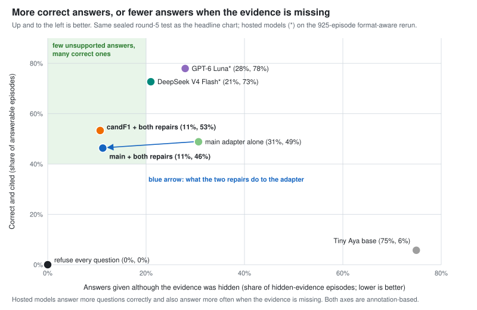

# Results in detail

The headline table and how to read it are in the [README](../README.md#results). This page has the fresh test, the hosted-model comparison and the general-capability check.

## A second, fresh test

After the first test was used up, we built another from questions nothing had used (679 episodes: 75 SQuAD, 60 HotpotQA and 29 RGB questions), hashed it before any model ran, and opened it once. It did two jobs.

First, it tested one more idea, a *second look*. When the system refuses after it has seen passages, it is asked once to answer anyway, and that answer is shown only if the self-check is at least 90% sure. We wrote the rule first: macro success must rise with an interval above zero, and the rate of answers on hidden evidence may rise by at most 2 points. The second look failed the first half. Macro success rose 0.9 points (interval −0.3 to +2.1), so nothing changed and the submitted system stays as it is. It did add correct, cited answers (+2.3 points, interval +0.7 to +4.1), but it also showed seven wrong answers and two on hidden evidence. Record: [pre-registration](../research/2026-11-15-round6-second-look-preregistration.md), [results](../research/2026-11-15-round6-second-look-results.md).

Second, it measured the submitted system again. Success by group of questions (the pooled columns in the [README](../README.md#results) are not comparable across the two tests, because the mix of question types differs):

| | SQuAD single | SQuAD two-part | HotpotQA | RGB | Macro success | Answers on hidden evidence |
| --- | ---: | ---: | ---: | ---: | ---: | ---: |
| Submitted system, fresh test | 43.3% | 36.2% | 58.9% | 78.0% | 54.1% | 29 / 291 (10.0%) |
| Submitted system, first test | 59.1% | 40.4% | 58.5% | 74.1% | 58.0% | 42 / 375 (11.2%) |
| Refuse every question, fresh test | 41.1% | 44.3% | 50.0% | 39.7% | 43.8% | 0 / 291 |

The refusing carried over: 10.0% of hidden-evidence episodes were answered, and macro success is 10.3 points above refusing everything (interval +7.5 to +13.1). The answering did not carry over for single-passage SQuAD questions: 43.3% is close to refusing everything (41.1%), on 75 questions from 25 articles, and we have not looked for the cause. On this test 34.7% of the answers shown are correct. The first test's pooled 67.3% is not directly comparable, because that test held many more RGB episodes (471 of 934, against 141 of 679). We did not run the base model or the hosted models here.

## Against hosted models

As a yardstick we ran two large commercial models on the same sealed test: 925 episodes both sides could answer. The hosted models were told the three-search limit and the answer format in their prompt; the adapter learned them in training. Hosted rows use the fail-closed rule and no self-check.

| System | Macro success | Answered | Correct among answered | Wrong or unsupported shown, of all cases |
| --- | ---: | ---: | ---: | ---: |
| Main + both repairs | 58.4% | 41.3% | 67.8% | 13.3% |
| candF1 + both repairs | 64.5% | 42.1% | 76.6% | 9.8% |
| GPT-6 Luna | 70.7% | 70.5% | 66.1% | 23.9% |
| DeepSeek V4 Flash | 68.8% | 64.2% | 67.7% | 20.8% |

GPT-6 Luna is 6.2 points above candF1 on macro (interval +1.1 to +11.1). DeepSeek V4 Flash is 4.4 above (interval −0.3 to +9.1), which is not clearly different. Both hosted models answer far more often, and show a wrong or unsupported answer about twice as often as candF1. [Full comparison](../reports/fair_rerun.md).

**Where the hosted models are better.** Of the questions whose documents hold the answer, GPT-6 Luna gives a correct, cited answer 77.9% of the time and DeepSeek V4 Flash 72.7%. Our submitted system does so 46.8% of the time (candF1: 53.9%). Our one advantage is fewer answers when the evidence was hidden: 11% against 21% (DeepSeek) and 28% (GPT-6 Luna). Part of that comes from refusing more often, not from being smarter. On HotpotQA, the question type we trained on, the adapters are level or ahead (main 59.5%, candF1 65.8%, GPT-6 Luna 55.7%, DeepSeek 57.0%). On SQuAD single-passage questions the hosted models are clearly ahead (GPT-6 Luna 86.6%, DeepSeek 84.3%, main 59.7%, candF1 62.0%), and on two-part questions GPT-6 Luna is ahead (62.3% against 40.3% and 54.1%).

**On benchmarks the adapters never trained on.** These are older suites. Every system has the fail-closed rule applied; none has the self-check. The hosted runs predate the fix that told them the answer format, so they understate the hosted models (on the sealed test, GPT-6 Luna's macro success rose from 60.8% to 70.7% once told).

| Suite (cases) | Refuse every question | Main + fail-closed | GPT-6 Luna + fail-closed | DeepSeek V4 Flash + fail-closed |
| --- | ---: | ---: | ---: | ---: |
| 2WikiMultihopQA (165) | 47.6% | 57.6% | 58.2% | 64.8% |
| MuSiQue (164) | 47.6% | 56.1% | 57.9% | 56.1% |
| SQuAD 2.0 (202) | 63.4% | 63.9% | 55.0% | 71.3% |
| RGB (450) | 36.9% | 62.2% | 62.7% | 78.4% |
| RGB integration (142) | 7.0% | 4.9% | 23.2% | 28.9% |

The adapter is within two points of GPT-6 Luna on three of the five suites and ahead on SQuAD 2.0, but it is behind DeepSeek V4 Flash on four, and far behind both on RGB integration (two-part answers). On SQuAD 2.0 it scores the same as refusing every question (63.9% against 63.4%). So the honest summary is that a small adapter gets close to large hosted models on this task, not that it beats them. [Source: `reports/external_benchmarks_corrected.md`](../reports/external_benchmarks_corrected.md).

**Cost.** For 10,000 episodes: $6.30 for the adapter's busy T4 time (perfect utilisation, $0.526 per hour, nothing else counted), $2.67 for GPT-6 Luna and $6.09 for DeepSeek, from the recorded token mix and published prices. The adapter is not cheaper. Its case is control: it runs on one GPU you own and shows fewer unsupported answers. See [`reports/azure_roi.md`](../reports/azure_roi.md) and [`reports/deepseek_roi.md`](../reports/deepseek_roi.md).

## Did the fine-tuning hurt general ability?

The hackathon asks for a general-capability check that shows the fine-tuning did not break something else. We ran one as a retention check (plan: [pre-registration](../research/2026-11-16-general-capability-preregistration.md), written before the run). Both published English adapters and the base model answered the same multiple-choice questions in plain text, zero-shot, with no chat template. The answer is the letter the model finds most likely. The base model is Tiny Aya Global with the adapters switched off. Languages: English for MMLU, ARC and TruthfulQA; English, Hindi and Spanish for Global-MMLU-Lite (the same 400 questions in each). None of these is part of the focus task (retrieval-augmented answering). The English adapters were trained on English only, so the Hindi and Spanish sets show what that training did to those languages.

| Benchmark | Questions | Base | Main (submitted) | candF1 (alternative) | Main minus base (points) | candF1 minus base (points) |
| --- | ---: | ---: | ---: | ---: | ---: | ---: |
| MMLU (English) | 14,042 | 54.5% | 54.1% | 54.2% | -0.4 [-0.8, +0.1] | -0.3 [-0.7, +0.2] |
| ARC-Challenge (English) | 1,172 | 73.5% | 72.7% | 73.0% | -0.8 [-2.0, +0.4] | -0.4 [-1.6, +0.8] |
| ARC-Easy (English) | 2,376 | 85.4% | 85.5% | 85.6% | +0.0 [-0.6, +0.7] | +0.2 [-0.5, +0.8] |
| TruthfulQA MC1 (English) | 817 | 51.8% | 48.2% | 50.1% | -3.5 [-5.6, -1.6] | -1.7 [-3.5, +0.1] |
| Global-MMLU-Lite, English | 400 | 60.5% | 58.8% | 59.8% | -1.7 [-4.5, +0.8] | -0.7 [-3.5, +1.8] |
| Global-MMLU-Lite, Hindi | 400 | 41.0% | 42.0% | 40.5% | +1.0 [-1.5, +3.7] | -0.5 [-3.5, +2.5] |
| Global-MMLU-Lite, Spanish | 400 | 57.2% | 56.2% | 56.2% | -1.0 [-3.0, +1.0] | -1.0 [-3.5, +1.5] |

Registered rule: an adapter is retained on a benchmark if the lower end of its paired interval is at least -3.0 points. The submitted adapter met the registered rule on all three English sets; candF1 met the registered rule on all three English sets.

| Registered rule: lower end of the paired interval at least -3.0 points | Main | candF1 |
| --- | --- | --- |
| MMLU | -0.8: retained | -0.7: retained |
| ARC-Challenge | -2.0: retained | -1.6: retained |
| ARC-Easy | -0.6: retained | -0.5: retained |

- Main differs from the base model by -0.4 points on MMLU, -0.8 on ARC-Challenge and +0.0 on ARC-Easy (intervals above).
- TruthfulQA is the one place where we measured a clear loss. Against the base model: main -3.5 points (interval -5.6 to -1.6, which excludes zero); candF1 -1.7 points (interval -3.5 to +0.1). It had no registered rule, because an interval on 817 questions is wider than the 3-point margin we set for the three sets with more questions. We report it as it is and have not tested why.
- Global-MMLU-Lite has no rule; with 400 questions per language its intervals are wide. Main differs by +1.0 points in Hindi, -1.0 in Spanish and -1.7 in English, and none of those intervals excludes zero.
- Absolute scores are not comparable with published ones: our prompt is plain zero-shot letter scoring, theirs differ, and AuditKIT's lm-eval engine was not used. Only the differences inside the table carry meaning. The adapters were trained with a chat template and a search protocol, so a prompt in that format could behave differently; we did not test one. Generation tasks (GSM8K, code) were not run. Full report: [`reports/general_capability.md`](../reports/general_capability.md).
