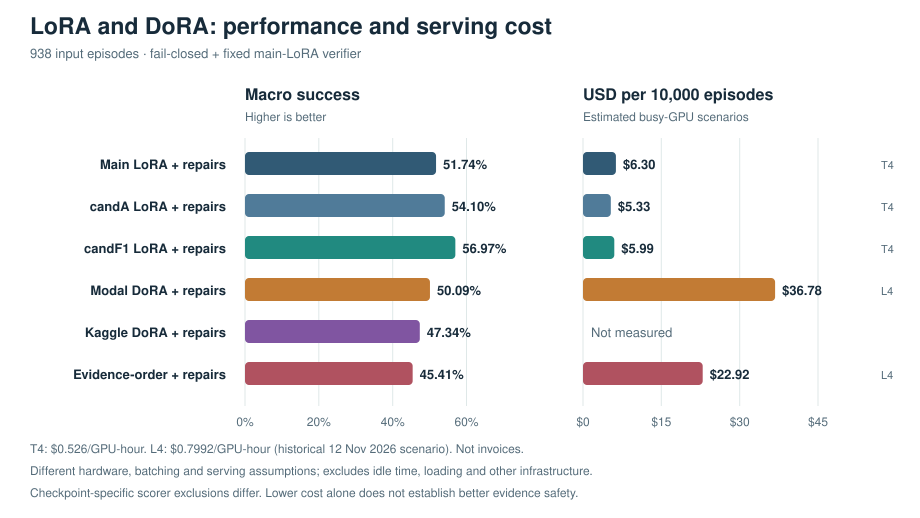
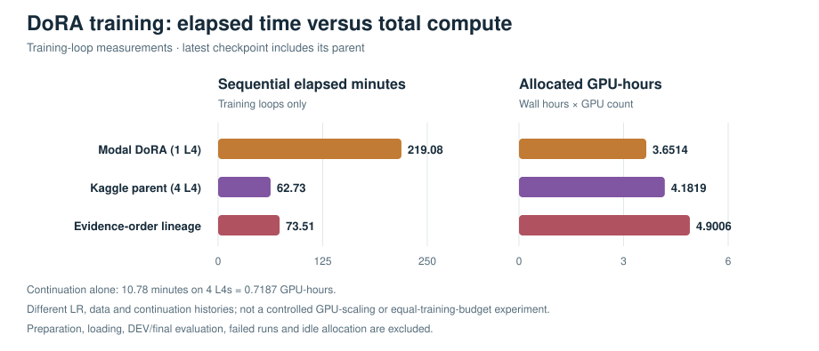
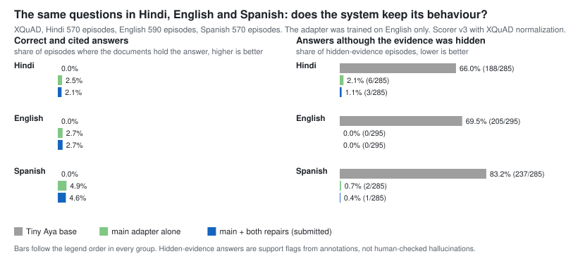

# Side studies: DoRA, Hindi and Spanish

Both experiments sit outside the submitted system, and neither changed it.

## DoRA experiments on the opened Round 5 suite

Contributed by Ansh ([@Ansh13579](https://github.com/Ansh13579), pull request 1) and reviewed in [`research/2026-11-15-pr1-review.md`](../research/2026-11-15-pr1-review.md): the frozen test inputs match our manifest hashes, but the raw run files are not in the repository, so these tables are reports and cannot be rescored from here. Three DoRA checkpoints were evaluated on the same 938 Round 5 input episodes. These are historical **scorer-v2** results; the scorer-v3 results in the [README](../README.md#results) use corrected rules. The individual checkpoints also have different exclusions, so this table is descriptive and should not be read as a paired, like-for-like ranking against the newer results.

| DoRA checkpoint | Raw macro success | With fail-closed and main verifier | Hidden-evidence answers with both repairs |
| --- | ---: | ---: | ---: |
| Original Modal DoRA | 44.71% | 50.09% | 64/364 |
| Kaggle DoRA, learning rate 5e-5 | 34.00% | 47.34% | 91/371 |
| Evidence-order continuation | 27.82% | 45.41% | 126/374 |

The evidence-order continuation failed its development screen and was not adopted. For reference, on the same scorer main with the same repairs scored 51.74% (41.43% raw) and candF1 56.97% (44.93% raw), so no DoRA checkpoint beat main once the repairs were applied ([comparison](../reports/evidence_order_all_previous_comparison.md)). These are results on an already opened test, not a new blind holdout. The PR reports use the main adapter as verifier; its checkpoint-specific exclusions and older scoring limit direct comparisons.

The figures use historical GPU-price scenarios and different hardware; they are not invoices or a controlled price-performance ranking. See the [DoRA comparison](../reports/evidence_order_all_previous_comparison.md), [cost and resource report](../reports/dora_lora_cost_efficiency.md), and [checkpoint evaluation](../reports/evidence_order_evaluation/EVALUATION_SUMMARY.md).

## Other languages: Hindi and Spanish

Tiny Aya reads 70 languages, but we trained the adapter on English only. On 15 November 2026 we ran the submitted system once on the same questions in Hindi, English and Spanish (XQuAD, Wikipedia questions translated by professionals). Nothing was retrained or tuned for this check, and the plan was committed before any data was built ([plan](../research/2026-11-15-multilingual-plan.md), [results](../research/2026-11-15-multilingual-results.md)).

| XQuAD, same questions in three languages | Hindi (285 questions) | English (295 questions) | Spanish (285 questions) |
| --- | ---: | ---: | ---: |
| Correct and cited, when the documents hold the answer | 2.1% | 2.7% | 4.6% |
| Answers although the evidence was hidden | 3 / 285 | 0 / 295 | 1 / 285 |
| Same, Tiny Aya base model | 188 / 285 | 205 / 295 | 237 / 285 |
| Success (refusing every question scores 50.0%) | 50.5% | 51.4% | 52.1% |
| Adapter alone: turns that ended invalid | 73.0% | 23.6% | 6.5% |

In plain words:

- **The refusing carries over.** When the evidence is hidden, the system answers 3 of 285 Hindi, 0 of 295 English and 1 of 285 Spanish questions. The base model answers two thirds or more of them.
- **The answering does not, in any of the three languages.** With the evidence in reach, the system gives a correct, cited answer to only 2% to 5% of questions, so its success rate sits at what refusing every question would score (50.0%). English is just as low as Hindi, because these are single-passage questions, a weak spot we already knew. This check therefore cannot tell a language problem apart from that one. It shows that Hindi and Spanish are not measurably worse than English.
- **Hindi breaks the search more often.** Before the repairs, 73% of the adapter's Hindi turns ended invalid, against 24% in English and 6.5% in Spanish. Nearly all of them repeat the previous search word for word. The repairs turn these into refusals. We did not test why.

One sample of 300 translated questions per language, so treat it as a first look. Hosted models were not run on Hindi.

## We then trained on Hindi, and the gain came with a safety cost

Because the English-only adapter answers almost nothing in Hindi, we continued training both `main` and `candF1` on Hindi: 220 machine-translated questions (IndicSQuAD) built into 540 Hindi rows, plus English replay, two epochs, one run each on Kaggle T4s. We tested both on 300 fresh human-translated XQuAD questions, and on the second English sealed test to see what Hindi training did to English. The rules were committed before any result ([pre-registration](../research/2026-11-15-hindi-training-preregistration.md), [results](../research/2026-11-15-hindi-training-results.md)). `hiMain` continues `main`, `hiF` continues `candF1`; every row below has both repairs.

| System | Hindi: correct and cited (291 questions) | Hindi: answers when evidence was hidden | English: macro success (second sealed test) | English: answers when evidence was hidden |
| --- | ---: | ---: | ---: | ---: |
| Main + both repairs (submitted) | 2.1% | 4 / 291 | 54.1% | 29 / 291 |
| hiMain + both repairs | 35.4% | 18 / 291 | 55.1% | 53 / 291 |
| candF1 + both repairs | 3.8% | 3 / 291 | 62.6% | 28 / 291 |
| hiF + both repairs | 35.1% | 13 / 291 | 63.9% | 33 / 291 |
| Refuse every question | 0.0% | 0 / 291 | 43.8% | 0 / 291 |

| Registered rule (difference in points, 95% interval) | hiMain minus main | hiF minus candF1 |
| --- | ---: | ---: |
| A1. Hindi, correct and cited (lower end above 0) | +33.3 [+27.9, +38.9]: met | +31.3 [+25.5, +37.3]: met |
| A2. Hindi, answers on hidden evidence (upper end at most +2.0) | +4.8 [+2.1, +7.8]: not met | +3.4 [+0.7, +6.6]: not met |
| A3a. English, macro success (lower end at least -3.0) | +1.0 [-2.0, +4.1]: met | +1.2 [-1.5, +4.0]: met |
| A3b. English, answers on hidden evidence (upper end at most +2.0) | +8.2 [+4.1, +12.2]: not met | +1.7 [-0.7, +4.6]: not met |

- **The Hindi gain is large.** Correct, cited answers rose from 2% and 4% to 35%, and the repeated-search failure went from 76% and 72% of raw turns to under 1%. Hindi success rose about 14 points above the 50% that refusing everything scores. Part of the gain is general single-passage answering: the same questions in English also improved (1.4% to 12.7% for `hiMain`, 10.3% to 24.1% for `hiF`).
- **It cost caution.** Both adapters answer on hidden evidence more often, in Hindi and, for `hiMain`, clearly in English (29 to 53 of 291). Under the registered rule neither adapter qualifies as a Hindi-capable variant, so **the submitted English system is unchanged**. `hiF` misses the English bound by a smaller margin.
- One training run per adapter, machine-translated training data, and test sets that are now used up: a second attempt would need a new registration and fresh tests. We did not test why the caution dropped.
