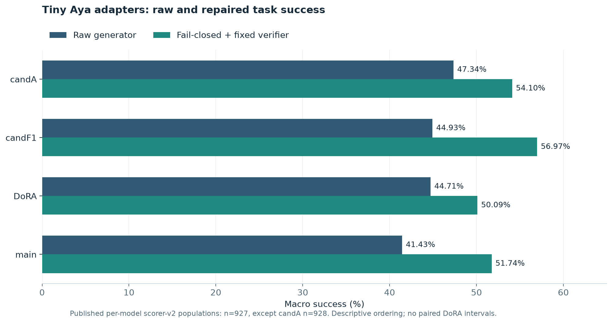
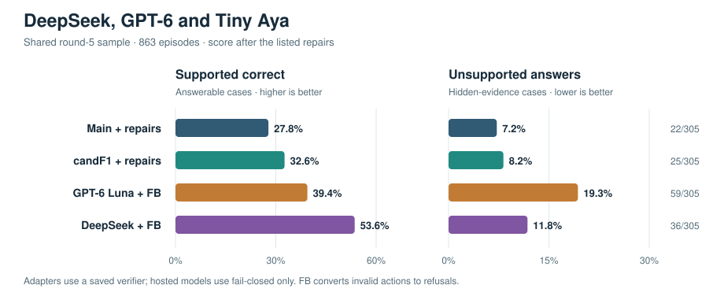
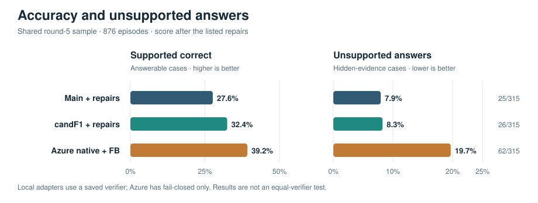
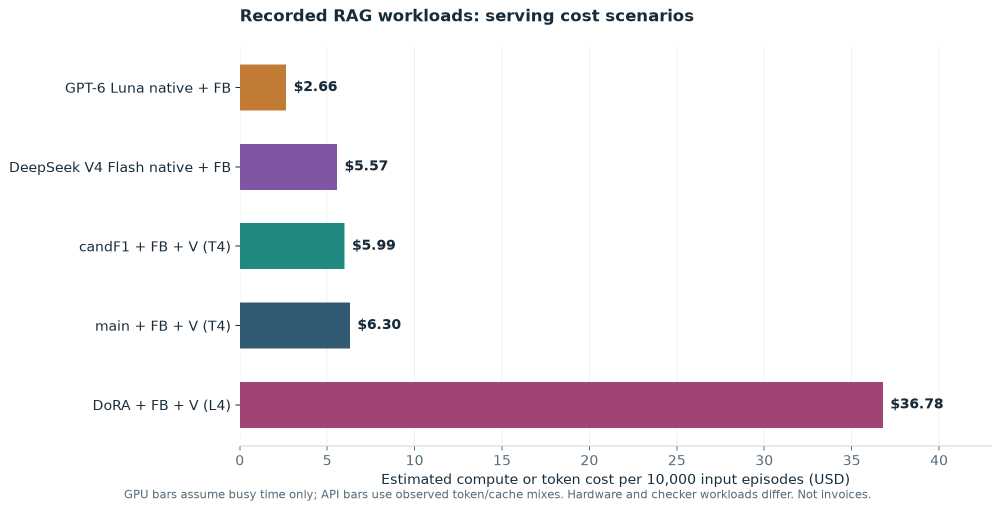
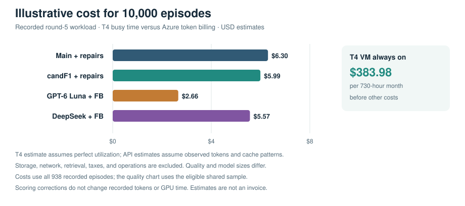
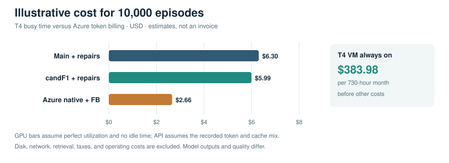

# Tiny Aya + DoRA: evaluation, adapter rankings and cost report

Prepared on 12 November 2026 from completed experiment records. Repository baseline: `6af4d518e7b86e12e5831ca528c3f4e900d7e761`.

The DoRA checkpoint achieves **44.71% raw macro success**, **48.18% with fail-closed finalization**, and **50.09% with fail-closed plus the saved main-adapter verifier**. Its directional adapter rank is **16**. Among the four evaluated adapter families, it places **third by raw macro success** and **fourth with both repairs**, using the published per-model results. These are descriptive project rankings; they do not establish a worldwide model rank or statistical significance.

All 19 measured AuditKIT outputs, their denominators, the adapter configuration, historical model comparisons, and cost assumptions are collected here. The accompanying [data snapshot](dora_evaluation_data.json) preserves full-precision values and source hashes. This report adds no model inference or training run.

## Problem and approach

**Problem statement:** fine-tune a model that decides when and what to retrieve, grounds its answers in retrieved text, and ignores distracting documents. The agent must also abstain when accessible evidence is insufficient.

The base is Cohere Tiny Aya Global, approximately 3.35 billion parameters, pinned to revision `af89d219b53ed9b13b8a4645f9c8028973510324`. The experiment uses a frozen, four-bit NF4 base and **DoRA (Weight-Decomposed Low-Rank Adaptation)**. DoRA learns a low-rank change to weight direction and a separate magnitude vector. PEFT implements this through `LoraConfig(use_dora=True)`. [DoRA paper](https://arxiv.org/abs/2402.09353), [PEFT documentation](https://huggingface.co/docs/peft/developer_guides/lora#weight-decomposed-low-rank-adaptation-dora).

Supervised examples teach search, cited answers and abstention with completion-only loss. At inference, the harness permits up to three searches, returns the top three passages and displays a maximum 800-character prefix per new passage. The generator uses greedy decoding and a 160-token generation cap.

**FB** is fail-closed finalization: invalid endings become abstentions. **V** is the existing main LoRA adapter's answer verifier, wording A, threshold 0.5. The three DoRA columns share one generator checkpoint and its recorded retrieval trajectory; FB and V are output-processing configurations, not separately trained adapters. This evaluation does not measure a DoRA self-verifier.

## Adapter configuration and training

| Setting | Recorded value |
| --- | --- |
| Base / revision | CohereLabs/tiny-aya-global @ `af89d219b53ed9b13b8a4645f9c8028973510324` |
| Method | QDoRA; frozen four-bit NF4 base |
| Directional rank / alpha / dropout | 16 / 32 / 0.05 |
| Target modules | `down_proj`, `gate_proj`, `k_proj`, `o_proj`, `q_proj`, `up_proj`, `v_proj` |
| Trainable parameters | 31,279,104 = 30,228,480 direction + 1,050,624 magnitude |
| Training rows / source episodes | 1,611 / 1,331 |
| Tokenized training rows, one pass | 2,134,235 processed; 55,392 supervised tokens |
| Epochs / optimizer steps | 2 / 202 |
| Learning rate / effective batch / seed | 0.0002 / 16 / 13 |
| Maximum sequence length | 2,560 tokens |
| Hardware | One NVIDIA L4 on Modal |
| Training wall time | 13,144.9 seconds (3.6514 hours) |
| Peak training GPU memory | 5.98 GB |
| Recorded training loss | 0.094968 |
| Runtime versions | torch 2.11.0+cu126, transformers 5.22.1, trl 1.7.1, peft 0.21.2, cuda 12.6 |

The rank of 16 describes the low-rank matrices, not the model's position in a leaderboard. The DoRA magnitude adds **1,050,624 parameters**, approximately **3.48%** beyond the 30,228,480 directional parameters. The 31,279,104 total trainable parameters are approximately **0.93%** of the roughly 3.35B base. Equal directional rank does not give LoRA and DoRA identical parameter counts.

The training report was checked against the saved Modal copy. The evaluated adapter weight SHA-256 is `2c08a87ceeb6668f5440bc20918ea2940425faa6639fdac9f5f7ba1a403afec9`; its configuration SHA-256 is `4d03f631b6de59b67275b03b799c63a8467924e3c30172e3775c5dacb5047a6c`. Weights are stored in the completed `dora-main` Modal run; this report does not upload model weights or imply a public DoRA model repository exists.

| Adapter | Adaptation and purpose | Published checkpoint / result availability |
| --- | --- | --- |
| main | Rank-16 QLoRA; search, answer and abstain mixture; original submitted adapter | [Main adapter](https://huggingface.co/BMEscanor/against-the-safety-tiny-aya-rag-main); round-5 results available |
| control | Rank-16 QLoRA; supported-only mixture without abstention targets | [Control adapter](https://huggingface.co/BMEscanor/against-the-safety-tiny-aya-rag-control); earlier tests available; no round-5 row in the ranking below |
| candA | LoRA alternative developed to answer more often | [candA adapter](https://huggingface.co/BMEscanor/against-the-safety-tiny-aya-rag-cand-a); round-5 results available |
| patch | Round-3 LoRA patch; improved single-passage answers but increased unsupported answers | [Patch adapter](https://huggingface.co/BMEscanor/against-the-safety-tiny-aya-rag-patch); earlier round-3 results available; no row in the round-5 ranking below |
| candF1 | Rank-16 LoRA evidence-curriculum continuation from candA, epoch 1 | [candF1 adapter](https://huggingface.co/BMEscanor/against-the-safety-tiny-aya-rag-cand-f1); round-5b alternative, not the selected submission |
| DoRA | Rank-16 direction plus trainable magnitudes; same main SFT mixture | Completed Modal run `dora-main`; three inference configurations reported here |

The repository also documents a round-3 patch and unsuccessful preference-training experiments. They are not additional evaluated DoRA checkpoints. The rank comparison covers only adapters with the required round-5 result records. candF1 has the highest reported repaired score, but failed the preregistered unsupported-answer non-inferiority rule; the original selected submission remains main + FB + V. [Selection report](round5b_final.md).

## Evaluation population

| Suite | Questions | Input episodes | Hidden-evidence episodes |
| --- | ---: | ---: | ---: |
| SQuAD single and two-part variants | 65 | 385 | 158 |
| HotpotQA | 60 | 82 | 38 |
| RGB | 100 | 471 | 179 |
| Total | 225 | 938 | 375 |

The benchmark's scorer v2 retains **927 DoRA episodes**, including **364 hidden-evidence episodes** and **563 answerable episodes**, after exclusions for alternate accessible evidence. Macro success is the equal mean of SQuAD single, SQuAD two-part, HotpotQA and RGB success rates. A successful episode ends in a supported correct answer or a correct abstention under that scorer.

AuditKIT instead audits **all 938 original episodes**, using the `recorded-v2` trace adapter and metric-specific cohorts. Its means must not be substituted for the benchmark macro. The suite was already public when DoRA was evaluated; this is a reproduction evaluation, not a newly sealed holdout. The saved completion record states the test was not used for training. [Frozen manifest](round5_test_manifest.json).

## DoRA benchmark results

| Metric | DoRA | DoRA + FB | DoRA + FB + V |
| --- | --- | --- | --- |
| Macro success | 44.71% | 48.18% | 50.09% |
| SQuAD single | 60.91% | 62.73% | 60.45% |
| SQuAD two-part | 26.67% | 35.76% | 38.79% |
| HotpotQA | 53.66% | 54.88% | 52.44% |
| RGB | 37.61% | 39.35% | 48.70% |
| Supported correct / answerable | 31.26% | 31.26% | 29.13% |
| False refusals / answerable (lower is better) | 19.89% | 23.09% | 34.46% |
| Unsupported / hidden (lower is better) | 117/364 (32.14%) | 117/364 (32.14%) | 64/364 (17.58%) |
| Invalid final actions after listed repairs | 46/938 | 0/938 | 0/938 |
| Retained / input episodes | 927/938 | 927/938 | 927/938 |

Raw DoRA exceeds raw main by **3.28 percentage points**. DoRA + FB exceeds main + FB by **0.81 points**. With both repairs, DoRA is **1.65 points below** main. Its unsupported hidden-evidence answers rise from main's **37/364** to **64/364**, while its supported-correct rate is higher and its false-refusal rate is lower. The result is an answering-versus-abstention trade-off. No paired confidence interval for these DoRA differences was computed.

## DoRA's project ranking

Each row uses that system's published scorer-v2 population from the same 938 input episodes. main, candF1 and DoRA retain 927 episodes; candA retains 928. This slightly different exclusion population makes the ordering descriptive rather than a newly computed common-intersection comparison.

| Adapter | Raw rank / 4 | Raw macro | Repaired rank / 4 | FB + V macro | Retained n |
| --- | --- | --- | --- | --- | --- |
| candA | 1 | 47.34% | 2 | 54.10% | 928 |
| candF1 | 2 | 44.93% | 1 | 56.97% | 927 |
| dora | 3 | 44.71% | 4 | 50.09% | 927 |
| main | 4 | 41.43% | 3 | 51.74% | 927 |



The plot shows each adapter's published raw and repaired macro success. It does not pool the raw and repaired configurations into one artificial leaderboard. The base model's raw macro is 2.22%; it is a reference rather than an additional adapter.

## All measured AuditKIT metrics

AuditKIT **1.1.3** scored saved outputs on CPU, without a judge model or new generation. Values below are on a 0-1 scale. Higher is better except redundant tool calls. The final column gives scored counts in the order DoRA / DoRA+FB / DoRA+FB+V.

| AuditKIT output | Cohort | DoRA | DoRA + FB | DoRA + FB + V | Scored n |
| --- | --- | --- | --- | --- | --- |
| evidence_set_recall | rag_stress | 0.9449 | 0.9449 | 0.9449 | 563 / 563 / 563 |
| citation_support | rag_stress | 0.7691 | 0.7691 | 0.6554 | 563 / 563 / 563 |
| citation_precision | rag_stress | 0.5731 | 0.5731 | 0.5074 | 563 / 563 / 563 |
| citation_recall | rag_stress | 0.3643 | 0.3643 | 0.3068 | 563 / 563 / 563 |
| tool_call_validity | agent | 1.0000 | 1.0000 | 1.0000 | 722 / 722 / 722 |
| redundant_tool_calls (lower is better) | agent | 0.0249 | 0.0249 | 0.0249 | 722 / 722 / 722 |
| agent_loop_detection | agent | 0.9499 | 0.9499 | 0.9499 | 938 / 938 / 938 |
| abstention | abstention | 0.7321 | 0.7260 | 0.7164 | 892 / 938 / 938 |
| lexical_groundedness | answerable_answered | 0.9868 | 0.9868 | 0.9973 | 433 / 433 / 369 |
| context_overlap | answerable_answered | 0.6901 | 0.6901 | 0.7114 | 433 / 433 / 369 |
| answer_overlap | answerable_answered | 0.7941 | 0.7941 | 0.8375 | 433 / 433 / 369 |
| f1_score | answerable_answered | 0.7607 | 0.7607 | 0.7996 | 433 / 433 / 369 |
| context_coverage | answerable_context | 0.9607 | 0.9607 | 0.9607 | 563 / 563 / 563 |
| hit_rate@3 | answerable_first_search | 0.9549 | 0.9549 | 0.9549 | 377 / 377 / 377 |
| precision@3 | answerable_first_search | 0.5208 | 0.5208 | 0.5208 | 377 / 377 / 377 |
| recall@3 | answerable_first_search | 0.6516 | 0.6516 | 0.6516 | 377 / 377 / 377 |
| mrr@3 | answerable_first_search | 0.8700 | 0.8700 | 0.8700 | 377 / 377 / 377 |
| average_precision@3 | answerable_first_search | 0.7390 | 0.7390 | 0.7390 | 377 / 377 / 377 |
| ndcg@3 | answerable_first_search | 0.7890 | 0.7890 | 0.7890 | 377 / 377 / 377 |

The metric names above are existing AuditKIT outputs; this report introduces no new metric or composite score. Machine-readable per-suite statistics and the exact metric-source hashes are included in the data snapshot.

### Cohorts and interpretation

- **Evidence and citation metrics:** 563 answerable episodes; 375 hidden-evidence cases are marked not tested rather than assigned artificial zero evidence scores. RGB alternate positive documents are alternative sufficient evidence sets, not a requirement to retrieve every copy.
- **First-search retrieval metrics:** 377 answerable episodes that actually searched. They evaluate the first ranked result list only; supplied context and later searches are excluded. Their unchanged scores across the three configurations reflect unchanged retrieval trajectories.
- **Answer metrics:** 433 answered, answerable episodes for raw DoRA and FB; 369 for FB+V. F1 uses the canonical reference answer. The higher conditional F1 after verification partly reflects which answers remain; it is not a measured improvement on a fixed answered cohort.
- **Abstention:** raw DoRA has 892 valid final actions and 46 invalid endings. FB and FB+V have 938 valid endings. These accuracy figures have different denominators. Tool-call validity of 1.0 on 722 episodes with tool calls does not imply every final response is valid.
- **LexicalGroundedness** measures token overlap, not semantic entailment or factual accuracy. **CitationSupport** validates mapped spans and document/version identity; it does not establish that a cited passage entails the answer. More abstentions can reduce citation averages when all 563 answerable episodes remain in the denominator.
- **RedundantToolCalls** is the mean per-episode redundant-call fraction, not a pooled fraction of all calls. **AgentLoopDetection** is scored so that 1 means loop-free.

### Relevant metrics that were not measured

| Metric family / outputs | Status and missing requirement |
| --- | --- |
| rag_judge: Faithfulness, ContextPrecision, ContextRecall, ContextRelevance, AnswerRelevancy, ResponseGroundedness, Hallucination; judge-based factuality/relevance/task completion/tool selection | Not measured; no LLM judge backend was configured or called |
| Agent ToolCallF1, TrajectoryMatch, ParallelToolCalls | Not measured; no unique gold tool trajectory or parallel-call reference |
| Freshness, wrong-version rate, AclCompliance, ContextRetention, NumericAccuracy, ToolPermission | Not measured; required version/date, policy, conversational-anchor or typed numeric labels absent |
| perf: LatencyStats, Throughput | No AuditKIT inference performance run; recorded amortized actor and verifier timings are analyzed separately below |
| Remaining code/structured/embedding/generation metrics | Not run; many are format, similarity or generation diagnostics rather than direct evidence-sensitive RAG success measures |
| Pairwise, security, toxicity, guard, encoder judges and perplexity | Not measured; require separate comparison outputs, task labels, judges/guard models or logits |

An unavailable metric is not zero. In particular, the citation implementation's default wrong-version rate is not reported as proof of temporal correctness. [AuditKIT metric definitions](https://github.com/Lexsi-Labs/AuditKIT/blob/main/src/auditkit/metrics/README.md).

## Comparisons with open-weight and closed models already in the README

The repository already contains completed Azure-hosted **DeepSeek V4 Flash** and **GPT-6 Luna** experiments. These are more relevant project comparisons than unrelated public leaderboard scores. The existing comparison uses **863 common episodes**, with **305 hidden-evidence cases**, shared corpus/masks, top-three retrieval and the three-search budget. Nine provider-blocked/missing cases and 66 additional scorer-v2 exclusions were removed from the original 938.

| System | Macro success | Supported correct / answerable | Unsupported / hidden | False refusals / answerable |
| --- | --- | --- | --- | --- |
| DeepSeek V4 Flash native + FB | 61.10% | 53.58% | 36/305 (11.80%) | 9.14% |
| candF1+FB+V | 55.54% | 32.62% | 25/305 (8.20%) | 37.46% |
| GPT-6 Luna native + FB | 54.90% | 39.43% | 59/305 (19.34%) | 2.69% |
| candA+FB+V | 52.98% | 31.18% | 31/305 (10.16%) | 31.90% |
| main+FB+V | 50.73% | 27.78% | 22/305 (7.21%) | 39.07% |

**DoRA is not assigned a rank in this 863-episode table.** Its completed results were not rescored on this exact intersection, and the historical per-episode hosted-model files are not present in this checkout. An aggregate score cannot recover a missing common-sample result. There is also no matching `recorded-v2` AuditKIT evaluation for these other models, so their AuditKIT cells cannot be filled from unrelated metrics.

The hosted models use native tools plus FB; the adapters use FB and their saved verifier. Hosted decoding defaults, 512-token completion caps, tool normalization and model identities differ from Tiny Aya's greedy 160-token configuration. Provider filtering and failures are excluded as documented. This is a comparison of the recorded systems, not an isolated test of model size, DoRA versus LoRA, or equal-verifier performance. [Full DeepSeek comparison](deepseek_comparison.md), [GPT-6 comparison on its separate 876-case intersection](azure_round5_comparison.md).



*Existing README graph: the 863-case shared comparison, without DoRA.*



*Existing README graph: the earlier 876-case comparison; its values should not be mixed with the 863-case table.*

For broader internet context, Cohere's 2025 Command A report gives ChatRAGBench correctness of **72.9% for Command A**, **66.6% for GPT-4o** and **40.3% for DeepSeek V3**. Those results use a different task and LLM-panel correctness procedure. They cannot establish DoRA's rank or be compared numerically with its conditional AuditKIT F1. [Command A report, Table 4](https://cohere.com/research/papers/command-a-technical-report.pdf#page=19).

## Cost and efficiency

### Recorded DoRA workload

| Recorded quantity | Value |
| --- | --- |
| r5t_squad actor time / episodes | 7,420.679 seconds / 385 |
| r5t_hotpot actor time / episodes | 2,047.070 seconds / 82 |
| r5t_rgb actor time / episodes | 5,950.897 seconds / 471 |
| Total actor time | 15,418.646 seconds |
| Actor output tokens / calls | 69,069 / 2,236 |
| Actor amortized seconds / episode | 16.4378 |
| Actor effective output tokens / second | 4.4796 |
| Main-verifier workload | 123.7 seconds / 560 answer cases |

The actor timings are sums of the `seconds` fields in all 938 saved score records. The harness allocates batch generation time across episodes. These are amortized throughput measurements, not individual-request latency or total billed container lifetime. The verifier's separate saved summary records 560 scored answers and 123.7 seconds, including cases that deterministic checks might already reject. It is counted once in the complete benchmark workload estimate.

Using the [Modal L4 list rate](https://modal.com/pricing) checked on 12 November 2026, **$0.000222 per GPU-second** (about $0.7992/hour):

```text
GPU-only training estimate = recorded training seconds * L4 dollars per second
GPU-only inference estimate per 10,000 = recorded workload seconds / 938 * 10,000 * L4 dollars per second
```

| Workload | GPU-only estimate |
| --- | --- |
| One completed DoRA training run | $2.92 |
| Recorded actor + verifier, all 938 episodes | $3.45 |
| Raw DoRA actor, scaled to 10,000 episodes | $36.49 |
| DoRA actor + recorded main verifier, scaled to 10,000 episodes | $36.78 |

These amounts exclude CPU, RAM, model loading, startup, local scoring overhead, storage, network, failed/repeated jobs and other experiments. Monthly credits can offset a bill but do not change resource use. This is not a Modal invoice or a claim about the account's remaining credits. Unmerged DoRA has additional inference work; this run does not establish the performance of a merged or otherwise optimized serving deployment.

### Comparison with the README cost scenarios

| System and serving setup | Estimated cost / 10,000 input episodes | Basis |
| --- | --- | --- |
| DeepSeek V4 Flash original prompt/parser | $1.65 | Azure recorded token/cache mix |
| GPT-6 Luna original prompt/parser | $1.57 | Azure recorded token/cache mix |
| DeepSeek V4 Flash native tools + FB | $5.57 | Azure recorded token/cache mix |
| GPT-6 Luna native tools + FB | $2.66 | Azure recorded token/cache mix |
| main+FB+V | $6.30 | Historical ideal T4 busy-time scenario |
| candF1+FB+V | $5.99 | Historical ideal T4 busy-time scenario |
| DoRA + FB + V | $36.78 | L4 measured actor + all 560 verifier cases; GPU-only |



*All bars scale recorded round-5 workload to 10,000 input episodes. DoRA uses measured L4 actor time plus all recorded verifier time. Historical main/candF1 use T4 busy time plus an estimated subset of checker calls; hosted models use token accounting. This is a compute/token comparison across different serving settings, not equal-quality or equal-hardware pricing.*





The original README figures are reused without altering their values. The T4 reference is the historical **$0.526/hour** East US VM scenario. It assumes perfect utilization and immediate stopping; its **$383.98 for 730 hours** example excludes other infrastructure. It is not a refreshed VM price quote. GPT-6 Luna's scenario uses $0.10 uncached input, $0.01 cache reads, $0.125 cache writes and $0.50 output per million tokens. DeepSeek V4 Flash uses $0.19 uncached input, $0.028 cached input and $0.51 output; writes are treated as ordinary input because the cited table has no separate write rate. These published token rates were checked against the linked Microsoft pages on 12 November 2026. [GPT-6 pricing](https://azure.microsoft.com/en-us/blog/gpt-6-astra-sol-and-luna-for-production-agents-in-microsoft-foundry/), [DeepSeek pricing](https://techcommunity.microsoft.com/blog/azure-ai-foundry-blog/introducing-deepseek-v4-flash-and-v4-pro-in-microsoft-foundry/4515174), [original Azure cost analysis](azure_roi.md), [original DeepSeek cost analysis](deepseek_roi.md).

**What the efficiency comparison supports:** in the recorded setup, DoRA's unmerged actor has higher amortized inference compute cost than the older T4 adapters and the quoted hosted API workloads. The current data does not support a claim that this DoRA checkpoint is cheaper or more accurate than the hosted models. Hardware, batching, implementation, output lengths, cache behavior and checker policies differ. A small trainable adapter does not by itself guarantee low serving cost. No cost-per-correct-outcome ranking is computed across unequal evaluation populations.

## Findings and next experiments

The generator frequently obtains useful evidence: first-search hit rate@3 is 95.49%, while first-search recall@3 is 65.16%. These measure different retrieval properties, and the high EvidenceSetRecall additionally includes accumulated and supplied context. Useful evidence does not consistently become a supported correct final answer.

The strongest demonstrated DoRA improvement is over raw main: higher macro success and fewer invalid endings. The complete repaired DoRA system has more unsupported hidden-evidence answers than repaired main, and lower macro success. Its conditional answer F1 improves after verification while fewer answers remain. Both coverage and answer quality should therefore be reported together.

Priorities are to diagnose missing multi-hop evidence and compound-answer coverage, improve the evidence-to-answer decision and citation completeness, and assess a verifier suited to DoRA on development data. Benchmark optimized/merged serving separately before making deployment-efficiency claims. Any new model ranking should use one fixed common episode intersection and matching metric contracts, with paired uncertainty estimates. Further tuning needs development data and a fresh held-out test rather than repeated selection on this public reproduction suite.

The four-L4 Kaggle workflow was prepared, including asset staging and distributed training support. The completed training and evaluation documented in this report ran on **one Modal L4**; no successful four-L4 run is established by these records.

## Artifacts and provenance

- [Full-precision data, source hashes, training settings, rankings and cost arithmetic](dora_evaluation_data.json).
- [Historical round-5 and round-5b results](round5b_final.json); [hosted-model shared comparison](deepseek_comparison.json); [historical cost inputs](deepseek_roi.json).
- Local source reports: `runs/modal/dora-main/benchmark_results/computed_round5.json` and `runs/modal/dora-main/benchmark_results/auditkit/auditkit_metrics.json`. The original local reports remain unchanged.
- Saved DoRA training report and verifier timing were checked against completed Modal artifacts. The public snapshot omits machine-specific absolute paths; numerical values and checkpoint hashes are preserved.
- The audit uses existing saved traces, AuditKIT 1.1.3 and `recorded-v2`; semantic judge scores remain unmeasured. Source hashes identify the exact audit adapter and official metric implementations used for this result.

No credentials, raw user documents, model weights, cache files or unrelated working changes are part of this report publication.
