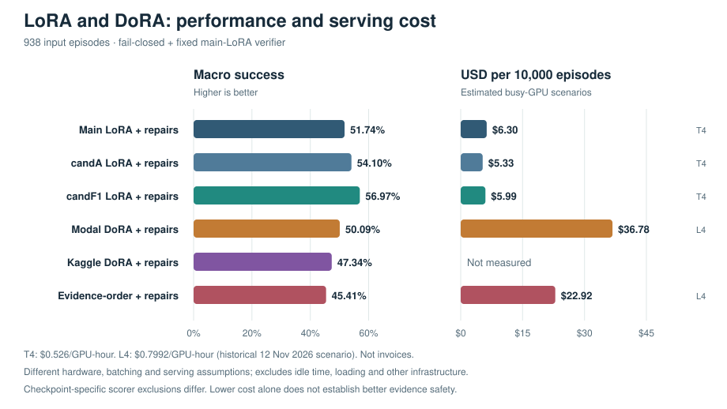
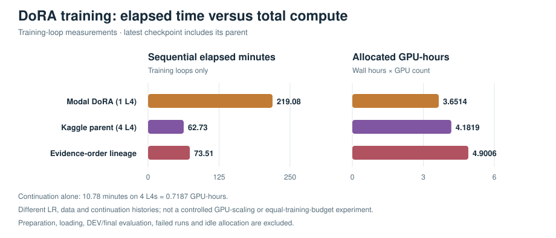

# Cost versus efficiency: LoRA and the three DoRA runs

Prepared 14 November 2026 from saved reports. Training GPU counts, wall times and tokens are measured records. Dollar amounts below are historical scenarios, not invoices or current pricing.

Generate figures from the published snapshots with `python scripts/make_dora_efficiency_figures.py`.

## Benchmark effectiveness

| Model | Raw macro | FB+V macro | Raw unsupported / hidden |
| --- | --- | --- | --- |
| Main LoRA | 41.43% | 51.74% | 108/364 |
| candA LoRA | 47.34% | 54.10% | 129/365 |
| candF1 LoRA | 44.93% | 56.97% | 114/364 |
| Modal DoRA | 44.71% | 50.09% | 117/364 |
| Kaggle DoRA lr5e-5 | 34.00% | 47.34% | 227/371 |
| Evidence-order DoRA | 27.82% | 45.41% | 306/374 |

All rows use the same 938 input episodes, with checkpoint-specific scorer-v2 exclusions. Macro is not a pooled success fraction. Dividing cost by macro would not measure cost per successful episode, so no such composite is reported.

## Training resources and GPU-only price scenario

Historical L4 scenario: **$0.7992/GPU-hour**, retained from the Modal report checked on 12 November 2026. Applying it to Kaggle is a hypothetical equivalent compute cost. No Kaggle invoice or monetary charge is observed; free-quota use still consumes GPU allocation.

| Run | GPUs | Wall minutes | Allocated GPU-hours | Rows / steps | Tokens/s (wall) | Tokens/s/GPU | Historical L4 scenario USD |
| --- | --- | --- | --- | --- | --- | --- | --- |
| Original Modal DoRA | 1 | 219.08 | 3.6514 | 1611/202 | 324.7 | 324.7 | $2.918 |
| Kaggle DoRA lr5e-5 | 4 | 62.73 | 4.1819 | 1611/202 | 1134.1 | 283.5 | $3.342 |
| Evidence-order DoRA continuation | 4 | 10.78 | 0.7187 | 541/34 | 1171.0 | 292.8 | $0.574 |

The latest continuation inherits the lr5e-5 parent, so its training lineage totals **4.9006 allocated GPU-hours** (historical equivalent **$3.917**), not just its 0.7187 incremental hours. Preparation, model loading, development evaluation, final benchmark, failed/smoke runs, idle allocation, CPU/RAM/storage and network are excluded.

The parent four-L4 run has 3.49× lower wall time than the one-L4 Modal training, but uses more allocated GPU-hours (4.1819 versus 3.6514). Its benchmark score also falls. This is not a controlled hardware scaling experiment: LR and execution conditions differ.

Historical main LoRA training used one T4 for **14,028.9 seconds (3.8969 hours)**, reported in `azure_roi.json`. The README's illustrative $0.35/T4-hour scenario gives about **$1.36**; it is not the same rate or GPU as the L4 scenario. Its 2,330,132 processed tokens/pass differ from DoRA's 2,134,235. No same-hardware, same-token, multi-seed LoRA-versus-DoRA cost experiment is established.

## Recorded inference resources

For the latest run, sum all 938 raw score rows' `seconds`, tokens and calls. The harness charges each episode its share of batch generation time. Sum the four verifier shards' wording-A seconds for FB+V. Concurrent workers are already summed: **do not multiply these sums by four again**. These are batch-amortized busy-time proxies, not user latency or total allocated/billed session duration.

| Run | Configuration | GPU-seconds/episode | GPU-hours / 10k episodes | Historical L4 USD / 10k | Actor output tokens/s |
| --- | --- | --- | --- | --- | --- |
| Original Modal DoRA | raw | 16.438 | 45.661 | $36.49 | 4.48 |
| Original Modal DoRA | FB+V | 16.570 | 46.027 | $36.78 | 4.48 |
| Latest evidence-order DoRA | raw | 10.120 | 28.110 | $22.47 | 4.52 |
| Latest evidence-order DoRA | FB+V | 10.325 | 28.681 | $22.92 | 4.52 |

Latest measured actor totals: **9492.283 seconds**, **1467 model calls**, **1,711,877 input tokens**, **42,946 output tokens**. Verifier: **851 cases**, **192.8 seconds**. A faster, shorter answering policy can reduce generation time while harming evidence safety. Interpret the resource table with the unsupported-answer rates above.

The previous Kaggle lr5e-5 download contains final reports but not its full raw timing traces; no inference cost is invented for that checkpoint.

### Historical LoRA serving estimates from the README's sources

| System | Historical T4 GPU-seconds/episode | Historical T4 USD / 10k episodes |
| --- | --- | --- |
| main+FB+V | 4.313 | $6.30 |
| candF1+FB+V | 4.102 | $5.99 |
| candA+FB+V | 3.646 | $5.33 |

These LoRA scenarios use **$0.526/T4-hour**, batched verifier estimates and their original serving settings. candA+FB+V is computed by the same method from its saved run times and the main verifier's average time per case, so it is an estimate. DoRA uses recorded L4 timings and a different scenario rate. They are not a controlled price/performance ranking. Hosted API token-price scenarios remain in [azure_roi.md](azure_roi.md) and [deepseek_roi.md](deepseek_roi.md); no current API prices are inferred here.

## Verified training and development outcome of the latest approach

The evaluated adapter hash matches the downloaded training completion record. The full continuation used LR **2e-05**, **1 epoch**, global batch **16**, **541 rows**, **34 steps**, and peak rank-0 memory **6.09 GiB**. The curriculum retained **128 pairs** with **223 answer**, **223 abstain** and **95 search** rows. Training loss was 0.0520; lower training loss did not produce better evaluation.

| DEV metric (159 episodes) | Parent | Continuation |
| --- | --- | --- |
| supported_correct | 26.74% | 38.37% |
| unsupported_answer | 23.29% | 53.42% |
| false_abstain | 47.67% | 15.12% |
| invalid | 1.89% | 0.00% |
| evidence_supported_good | 40.25% | 33.96% |

**The development screen failed.** Unsupported answers increased from **17/73 to 39/73** and evidence-supported good outcomes fell from **64/159 to 54/159**. This negative development result predates the reported final benchmark. The candidate should not be promoted under the stated rule. More training or a smaller generation bill is not itself an efficiency improvement when the required evidence behavior degrades.

## Artifacts and formulas

- Allocated training GPU-hours = wall seconds × GPU count / 3,600.
- Processed tokens/s = tokens per pass × epochs / training wall seconds.
- Processed tokens/s/GPU = processed tokens/s / GPU count.
- Inference scenario USD/10k = amortized seconds / 938 × 10,000 / 3,600 × historical GPU rate.
- Cumulative continuation training adds the parent cost; inference remains a separate phase.

[CSV](dora_lora_cost_efficiency.csv) · [Full data and assumptions](dora_lora_cost_efficiency.json) · [Verified training/DEV snapshot](evidence_order_training_data.json) · [Inference resource snapshot](evidence_order_inference_resources.json) · [All benchmark comparison](evidence_order_all_previous_comparison.md) · [README LoRA comparison](readme_lora_vs_all_dora.md).
