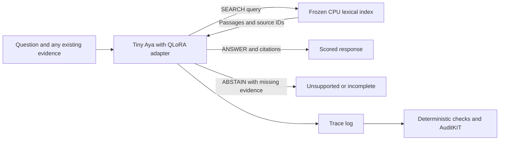

# Fine-tuning for RAG — paper review and project plan

**Team:** Against-the-safety  
**Research date:** 4 November 2026, IST  
**Last rechecked:** 4 November 2026, second pass at 13:30 IST, covering the PS 4 text, rules and credits, newer papers, the Tiny Aya chat template, AgentTune and AuditKIT RAG source, Kaggle quota, HF Spaces and HF Jobs.  
**Competition:** Lexsi AI Safety and Alignment Hackathon  
**Working interpretation:** Track 3, Agentic Fine-tuning, PS 4 — Fine-tuning for retrieval-augmented generation  
**Resources:** One Kaggle account with about 30 GPU hours per week in the T4 ×2 configuration (the quota resets weekly), the $20 HF credit once redeemed, and the Kaggle Model Proxy quota ($10/day) for evaluation-only API calls.  
**Status:** Research and proposed experiments. Training performance, cost and improvements have yet to be measured.

The active project is now PS 4. The earlier [distillation research note](2026-11-03-agentic-distillation.md) records the previous direction. This document covers the new research, decisions, implementation sequence and evaluation protocol.

**Recheck conclusion:** Retain PS 4 and the small-model SFT direction. The original 30-hour allocation did not demonstrate that the proposed experiment matrix would fit. Sections 5–8 now specify a smaller core experiment, a fairer training control and throughput-based admission gates. GPU feasibility remains unmeasured; the pilot must determine the final sample and token counts. Section 14 records the corrections.

**Second-pass conclusion:** The official PS 4 text matches this plan, so the direction stays. The changes are practical. The Nov 4–14 window spans two Kaggle quota resets, and the $20 HF credit should be able to pay for bf16 GPUs through HF Jobs, so compute is less tight than first assumed. AuditKIT already ships deterministic RAG checks for evidence sets, citations, abstention and dated documents, so evaluation maps onto them instead of custom scorers. Tiny Aya's chat template needs prompt/completion training rows. Four newer papers add an answerable look-alike control, a retrieval-score-gate baseline and an end-to-end headline metric. HF Space hosting rules changed, which affects the demo. Section 15 records the details.

## 1. Recommendation derived from the papers

Build a small document assistant that learns to issue useful searches, identify missing evidence, answer with source citations, and abstain when accessible evidence remains insufficient. Use Tiny Aya Global with QLoRA supervised fine-tuning on short, verified tool-use episodes. Keep the corpus and retriever fixed while measuring the effect of training.

The main experiment should test **matched evidence conditions**. For the same question, present sufficient evidence, incomplete evidence, sufficient evidence mixed with distractors, and an environment where support is absent. The target action changes with the visible state and remaining search budget. This directly tests whether the model learned to use evidence rather than associate a question with a memorized answer.

For a practical demonstration, build an original, fictional product-support corpus with dated product manuals, troubleshooting notes, warranty terms and policy versions. Show a question requiring two documents, a distracting document, and a question for which evidence is unavailable. Use synthetic product names and newly changed facts to test dependence on current documents. Keep the first experiment in English. Preserve the earlier ambition of a Hugging Face Space and a local CPU run, subject to measured feasibility.

This is our proposed adaptation of existing research. The novelty claim should concern the documented Tiny Aya adaptation, controlled evidence interventions and measured accuracy–coverage–cost trade-off. The component techniques already have published precedents.

## 2. Competition fit and judging

PS 4 asks for a model that decides when and what to retrieve, grounds its answers in the retrieved text, and ignores distracting documents. A static document-answering reader provides a useful control. The main system needs actual learned search decisions. The eligible list on the kickoff slides has seven models: Tiny Aya Base, Global, Fire, Water and Earth, and Aya Expanse 8B and 32B. Use AgentTune and AuditKIT in an inspectable pipeline. The website exempts Track 3 from its general two-repository minimum, while the slides describe repository chaining more generally. Using both fits either reading. The slides list CuratorKIT and AuditKIT as a common stack usable in every track, so CuratorKIT is an optional third repository if it is used to build the product-support QA set. [Official rules and problem statements](https://hackathon.lexsi.ai/).

Each clause of the PS gets its own headline measurement, so the write-up answers the PS directly:

| PS 4 clause | Measurement |
| --- | --- |
| Decides **when** to retrieve | Missed-search rate on new questions and unnecessary-search rate when sufficient evidence is already supplied. |
| Decides **what** to retrieve | Evidence-set recall of the model's own queries, and second-hop recovery after a partial first retrieval. |
| **Grounds** answers in retrieved text | Grounded answer success and citation support against passages actually observed. |
| **Ignores distracting** documents | Accuracy change from clean to distractor variants of the same question. |
| Our addition: abstains when support is absent | Unsupported-answer rate on audited missing-support variants, reported with false abstention. This overlaps Track 1's "Grounded answers" PS, so it supports the headline rather than replacing it. |

The kickoff slides publish these categories. Earlier research in this chat missed the slide categories, which are now incorporated here.

| Published category | Published scale | Evidence we should prepare |
| --- | ---: | --- |
| Write-up clarity | /10 | An HF Article with the research question, data, methods, baselines, results and limitations. |
| Practical usefulness | /10 | A source-backed support assistant with a visible retrieval trace and useful abstention. |
| Code/notebook quality | /10 | A small reproducible pipeline, pinned revisions, saved configs and clean notebooks. |
| Overall review | /100 | A coherent contribution supported by paired experiments. |

The slides describe multiple double-blind scores and normalized averages for shortlisting. They do not explain how the four scales combine. We should not invent a weighted score or winning probability. [Kickoff slides](https://hackathon.lexsi.ai/kickoff-slides/).

Operational requirements include a team of one to three, registration by Nov 5 AoE, multiple before-and-after metrics, public HF artifacts and collections, a public demo or repository, reproducible code, and a write-up. The submission deadline is Nov 14 AoE, approximately Nov 15 at 5:29 p.m. IST. Aim to submit Nov 14 IST. The last submission counts. Shortlisting is by Nov 16 and Demo Day is Nov 22. [Competition schedule and submission requirements](https://hackathon.lexsi.ai/).

Also retain these requirements in the submission checklist: develop the project during the event, participate through only one team, have at least one teammate join Discord, and prepare an abstract under 500 words. The website accepts a GitHub README if HF Articles are inaccessible; prepare the HF Article as the default. An ROI comparison is optional but preferred. A continuously running paid GPU endpoint is not a prerequisite when the public repository satisfies the stated deployment option. [Rules and submission form requirements](https://hackathon.lexsi.ai/).

Prepare the Article around the slides' checklist: problem and approach, hackathon repositories and features used, models and licenses, datasets and licenses, model collection, data/trace collection, experiments and findings, what additional credits would enable, and teammate tags. The submit page requires every repository in both HF collections, and the collections themselves, to be public and un-gated. Publish the adapter as its own un-gated repository; it loads the gated Tiny Aya base, which each user accepts on the model page. [Submit requirements](https://hackathon.lexsi.ai/), [kickoff checklist](https://hackathon.lexsi.ai/kickoff-slides/).

### 2.1 Are AgentTune and AuditKIT compulsory? — rule clarification, Nov 4

Using Lexsi's track repositories as functioning parts of the project is a requirement. The website's Project Requirements apply to all submissions, and its separate minimum-repository rule explicitly exempts Track 3. The FAQ repeats that exception. It is an exception to the two-repository count, not an express permission to build the whole entry without the track stack. [Official rules and FAQ](https://hackathon.lexsi.ai/).

The website does not explicitly name both AgentTune and AuditKIT as individually mandatory for every Track 3 submission. AgentTune is the framework presented for the agentic track. The kickoff slides show AgentTune and AuditKIT together for Track 3 and give a general two-repository rule without repeating the website exception. Distinguish that difference in wording from an organizer-confirmed exemption for either specific library. [Track description](https://hackathon.lexsi.ai/), [kickoff track map and rules](https://hackathon.lexsi.ai/kickoff-slides/).

**Our project decision is to use both in a connected pipeline.** AgentTune supplies real retrieval/tool episodes and training integration; AuditKIT evaluates the original and fine-tuned agent on the same cases and produces inspectable reports. These roles match their documented capabilities. Installing, importing or mentioning a repository alone does not demonstrate its role in the required pipeline. Supporting Transformers, PEFT and TRL components can remain part of that implementation; AgentTune itself uses TRL. [AgentTune README and AuditKIT handoff](https://github.com/Lexsi-Labs/AgentTune#hand-the-run-to-auditkit), [AuditKIT README](https://github.com/Lexsi-Labs/AuditKIT).

Therefore, describe use of the Lexsi stack as compulsory, the Track 3 two-repository minimum as explicitly waived on the website, and our use of AgentTune plus AuditKIT as the selected implementation that fits both published descriptions. Do not assert that the website unambiguously makes both named repositories compulsory, or that the Track 3 exception makes all Lexsi tooling optional.

## 3. Literature review completed before selecting the plan

Discovery used Exa across paper, data and implementation workstreams. The researchers requested 85 candidate results in aggregate, including duplicates, and then read original papers, author repositories and official documentation. This count describes search-result slots, not 85 fully read papers. The studies below were read beyond their abstracts, focusing on methods, evaluation and relevant limitations. Publication claims apply to the named models and settings. None establishes a Tiny Aya result for our project.

### 3.1 Foundational methods and work first released by 2025

| Paper and date | What the original method does | What we adopt and what needs testing |
| --- | --- | --- |
| **Self-RAG**, 2023 preprint / ICLR 2024 | Trains retrieval and reflection behavior using offline critic annotations and reflection tokens. The generator can learn retrieval need, relevance, support and utility. | Use explicit action supervision and evidence checks. Its full critic/generator setup adds expense, so begin with ordinary structured outputs and QLoRA. Read method §§3.1–3.3. [Paper](https://arxiv.org/html/2310.11511v3). |
| **RAFT**, 2024 | Fine-tunes a reader with answer-bearing documents, distractors and evidence-oriented reasoning. A fraction of examples omits the gold passage while retaining the known answer as the target to encourage memorization. | Adopt hard distractors and source-backed targets. For our corpus-grounded task, missing-support targets must instead request more evidence or abstain. RAFT alone does not train a search controller. Read method and distractor analysis. [Paper](https://arxiv.org/html/2403.10131v2). |
| **Search-R1**, 2025 | Uses outcome-supervised RL with actual multi-round search. Retrieved observations are masked from policy loss. Its reported setup uses eight H100s, large batches and up to 500 optimization steps. | Borrow the search loop and observation masking. Allocate our main budget to SFT, with RL only after a finished result. Read method and implementation setup. [Paper](https://arxiv.org/html/2503.09516v4). |
| **R1-Searcher**, 2025 | Two-stage RL first teaches tool invocation, then combines format and answer rewards to teach useful search. | Separate format learning from retrieval quality in the pilot. A valid tool call is one metric, while useful retrieved evidence is another. Read method and analysis. [Paper](https://arxiv.org/html/2503.05592). |
| **RAG-Gym**, first released February 2025; reviewed version v3 is titled **Supervising the search process produces reliable and generalizable information-seeking agents** | Treats query and answer actions as a sequential process and studies actor optimization and critic-guided selection. The reviewed revision includes SFT, DPO and PPO experiments. | Supervise intermediate decisions and inspect bad queries. DPO or a critic is a stretch experiment after SFT. Cite the reviewed revision explicitly: the unversioned abstract returned an older title/version during the recheck. Read actor/process supervision and evaluation sections. [Reviewed v3](https://arxiv.org/html/2502.13957v3), [versioned abstract](https://arxiv.org/abs/2502.13957v3). |
| **Sufficient Context**, ICLR 2025 | Distinguishes context sufficiency from answer correctness. Models can fail with sufficient evidence or answer correctly without complete evidence. Its selective-generation work studies accuracy versus coverage. | Evaluate evidence sufficiency and answering separately. Report false abstention on supported questions. The paper also reports that simple sufficiency fine-tuning can increase abstention while losing correct answers. Read §§3–5. [Paper](https://arxiv.org/html/2411.06037). |
| **PrismRAG**, July 2025 | Constructs targeted distractors by modifying entities, dates and locations, filters generated examples, and teaches strategic use of context. | Include challenging near-match documents and dated versions. Check synthetic labels manually and do not treat fluent generated passages as trusted evidence. Read §§4.1–4.3 and limitations. [Paper](https://arxiv.org/html/2507.18857v1). |

### 3.2 Recent 2026 papers and counterevidence

These are recent preprints or source versions reviewed as of Nov 4, 2026. Their reported outcomes remain unreplicated in our environment.

| Paper and date | Evidence read | Consequence for the experiment |
| --- | --- | --- |
| **Search, Do not Guess — Always-Search Policy**, Apr 6, 2026 | Main method, adaptivity study and Appendix B. It finds under-searching in small Qwen/Llama agents and harm from confidence-based bypass of search in factual QA. Uses 18,000 teacher trajectories, a Qwen3-32B summarizer, a substantial retriever/corpus and different hardware. | Include a forced-first-retrieval baseline. Learn follow-up search and stopping from evidence. Test direct answering when evidence is already supplied. Do not infer that Tiny Aya can safely answer factual questions from confidence alone, or that the paper's pipeline is cheap to reproduce. [Paper](https://arxiv.org/html/2604.04651v1). |
| **OCC-RAG**, submitted May 30, 2026; June arXiv identifier | Data and training sections. Uses millions of QA pairs, approximately 9B training tokens per released model, and eight H100s for its reported midtraining experiments. | Supports deliberate evidence-grounding training, while its training scale lies beyond this project's budget. Use it as a design reference. The identifier's month is not its submission date. [Paper](https://arxiv.org/html/2606.00683), [submission metadata](https://arxiv.org/abs/2606.00683). |
| **When Should Multi-Round RAG Stop?**, Aug 13, 2026 | Sequential stopping formulation and evaluation. A learned judge over a frozen Search-R1 system reduces calls by 3.70% with a 0.625-point EM decrease in its confirmatory test. State ranking improvements do not automatically yield good first-stop decisions. | Evaluate complete trajectories and the earliest wrong stop. Fewer retrieval calls alone cannot establish improved accuracy or total compute cost. A separate judge also consumes resources. [Paper](https://arxiv.org/html/2608.13237). |
| **Prompt-Based Abstention Fails Under Misleading Context**, Aug 23, 2026 | Matched supportive, degraded, missing and misleading context experiments with small frozen models. Its intervention changes evidence while holding questions fixed. Prompted refusal performs differently on absent evidence and fluent misleading evidence. | Keep missing support, irrelevant passages, contradictory claims and injected instructions as distinct test conditions. Metadata or independent authority is needed when sources conflict. Read benchmark construction, experiments and limitations. [Paper](https://arxiv.org/html/2608.22228). |
| **Regime Boundary Alignment for Evidence-Gated QA**, Sep 25, 2026 | §§3–4. Uses matched clean, mixed and support-removed contexts. Supported examples target the answer and unsupported examples target abstention. It trains one reader with standard sequence loss and ordinary decoding. | Most direct low-compute training inspiration. Extend the matched-state idea to SEARCH, ANSWER and ABSTAIN decisions and test the extension. The paper's known-gold construction does not resolve equally authoritative real-world contradictions. Its large reported gains are hypotheses to test here. [Paper](https://arxiv.org/html/2609.37491). |

### 3.3 Papers added in the second pass

A second search on Nov 4 covered September–November 2026 preprints on small-model retrieval control and abstention. These four change the protocol. All are unreplicated preprints on other models.

| Paper and date | Evidence read | Consequence for the experiment |
| --- | --- | --- |
| **The Fellowship of the Query: Learning Retrieval Actions**, Sep 23, 2026 | Abstract and results. LoRA SFT on teacher search traces teaches a 3B model a seven-way next-action task (macro-F1 0.65 vs 0.17 zero-shot). A 3,000-row training set came within 0.02 macro-F1 of the best size. End-to-end, using the tuned model for both control and answering raised EM from 0.753 to 0.795 over 149 trajectories, but controller-only answer gains had bootstrap intervals crossing zero. The rare `verify` class stayed unreliable. | Report end-to-end episode outcomes as the headline and per-decision action accuracy only as a diagnostic. Balance rare actions. A few thousand state-action rows is a reasonable first target. [Paper](https://arxiv.org/abs/2609.28653). |
| **Do Multimodal Models Decide Consistently on Equivalent Optical Spectra?**, Oct 30, 2026 | Abstract. Much of a LoRA model's gain on unanswerable cases came from a shortcut: it abstained whenever the input was truncated. Adding answerable truncations removed the shortcut in all six seeds; adding the same amount of ordinary task data did not in five of six. | Add answerable look-alikes: episodes where a non-support document is masked, or the first search returns weak results but the answer is still recoverable. Without them, "something is missing" can become a cue for abstention. [Paper](https://arxiv.org/abs/2611.00428). |
| **Trust Mechanisms for Offline Generative AI at the Edge**, Oct 24, 2026 | Abstract and results on 300 SQuAD 2.0 questions with Qwen2.5 1.5B–7B. A calibrated retrieval-score gate caught out-of-corpus questions (AUROC 0.97) but not in-topic unanswerable ones (0.68). Turning malformed outputs into abstentions lowered risk without losing correct answers, but this re-routed format failures rather than reducing false claims. Five retrieved passages lowered correctness from 75% to 52% compared with three. | Add a free retrieval-score-gate baseline. Count parse failures separately from deliberate abstentions. Keep `top_k` small and tune it on development data. [Paper](https://arxiv.org/abs/2610.33732). |
| **A Small Model Asks Better: Fine-Tuning Query Clarification for RAG**, Oct 19, 2026 | Abstract and LoRA results. A LoRA classifier reached 96.6% accuracy on clarification decisions and beat prompted larger models; the authors found hard negatives essential. | Supports the claim that a small tuned model can learn to read the retrieval signal. Hard negatives (near-match distractors, recoverable gaps) matter more than extra easy rows. [Paper](https://arxiv.org/abs/2610.28686). |

### 3.4 Synthesis and the research question

The literature supports training with realistic retrieval noise, masking environment text, explicitly supervising unsupported states and measuring coverage alongside correctness. It also provides reasons to challenge aggressive search skipping and automatic early stopping. The second-pass papers add two warnings: better per-step action accuracy does not guarantee better final answers, and abstention training can learn a surface cue unless answerable look-alikes are present.

**Research question:** Under the same corpus, lexical search backend and call budget, does Tiny Aya trained on matched evidence states produce more correct, supported answers and fewer unsupported answers than prompt-only and supported-only tool-episode SFT baselines, while preserving useful answer coverage?

The proposed primary contribution is a low-compute experimental protocol and a verified Tiny Aya adaptation. Establish the direction of the effect with held-out data before describing it as an improvement.

The closest paper, Regime Boundary Alignment, evaluates primarily Qwen3-8B with additional 7B/8B readers and rank-16 LoRA. Its ordinary decoding and absence of an extra verifier motivate a simple architecture; they do not establish a T4 runtime or a Tiny Aya result. Its sequence-summed loss also differs from common token-averaged SFT defaults. Our first run is an adaptation of its evidence-state idea, not an exact reproduction of its objective or reported gains. [Original method and experimental setup](https://arxiv.org/html/2609.37491).

## 4. System and task contract

### 4.1 Bounded retrieval environment



Use a single real tool, `search_corpus(query)`, built from AgentTune's `SearchCorpusTool` with `top_k` fixed by the harness. Wrap its output so the model sees neutral chunk IDs, titles and passage text but not BM25 scores. Under matched variants a visible score is a cheap shortcut, and the edge-RAG study in §3.3 found score gates weak on in-topic gaps. Start with `top_k` 3 and at most three searches, then choose the smallest settings that reach the retrieval ceiling in §4.3 on development data. Cap the total rendered context at a benchmarked 1,024–2,048 tokens, counting Tiny Aya's fixed system preamble, which the template always inserts. These are starting settings. Store stable document, chunk and sentence IDs, source revision, title and source text. Reconcile token truncation with gold-support labels before accepting an example.

The assistant emits one action per turn. Use AgentTune's documented Tiny Aya fallback so AgentTune rollouts, its RAG rewards and the AuditKIT importers read the same text without custom glue. A search is the fallback tool-call list. A final turn uses the `<answer>` tags that AgentTune's default RAG prompt and `answer_correctness_reward` expect, plus citation and abstention tags. AgentTune's `search_grounding_reward` only rewards search use and parses no citation tag, so the `<citations>` and `<abstain>` tags are ours; the harness hands cited chunk IDs to AuditKIT as `cited_spans` (§16). Plain text tags avoid vocabulary extension. [AgentTune Tiny Aya tool-calling notes](https://github.com/Lexsi-Labs/AgentTune#tool-calling-with-cohere-models-tiny-aya), [RAG trainer defaults](https://raw.githubusercontent.com/Lexsi-Labs/AgentTune/main/src/agenttune/rag/trainer.py).

```text
[{"tool_name": "search_corpus", "parameters": {"query": "Aster device warranty battery coverage"}}]
```

```text
<answer>The battery is covered for twelve months.</answer><citations>c0142</citations>
```

```text
<abstain>The accessible documents do not state coverage for this accessory.</abstain>
```

These are illustrative fixture values, not factual product claims. The environment validates actions, executes retrieval and logs the passages actually returned. It never executes shell commands or follows document instructions. Unparseable output, repeated queries and timeouts get explicit terminal/error labels. A parse failure is never counted as an abstention. Support/answer annotations remain in the scorer.

### 4.2 What “when to retrieve” means here

| Visible state | Target behavior |
| --- | --- |
| New factual question with no evidence | Search for evidence. |
| Already supplied or cached evidence fully supports the answer | Answer with citations without another search. |
| First retrieval has one hop and lacks the bridge fact | Search again with a query grounded in the observed bridge entity. |
| First search returns weak or off-topic passages, but a reformulated query can recover support | Search again with a reformulated query. This answerable look-alike keeps "weak first results" from becoming a cue to abstain. |
| Enough retrieved evidence is present | Answer and stop. |
| No useful evidence after the allowed searches | Abstain and identify the missing evidence. |
| Conflicting equally authoritative evidence with no resolution rule | State the conflict and abstain, or request clarification in the demo. |

The controller learns decisions over **visible evidence and remaining budget**. A low lexical retrieval score or a self-reported confidence number cannot prove unanswerability. The forced-first-search control tests the small-model counterevidence from Always-Search Policy. Clarification is a later extension, keeping the first action space small.

### 4.3 Retrieval backend

Start with AgentTune's SQLite FTS/BM25 backend on CPU. Set `match_all=False` explicitly when constructing it directly, then test paraphrases, quoted strings, punctuation, no-result queries, duplicate passages and deterministic ranking. Freeze the corpus and index hash for each evaluation. If retrieval recall is inadequate, try a frozen small dense retriever or hybrid retrieval on development data and apply that same backend to every model. Treat backend changes as separate experiments. [SQLite backend implementation](https://raw.githubusercontent.com/Lexsi-Labs/AgentTune/main/src/agenttune/rag/retrieval/sqlite_fts.py).

Three implementation details make the matched variants work inside a real search loop:

- **One shared index.** Index the union of all context paragraphs from every sampled HotpotQA question (train, development and test), deduplicated by title and text hash. Searching ten paragraphs per question is close to a reading task; a shared pool of several thousand paragraphs makes query choice matter, and HotpotQA's own TF-IDF distractors stay in the pool as hard negatives.
- **Per-episode masks instead of per-episode indexes.** A masked-search wrapper over-fetches (for example the top 10), drops the episode's masked document IDs, then returns `top_k`. Missing-support episodes mask every support copy. Answerable look-alikes mask an equal number of non-support documents, so masking itself carries no label.
- **A CPU-only retrieval ceiling before any GPU work.** Run scripted oracle queries (the question for hop 1, then the bridge title as it appears in the observed gold passage) and measure complete-support-set recall at each candidate `top_k` and search budget. If the ceiling on development questions is low, fix retrieval first; training cannot recover evidence the backend never returns. Report this ceiling next to reader accuracy.

## 5. Data plan

### 5.1 Main experiment and practical corpus

Use a small HotpotQA subset for the controlled multi-hop experiment, plus an original support-document corpus for the practical demonstration. Hotpot's distractor setting has ten paragraphs per example and sentence-level supporting facts. Pooling those paragraphs into one shared index (§4.3) measures controlled retrieval. It does not establish full-Wikipedia search performance. MuSiQue is a useful optional transfer test with answerable and unanswerable settings. [HotpotQA author page](https://hotpotqa.github.io/). [MuSiQue repository](https://github.com/StonyBrookNLP/musique).

| Source | Role | Notes (license listed for the Article checklist) |
| --- | --- | --- |
| HotpotQA | Primary controlled training and test episodes | CC BY-SA 4.0. Record the dataset revision. |
| Original fictional support documents | Demo and changed-fact generalization | Write source documents, version metadata, reference answers and support spans. Audit all generated facts against the final documents. |
| MuSiQue | Optional 50-question transfer slice | CC BY 4.0. Use the published exclusion guidance if mixing its seed datasets with training data. |
| SQuAD 2.0 | Optional unanswerable-state reference | CC BY-SA 4.0. An answer missing from one paragraph may exist elsewhere, so specify accessible evidence precisely. [Author page](https://rajpurkar.github.io/SQuAD-explorer/). |
| 2Wiki / PopQA / Natural Questions | Future extension | Outside the first core run. [2Wiki](https://github.com/Alab-NII/2wikimultihop), [PopQA](https://github.com/AlexTMallen/adaptive-retrieval), [Natural Questions](https://github.com/google-research-datasets/natural-questions). |

Start data preparation with 300–600 training questions and 50–100 disjoint development questions from HotpotQA's training partition. Target 100 held-out questions from the official development partition as our final evaluation, with 30 of those receiving four additional evidence conditions. These are proposed subset sizes, not official benchmark protocols. Freeze a seeded, stratified order before model evaluation; use the throughput pilot to choose the sample count before opening final results. Grow toward 600–1,000 training and 150–200 evaluation questions only if the measured budget permits. Count state-action rows and processed tokens separately from source questions.

The fictional support corpus should also have 20–30 manually verified held-out tasks covering ordinary support, two-document reasoning, a dated fact change and missing evidence. Keep these outside training and checkpoint selection. Show before/after results for this small practical set, labeled exploratory, so the demo does not rest entirely on selected successes. Admit its inference cost within the same evaluation allowance. If the HotpotQA-only adapter transfers poorly on development product tasks, add a small training slice from product families that never appear in the held-out tasks, and report it as a separate configuration.

Tiny Aya was pretrained on web text that likely includes the Wikipedia pages behind HotpotQA. On a missing-support variant it may answer correctly from memory. Score that as an unsupported answer, but report unsupported-correct and unsupported-wrong separately. A closed-book run (question only, no tool) on the 100 test questions estimates how much the model already knows, at the cost of one short decision per question. The fictional corpus has no such memory effect, which is one more reason to keep it.

For each question, create available versions of the following states. The final count is the number of state-action training rows, which can exceed the number of source questions. Pre-supplied evidence goes into the user turn; everything else comes from real searches under the per-episode mask in §4.3.

1. Sufficient, clean evidence with a verified answer and citations.
2. Sufficient evidence mixed with unrelated or near-match distractors.
3. Partial evidence with a second-hop query that can recover support.
4. Missing support with no accessible recovery path, targeting abstention at the budget limit.
5. Evidence already present in the prompt, targeting no additional retrieval.
6. Answerable look-alike: non-support documents are masked, or the first search returns weak passages, but support is still reachable. The target is a further search and then an answer.

Use the same question across variants to reduce question-level shortcuts. Limit to audited episodes of at most four decisions (three searches and a final turn). Keep generated explanations short. Balance the final mixture by action, since rare actions were the unreliable ones in the Fellowship study. A deterministic gold answer and support annotation can supervise extraction without a paid teacher. Use an eligible Aya Expanse model only where query rewriting or natural trace generation is helpful. A stronger teacher is optional for PS 4. Kaggle Model Proxy models are used only for evaluation (§8.2); their outputs never enter training rows. If model-written product documents or questions enter training, write them with an eligible Aya Expanse model or by hand.

### 5.2 Leakage and false-label controls

- Split by original question and evidence family before expansion. Paraphrases, intervention variants and closely linked compositions stay together. Near-duplicate text is deduplicated by normalized content hash.
- Freeze source IDs, corpus scope, search configuration and split manifests. Index document content and legitimate metadata only. Exclude benchmark answers, supporting-fact tags, rationale annotations and QA prompts from searchable text.
- A shared retrieval index may contain unseen evaluation documents because finding unseen documents is part of RAG. Claim document-level transfer only for documents absent from SFT examples. Report that distinction.
- For a missing-support episode, remove all identified support copies from the entire accessible pool. Check alternate evidence paths and manually audit a sample. Label insufficient accessible evidence rather than absolute unknowability.
- Keep all evaluation variants out of training and checkpoint selection. Use a development set to choose prompts, retrieval parameters and checkpoints.
- For policy conflicts, label authority and effective dates explicitly. An absent provenance rule makes a supposedly correct gold preference ambiguous. Test omission and contradiction separately.
- Store the input source, revision, teacher or generator identifier, parent question, state label, support spans, verification outcome and rejection reason for each accepted row. Publish counts and representative rejected examples.
- Keep state labels, gold answers and support annotations in the offline builder/scorer. Exclude them from model-visible fields. Use neutral source IDs. Match passage counts and approximate lengths across supported and unsupported variants where possible, replacing withheld support with audited distractors, so document count or a special prefix does not reveal the label.
- Verify search targets against the information available at that turn. The first query uses the question; a bridge query uses the question and already observed passages. Do not insert an unseen gold document title or answer into a query and present it as a learned discovery. Execute each training query through the real backend and verify the actual observation before accepting its next action.

### 5.3 Data verification gates

Inspect 30–50 accepted examples and every distinct action/label template before the main run. Ensure the full evidence reaches the tokenizer, citations point to observed text, and a withheld passage cannot be recovered through a duplicated source. A benchmark supporting-fact annotation is a starting point, not a complete sufficiency oracle. Track annotation disagreements and exclude unresolved rows with a recorded reason.

### 5.4 Licenses for the Article checklist

List these once in the Article: Tiny Aya Global, CC-BY-NC 4.0 (gated); AgentTune, LSAL v1.1; AuditKIT, LSAL v1.2; and the dataset licenses in §5.1. [Tiny Aya model card](https://huggingface.co/CohereLabs/tiny-aya-global), [AgentTune license](https://raw.githubusercontent.com/Lexsi-Labs/AgentTune/main/LICENSE), [AuditKIT license](https://raw.githubusercontent.com/Lexsi-Labs/AuditKIT/main/LICENSE.md).

## 6. Training and framework integration

### 6.1 Minimal main run

Use `CohereLabs/tiny-aya-global`, a permitted 3.35B model, with short-context QLoRA SFT. Pin the revision; the Hub reported commit `af89d219b53ed9b13b8a4645f9c8028973510324` (last modified Sep 30, 2026) on Nov 4. Start with 4-bit NF4, FP16 compute on T4, microbatch 1, gradient accumulation, gradient checkpointing, LoRA rank 8 or 16, and one to two epochs selected on development performance. Tiny Aya's vocabulary is about 262k tokens, so the logits tensor alone is about 2 GB in FP32 at 2,048 tokens; keep microbatch 1 at that length and watch peak memory. Measure the actual token budget and peak memory. Pin working library/model revisions after the smoke test. These are initial settings to benchmark. [Tiny Aya model card](https://huggingface.co/CohereLabs/tiny-aya-global). [Bitsandbytes documentation](https://huggingface.co/docs/transformers/quantization/bitsandbytes).

Supervise assistant actions, queries and final responses. Mask user, system and retrieved observation tokens. Tiny Aya's chat template has no generation markers, so TRL's assistant-only loss cannot find the assistant spans. Build one prompt/completion row per assistant decision instead, with the previous episode as the prompt. The template also behaves in ways the row builder must match:

- It always inserts Cohere's default system preamble and places our system prompt under a "Developer Preamble" heading. Count those tokens in the context cap.
- It raises an exception unless turns strictly alternate user/assistant, so search results go back as user turns, and pre-supplied evidence shares the question's user turn.
- A `tool` role renders as an empty turn. Assert that every rendered row contains its observation text.
- Assistant text sits between `<|START_RESPONSE|>` and `<|END_RESPONSE|>`, and the EOS token is `<|END_OF_TURN_TOKEN|>`. The prompt therefore ends with `<|START_OF_TURN_TOKEN|><|CHATBOT_TOKEN|><|START_RESPONSE|>`, the completion ends with `<|END_RESPONSE|><|END_OF_TURN_TOKEN|>`, and decoding stops on either token.

Inspect decoded inputs, labels and EOS on examples for every action class. Keep validation and deployment serialization identical. [TRL SFT documentation](https://huggingface.co/docs/trl/sft_trainer), [Tiny Aya chat template](https://huggingface.co/api/models/CohereLabs/tiny-aya-global).

Install against AgentTune's pins: Python 3.12 or newer, `torch==2.11.0` and `transformers>=5.15,<6`; AgentTune's own comments say 5.17 is verified with the `cohere2` architecture. The default PyPI torch 2.11 wheel targets CUDA 13, which needs NVIDIA driver 580 or newer. Run `nvidia-smi` first. If the Kaggle driver is older, install the same torch version from the cu126 or cu128 index. [AgentTune pyproject](https://raw.githubusercontent.com/Lexsi-Labs/AgentTune/main/pyproject.toml).

Balance the mixture by action and parent question. Report both processed input tokens and supervised target tokens, optimizer steps, wall time and peak memory. The primary training control is **supported-only tool-episode SFT**: it learns the same action format, search queries and supported answers from the same parent questions, including supported distractor cases, but excludes unsupported-state targets. This avoids comparing a tool-trained model only against a reader that never learned search actions.

Use the same starting checkpoint, prompt, LoRA configuration, optimizer and sequence-length policy. Resample supported control rows when necessary to match the main run's processed-token budget, targeting a difference within 5%; report exact totals and differences in supervised targets. Give both runs the same runtime cap and checkpoint-selection procedure. If matching is infeasible, describe a budget-constrained comparison and weaken the causal claim. This control tests the combined effect of the changed training distribution; it does not isolate every intervention separately.

### 6.2 Source-code findings that affect the plan

| Component | Finding from the current source | Action |
| --- | --- | --- |
| `create_rag_trainer` | A GRPO-oriented factory indexes a corpus, wires search, and delegates to the agentic trainer. The default prompt requires search before an answer and default rewards reward search use. | Reuse retrieval components for SFT. Override defaults in any learned no-extra-search or RL experiment. [Factory](https://raw.githubusercontent.com/Lexsi-Labs/AgentTune/main/src/agenttune/rag/trainer.py). |
| QA fields and rewards | Factory normalization and separate reward helpers may consume different answer field names. | Run known fixtures through the exact reward/data path before an RL run. [Reward source](https://raw.githubusercontent.com/Lexsi-Labs/AgentTune/main/src/agenttune/rag/rewards/phase1_rewards.py). |
| Project SFT | Native project training expects trainable trajectories, while simple inference can create lightweight logs. | Preview `sft_dataset()` or build auditable TRL rows. Retain original trace fields and never invent log probabilities to satisfy a schema. [Project implementation](https://raw.githubusercontent.com/Lexsi-Labs/AgentTune/main/src/agenttune/agentic/project.py). |
| Tiny Aya tool formatting | Tiny Aya ships only a `default` template, and it renders a `tool` turn as empty. AgentTune detects this and falls back with a warning: tool schemas go into the system prompt as a `[{"tool_name": ..., "parameters": {...}}]` request, and tool results return as user turns. | Use that fallback format (§4.1) and the row checks in §6.1 before training. [Cohere guidance](https://github.com/Lexsi-Labs/AgentTune#tool-calling-with-cohere-models-tiny-aya). |
| `TrajectoryStore` | A stdlib SQLite log of each rollout: question, gold and final answer, reward components, per-step actions, observations and tool calls, with `export_jsonl`. | Log every training and evaluation episode through it and publish the JSONL export as the trace dataset in the HF collection. [RAG guide §7](https://agenttune.lexsi.ai/user-guide/rag-and-synthesis/). |
| Synthesis split | Connected components of shared evidence may create a degenerate/empty validation split. | Inspect split counts and component overlap. Create more independent source families when the split degenerates. [Splitter](https://raw.githubusercontent.com/Lexsi-Labs/AgentTune/main/src/agenttune/rag/synthesis/split.py). |
| Dependencies and registry imports | Optional dependencies and default tool construction can fail before the desired tool runs. | Use direct Python construction and a small import/model/train/reload test. Save environment details. [Known issues](https://raw.githubusercontent.com/Lexsi-Labs/AgentTune/main/docs/community/known-issues.md). |

Read the exact pinned source again at implementation time. These findings describe the versions inspected during research and may change upstream. [AgentTune RAG guide](https://agenttune.lexsi.ai/user-guide/rag-and-synthesis/).

### 6.3 Research extensions after the complete SFT result

The first extension is an equal-budget negative-state or hard-distractor ablation. DPO using verified better/worse search actions is a later possibility. A short GRPO run is a separate stretch project. Its reward would need correctness, real evidence support, safe termination and sensible retrieval cost. Log components separately and check for loops or reward variance collapse. Search count or lexical overlap alone can incentivize unhelpful search. [AgentTune necessity/frugality rewards](https://raw.githubusercontent.com/Lexsi-Labs/AgentTune/main/src/agenttune/rag/rewards/t3_rewards.py).

## 7. Kaggle plan and budget gates

### 7.1 Resource assumptions and revised allocation

Plan against the team's stated **30 GPU hours per week with the T4 ×2 configuration**, subject to the quota actually displayed on the account. If both cards are allocated for the full duration, that represents about 60 physical GPU-hours. Each has separate 16 GB memory. Using both requires tested distributed training or independent process replicas. A DDP replica must fit on each GPU. The two cards do not automatically double speed. The public Kaggle T4 page returned a browser challenge during this recheck, so the current account entitlement has not been independently verified. [Kaggle T4 page](https://www.kaggle.com/product-feedback/361104), [notebook documentation](https://www.kaggle.com/docs/notebooks).

**The quota resets weekly, and the build window spans two resets.** Kaggle's GPU tips page says the quota resets each week, and a Kaggle forum thread places the reset at midnight CET between Friday and Saturday. If that holds, resets fall early on Saturday Nov 7 and Saturday Nov 14 IST. Read the reset time shown on the Kaggle profile before relying on it. The deadline then falls in a third allowance window. [Kaggle GPU tips](https://www.kaggle.com/docs/efficient-gpu-usage), [forum thread](https://www.kaggle.com/general/108481).

| Window (IST, approximate) | Quota | Use |
| --- | --- | --- |
| Nov 4 → Nov 7 reset | Whatever remains this week | Smoke test, retrieval/throughput pilot, and the main and control runs if the pilot finishes early. |
| Nov 7 → Nov 14 reset | A fresh 30 hours | Main and control training if not done, then final evaluation. |
| Nov 14 → deadline (about Nov 15, 5:29 p.m. IST) | A fresh 30 hours, but only about a day and a half remains | Reruns and fixes only. Nothing new should depend on it. |

The core still has to fit in one allowance, so the table below keeps a 30-hour total. The reset only provides a second chance if a run fails.

**The $20 HF credit is a likely second GPU source.** HF Jobs run for any account with a positive credit balance, no PRO plan needed, and bill per minute. An L4 (24 GB, bf16) costs $0.80/hour and an A10G-small $1.00/hour, so if the hackathon coupon counts toward that balance, $20 buys about 20–25 GPU-hours. Confirm with a one-minute CPU job after redeeming. That is useful for the final evaluation if T4 FP16 output or vLLM on T4 fails the smoke test. The credit only arrives if the team joins Discord, the HF username matches the registration form, and the coupon is redeemed among the first 800 teams; it expires 30 days after redemption. Run every system's final evaluation on the same hardware and precision, so moving the evaluation means moving all of it. [HF Jobs guide and hardware prices](https://huggingface.co/docs/huggingface_hub/guides/jobs), [credit rules](https://hackathon.lexsi.ai/).

Use one inference replica per T4 to shard independent evaluation episodes if both fit. Benchmark aggregate throughput, including shared CPU/RAM and loading overhead. For training, the default is to run the main and control jobs at the same time, one process per card (`CUDA_VISIBLE_DEVICES=0` and `=1`), after checking host RAM. This avoids debugging DDP and gives both runs identical wall-clock conditions. If it works, the two six-hour rows below overlap and free about six hours for evaluation. Fall back to sequential one-GPU runs if memory or host RAM does not allow it. Report physical GPU usage per experiment separately. `device_map="auto"` is not the distributed-training configuration. Run long jobs as background notebook versions (Save Version, Run All) so an idle browser does not end the session.

| Activity | Maximum planning allocation in notebook hours | Exit criterion |
| --- | ---: | --- |
| Environment and model smoke test | 2 | One search episode, loss step, checkpoint save/reload and real inference. |
| Baseline and retrieval pilot | 2 | Development-only fixtures and measured training/evaluation throughput. |
| Optional model-assisted trace cleanup | 2 | Accepted count, action coverage and provenance manifest. Gold-backed data construction and manual auditing run on CPU outside GPU sessions. |
| Main matched-state SFT | 6 | A reloadable adapter and validation metrics. |
| Supported-only tool-episode SFT control | 6 | Same training cap and matched processed-token budget. |
| Final held-out evaluation and timing | 8 | Saved predictions and failures for the admitted experiment matrix, including the practical corpus. |
| Recovery reserve | 4 | Interrupted-run recovery, export and artifact verification. |
| **Total** | **30** | A finished SFT experiment before any RL extension. |

These remain allocation limits. No matching Tiny Aya/T4 benchmark has been run. Do not load a local 32B teacher into this core plan. Use gold-backed labels and verified query templates first; any permitted external teacher has a separate budget and is optional. Transfer unused generation time to evaluation or recovery after measuring it.

Two checks belong in the two-hour smoke test because they decide how evaluation runs:

- **FP16 sanity.** Tiny Aya was released in BF16, and the T4 has no BF16 support, so GPU inference and the 4-bit path both compute in FP16. Compare greedy FP16 generations on a few development prompts against an FP32 CPU run of the same prompts (about 13 GB of RAM), and check for NaN or degenerate output. If FP16 fails, evaluate everything on an HF Jobs L4 in BF16.
- **vLLM on T4.** vLLM's install page lists compute capability 7.5 (T4) as its floor, and AgentTune's `[vllm]` extra resolves vLLM 0.22.1 with torch 2.11. On T4, vLLM cannot use FlashAttention and selects a Triton backend, and 2026 issue reports show some architectures (Gemma 4) failing there on shared-memory limits. Test Tiny Aya with the LoRA adapter once. If it fails, use batched Hugging Face generation. [vLLM GPU requirements](https://github.com/vllm-project/vllm/blob/main/docs/getting_started/installation/gpu.cuda.inc.md), [Gemma 4 on T4 issue](https://github.com/vllm-project/vllm/issues/38918).

### 7.2 Compute from measured throughput

Measure training throughput in **processed tokens per second under the actual padding/packing setup**, including masked prompt and retrieval tokens. Those tokens still consume computation. Do not divide full input-token counts by an answer-only throughput measurement. Also record supervised target tokens for learning comparisons.

Use these planning calculations, with 25% overhead as an initial allowance to replace with measured overhead:

```text
train_hours = 1.25 × processed_tokens_per_epoch × epochs / tokens_per_second / 3600
eval_hours  = 1.25 × episode_count / measured_aggregate_episodes_per_second / 3600
generation_hours = attempted_traces × mean_seconds_per_attempt / 3600
accepted_traces = attempted_traces × measured_acceptance_fraction
```

For evaluation, measure a representative mix of cases and model configurations; use per-configuration estimates when their speeds differ. Aggregate throughput means completed episodes per second across the two real workers, so do not divide the result by two again.

**Arithmetic illustration, not a hardware benchmark:** 1,500 training rows averaging 1,000 processed tokens over one epoch require about 10.4, 5.2 or 2.6 hours at measured throughputs of 50, 100 or 200 tokens/s, respectively, including the 25% allowance. Two epochs double those values. Admit rows/epochs only if the main and matched control each fit their six-hour cap. Start with one epoch and select on development performance.

These throughputs are deliberately pessimistic. A rough FLOPs count for LoRA with gradient checkpointing is about 6 × 3.35B ≈ 2 × 10¹⁰ FLOPs per processed token. A T4 sustaining 10–20 TFLOP/s in FP16 would then process 500–1,000 tokens/s before 4-bit dequantization overhead, which often costs a further factor of about two. If the pilot confirms even a few hundred tokens/s, training fits easily and decoding during evaluation becomes the bottleneck.

Evaluation speed depends mostly on batching. One episode run alone takes seconds of decoding per decision, but stepping all active episodes together (batched generation, or vLLM's continuous batching) raises completed episodes per hour by roughly the batch size until memory runs out. Measure aggregate throughput for the batched setup and report single-episode latency separately for the demo and ROI table.

The earlier broad matrix could mean `200 questions × 5 conditions × 6 systems = 6,000 episodes`. Even an effective 20 seconds per completed episode would require 33.3 hours before overhead. It therefore cannot be justified by a four-hour evaluation allocation.

The revised target is about 980 episodes: 100 ordinary tasks across four core systems (400), four extra conditions for 30 of those questions across those systems (480), 20 oracle-reader diagnostics, and 20 practical-corpus tasks across four systems (80). At effective aggregate times of 20, 40 or 80 seconds per episode, that takes about **6.8, 13.6 or 27.2 notebook hours**, including overhead. These scenarios describe the required throughput, not predicted T4 performance. Fitting all 980 into eight hours requires approximately 153 completed episodes/hour across the actual workers, or better. The closed-book diagnostic adds 100 single-decision runs. The closed-model reference runs through the API and uses no GPU time.

### 7.3 Scope admission and fallback

Before final evaluation, freeze the actual sample counts using development throughput and remaining hours. Preserve all four evidence stress conditions on a smaller paired subset instead of running every condition for every question. Admit optional stopping/forced-first controls and extra seeds only after the core fits. Fix short action-output limits in the pilot, initially up to 128 new tokens per decision, and count truncation as a failure rather than silently retrying with a larger budget.

If projected training exceeds the cap, reduce rows or epochs equally for the main/control comparison, keeping evidence and action coverage. If projected evaluation exceeds the cap, reduce the number of parent questions using the precommitted sample order before viewing outcomes. If a control cannot be completed, retain the before/after core and disclose the missing comparison. Never select final questions based on model success or consume the recovery reserve on speculative RL.

Keep packages, downloads and CPU data preparation out of GPU sessions where practical. Save adapters and manifests frequently and plan for session time limits. Fit the core into one weekly allowance, but place it across the Nov 7 reset: smoke test and pilot before the reset, final evaluation after it. Leave the Nov 14 allowance for reruns. If extra quota or HF credit remains, use it for replication or transfer evaluation after preserving a completed main result.

## 8. Evaluation protocol

### 8.1 Baselines and controls

| System | Purpose |
| --- | --- |
| **Core:** Original Tiny Aya with fixed first retrieval and one answer/abstention | Practical retrieve-then-answer baseline. It deliberately uses a fixed policy and may use fewer than the allowed searches. |
| **Core:** Original Tiny Aya with the bounded search/answer/abstain loop | Measures the effect of fine-tuning in the same agent environment. |
| **Core control:** Supported-only tool-episode SFT with the same bounded loop | Controls for learning the action format, queries and supported answers, with matched processed-token training budget. |
| **Core:** Matched-state SFT with the identical bounded loop | Main proposed intervention. |
| **Optional:** Forced-first-retrieval version of the trained model | Most informative on already-supplied-evidence cases. New factual questions already target first retrieval in our task contract. May share the same checkpoint with a disclosed policy constraint. |
| **Diagnostic subset:** Oracle-evidence reader | Diagnoses reader limitations when all required support is present. Evaluator-only access to gold evidence; exclude it from deployable-system rankings. |
| **Diagnostic, no extra GPU:** Retrieval-score gate | Applied to the logged fixed-RAG baseline runs: abstain when the top BM25 score falls below a threshold tuned on development data. The harness logs the scores it hides from the model. The edge-RAG study predicts this works for off-topic gaps and fails for in-topic missing support, which is the case the trained model must handle. |
| **Diagnostic:** Closed-book Tiny Aya | Question only, no tool, one decision per question. Estimates how many answers can come from pretraining memory (§5.1). |
| **Reference for the ROI table:** A closed model in the identical loop | Run through the Kaggle Model Proxy on the 100 ordinary tasks and the paired subset, with the same prompt, parser, tools and budgets. Evaluation only. It gives the accuracy and token counts the ROI comparison needs. |

If runtime forces cuts, preserve original fixed RAG, original adaptive loop and the trained adaptive model, then report the missing control as a limitation. Compare identical questions, accessible documents, top-k, call budgets, context limits, quantization and decoding. Record out-of-memory events, invalid actions and timeouts as outcomes.

The four added conditions on the paired subset are supported evidence plus distractors, recoverably incomplete evidence, support unavailable in the accessible corpus, and sufficient evidence already supplied. Half of the recoverably incomplete cases use the answerable look-alike construction from §5.1 (non-support documents masked, or weak first results), so a shortcut that abstains whenever something looks missing shows up as false abstention without enlarging the matrix. They are complete environment variants with real rollouts. A static action-classification score is a separate diagnostic and does not replace episode success. Forced-first and other optional comparisons use a declared subset rather than expanding the entire matrix automatically.

### 8.2 Primary and secondary metrics

| Dimension | Definition |
| --- | --- |
| Answer correctness | Dataset-normalized EM and token F1 on answerable tasks. Score a short structured answer field. |
| Grounded answer success | Correct answer with support from passages actually observed in the episode. Existence of a citation ID alone does not establish support. |
| Evidence retrieval | Gold document/sentence recall and precision, including second-hop recovery. Report the retrieval ceiling separately from reader accuracy. |
| Unsupported answering | Fraction of audited insufficient-evidence episodes where the agent supplies an unsupported answer. |
| Useful coverage | Fraction of answerable tasks answered correctly, plus overall answer coverage and false-abstention rate. Pair refusal improvements with the cost to answerable tasks. |
| Policy behavior | Valid actions, search necessity in annotated visible states, repeated queries, premature stop, and budget exhaustion. |
| Efficiency | Calls and context tokens per episode, calls per successful grounded answer, p50/p95 end-to-end latency and throughput under stated hardware/concurrency. |
| Injection robustness | Clean-task utility and attack success when retrieved text contains malicious instructions. Include benign lookalikes and over-refusal. |

Use deterministic answer/support checks where justified and manually inspect 30–50 stratified outputs. Citation entailment for paraphrases may need human review or a calibrated judge. RAGAS and AuditKIT judge scores can help diagnose disagreements, but report their model/version, prompt, price and agreement with manually labeled cases. RAGAS's answer relevance score does not establish factual accuracy. RAGBench's TRACe decomposition separates relevance, utilization, adherence and completeness, while its labels are largely model-generated. ALCE separately measures correctness and citation quality. [RAGAS original paper](https://aclanthology.org/2024.eacl-demo.16/). [RAGBench original paper](https://arxiv.org/html/2407.11005). [ALCE author repository](https://github.com/princeton-nlp/ALCE).

AuditKIT already implements most of the deterministic checks this protocol needs, in `auditkit.metrics.rag_stress`. They score a versioned corpus, a question, a retrieval trace and an answer against a gold oracle, with no LLM judge, and they return an explicit `unknown` or `not_tested` result instead of a silent zero when gold or trace fields are missing. Map each episode onto its three dataclasses:

| AuditKIT object | What we fill in |
| --- | --- |
| `CorpusSnapshot` | Per-document content digest and version, plus `effective_date` and `superseded_date` for dated product policies, and the chunk span map. Built once per frozen index. |
| `RAGCase` | `answerability`, `expected_action` (answer or abstain), `sufficient_evidence_sets` (HotpotQA's gold paragraph set, plus any audited alternate set), `gold_citations` and `decision_date`. |
| `RAGTrace` | The model's queries, the ranked `retrieved` chunk IDs per search, `final_context`, `cited_spans` mapped from cited chunk IDs, `answer_claims`, and `abstained` set explicitly from the parsed `<abstain>` tag. |

Then score `evidence_set_recall` (one complete support set retrieved), `citation_support` (citations exist and match gold, with wrong-version rate), `abstention` (correct answer or abstain against `expected_action`) and, on the product corpus, `freshness` (stale-version hits). Add `RetrievalMetrics` for recall and MRR, and the agent metrics `ToolCallValidity`, `RedundantToolCalls` and `AgentLoopDetection` for policy behavior. Set `abstained` explicitly: AuditKIT's abstention check otherwise falls back to a keyword scan of the output, which could count a garbled reply as an abstention. `run_stress` and `generate_stress_cases` provide a paired stress-arm/control-arm runner and fixtures; use them to test the metric wiring before scoring our own episodes. [AuditKIT RAG stress documentation](https://raw.githubusercontent.com/Lexsi-Labs/AuditKIT/main/docs/rag_stress.md), [AuditKIT metric inventory](https://raw.githubusercontent.com/Lexsi-Labs/AuditKIT/main/src/auditkit/metrics/README.md).

For paraphrased answers where exact match fails, use an LLM judge for citation entailment and calibrate it before trusting it. AuditKIT's `judge_calibration` reports agreement, Cohen's kappa and false-pass rate against human labels; label 50 stratified cases by hand. `review_queue` picks the cases a reviewer should inspect. The judge can run through the Kaggle Model Proxy: on Nov 3, Claude Sonnet 5 cost about $0.002 and Gemini 3 Flash about $0.001 per short call, within a $10 daily quota. The proxy uses a staging endpoint and its key expires after two hours, so the evaluation script must re-authenticate. Judge outputs are evaluation data only. Keep an independently inspectable score calculation for the headline success metric.

Specify denominators in the results file: supported-task success uses all answerable episodes, including failures and abstentions; false abstention uses answerable episodes; unsupported-answer rate uses only audited insufficient-evidence episodes; answer coverage uses all episodes in the stated stratum. Do not merge these into one accuracy score whose value changes with the chosen mixture of answerable/unanswerable cases. Report per-condition counts, answer correctness and citation support together.

### 8.3 Paired stress tests and uncertainty

For the same parent question, compare clean evidence, reordered evidence, distractors, recoverably incomplete evidence and inaccessible support. Separate misleading factual content from instructions injected into source text. Do not label an arbitrary forged passage as authoritative. In the original corpus, source authority and effective date are part of the task contract.

For stopping, score the whole generated episode. A model that classifies many states correctly can still stop at its first bad state and lose the answer. The Fellowship study found a related gap: large action-accuracy gains, but controller-only answer gains that were not statistically clear. Bootstrap paired differences by parent question or document family, keeping variants together. Report absolute successes/failures and uncertainty for small samples. Any threshold or checkpoint is chosen on development data and frozen before final testing.

Expect wide intervals. For a paired binary outcome on 100 questions, the 95% interval on the difference is roughly ±9 to ±12 percentage points when 20–35% of outcomes change between systems; on the 30-question paired subset it is roughly ±16 to ±21 points. A change in unsupported answering on the scale RBA reports would still be clear, but a few points of accuracy would not. If the pilot shows spare throughput, enlarge the missing-support paired subset from 30 to 60 questions first, because that is where the largest effect is expected.

Set an internal pilot gate before the final test. Seek a useful supported-answer gain or a reduction in unsupported answers with an explicitly tolerated loss in supported accuracy. A provisional maximum two-percentage-point development accuracy loss may be a useful engineering target, but a small evaluation cannot establish non-inferiority precisely. Report actual trade-offs and confidence intervals.

## 9. Deployment and cost

Hugging Face changed Space hosting in 2026, which changes the demo plan. Creating Gradio or Docker Spaces on CPU hardware now needs a PRO plan; Static Spaces stay free. Free personal accounts with a verified email that are older than 30 days can still host up to two ZeroGPU Spaces, which must use Gradio. A visitor on a free account gets 5 minutes of ZeroGPU time per day, and an unauthenticated visitor gets 2. [ZeroGPU documentation](https://huggingface.co/docs/hub/en/spaces-zerogpu), [HF forum confirmation](https://discuss.huggingface.co/t/what-the-hell-is-this/180523).

- **If the account qualifies:** a Gradio ZeroGPU Space running the base model plus adapter, showing the retrieval trace for each answer. Existing public Tiny Aya ZeroGPU Spaces show the model fits.
- **If it does not:** a Static Space that browses saved evaluation episodes (questions, searches, passages, answers and scores) with no live model, plus the GitHub repository with local run instructions. The rules accept a public repository as the deployment.

Keep the corpus, index hash, model revision and adapter revision visible in the demo metadata. Store model-access tokens as server-side secrets. [Spaces documentation](https://huggingface.co/docs/hub/spaces-overview). [Token documentation](https://huggingface.co/docs/hub/security-tokens).

A local CPU run remains a useful deployment test. llama.cpp already runs Tiny Aya; a community GGUF repackages it with Tiny Aya's actual template and stop tokens. Merge the adapter and quantize, or convert the adapter with llama.cpp's LoRA converter. Quantization can break a strict output format, so measure action validity and grounded success at the chosen quantization on 30 development episodes, then measure latency and peak memory on the actual laptop. Claim local usability only after running representative episodes. [Community Tiny Aya GGUF](https://huggingface.co/Bronsn/tiny-aya-global-tools-GGUF).

Track external judge and reference-model costs separately. For any API, cost is input tokens × current input rate plus output tokens × current output rate, with retries and failed examples included.

For the ROI comparison, price the closed model at its provider's public per-token rates using the token counts measured in the reference run (§8.1). Kaggle's free quota pays for the run, but the ROI table should use list prices. Price self-hosting from a published hourly GPU rate, for example HF Jobs at $0.40/hour for a T4 or $0.80/hour for an L4, and the measured aggregate throughput. Report `(GPU-hours × hourly rate) / correct grounded answers` at a declared request volume, including idle time. Separate training expense from serving expense. A lower retrieval-call count can still have higher total cost if generation or a separate verifier adds work.

## 10. Execution schedule

| IST planning dates | Work and decision |
| --- | --- |
| Nov 4–5 | Register before Nov 5 AoE (about Nov 6, 5:29 p.m. IST), join Discord and redeem the HF credit, accept the Tiny Aya gate. On CPU: build the shared index, masked-search wrapper, parser and row builder, then run the retrieval ceiling check (§4.3). Run the two-hour GPU smoke test, including `nvidia-smi`, the install, FP16 sanity and the vLLM test (§7.1). |
| Nov 5–6 | Choose the bounded benchmark scope and support contract. Freeze the split and sampling order, measure development throughput, then admit final sample/token counts using §7. Build and audit matched-state rows. |
| Nov 6–7, before the reset | Start main and control SFT together, one per T4, if the rows are ready. Otherwise start them right after the reset. Start the Article with methods and unfilled result tables. |
| Nov 7–9 | Evaluate on development data and select checkpoints. Resolve invalid actions, truncation and citation-format failures using development cases. |
| Nov 9–11 | Freeze checkpoint/config and run final paired evaluation, stress tests, the closed-book diagnostic, the closed-model reference run and latency measurements. |
| Nov 11–13 | Build the Space or static trace viewer and test the local GGUF run. Publish datasets, adapter, traces and HF collections. Verify reproduction in a clean environment. |
| Nov 13–14 | Finish the Article and the abstract (under 500 words) and submit on Nov 14 IST. Use the Nov 14 quota reset only for reruns. |
| Nov 16–21 if shortlisted | Use additional available credits for replication, transfer evaluation or a small verified preference/RL experiment. Label post-submission results clearly. |

## 11. Deliverables and acceptance gates

- A corpus manifest, split hashes and documented synthetic interventions.
- A deterministic CPU retrieval environment with known tests for no results, partial support, adequate support and repeated calls.
- A training notebook with pinned environment, masking checks, measured runtime, checkpoint reload and adapter provenance.
- Original and fine-tuned predictions under an identical harness, paired metric tables, uncertainty and an error taxonomy, with the AuditKIT result files.
- An HF model/adapter collection, an HF data/trace collection (including the `TrajectoryStore` JSONL export), GitHub reproduction instructions and an HF Article following the published checklist.
- A demo with a normal question, a two-hop question, a changed document fact and a genuinely insufficient-evidence question. Include both success and failure examples in the report.

The first GPU gate is one complete episode after save/reload. The retrieval gate is an adequate CPU retrieval ceiling on development questions. The data gate is a nondegenerate split and audited state labels. The experimental gate is a fixed baseline plus a finished trained checkpoint with complete predictions. Extra RL, dense retrieval, multilingual training and a critic are considered only after these gates pass.

## 12. Open decisions and evidence limits

1. The track interpretation is Track 3 PS 4. A different intended track would change repository and evaluation requirements.
2. Kaggle hours and the reset time must be read from the account. The Nov 7 reset and the $20 HF credit add headroom, but no matching training or inference benchmark has been measured, so the core must still fit one 30-hour allowance.
3. Tiny Aya tool formatting, QLoRA, FP16 inference on T4, vLLM on T4, source imports and AuditKIT adapters require an end-to-end compatibility test.
4. Official supporting facts may omit alternate answers or support paths. Missing-evidence labels require auditing.
5. Recent papers use other models and some are unreplicated preprints. Their improvements cannot be transferred numerically to Tiny Aya.
6. The score categories are published, but their combination weights remain unspecified. A competition outcome cannot be inferred from the plan.
7. The core needs no teacher. If a model-written query rewrite or trace is added later, ask the organizers on Discord before using a non-Cohere model.
8. A ZeroGPU Space requires an HF account older than 30 days with a verified email, unless the team pays for PRO. Check the account age now; it decides between the live Space and the static trace viewer.
9. The $20 HF credit depends on the Discord join, the username match and the 800-team cap. Do not schedule anything that only the credit can run.

## 13. Reading and source map

The original methods in §§3.1–3.3 supply the paper reading list. The author data pages in §5 establish the selected benchmark formats and licenses. The implementation links in §§6–8 identify the exact components inspected. Before implementation, record upstream commit hashes and model/dataset revisions because branch URLs can change. Search and fetching were conducted on Nov 4, 2026. This is a bounded, source-backed research plan with explicit unresolved decisions, rather than a claim that every possible RAG paper or tool has been covered.

## 14. Recheck record — 4 November 2026

Re-fetched the official competition page and kickoff slides, checked the identities of all twelve papers in the main review, reread the key training and evaluation passages, and inspected the model card, training/retrieval source, data pages and TRL masking guidance. The core PS 4 interpretation and SFT recommendation remain supported. No Kaggle job, model training or deployment was performed during this review.

| Finding | Correction or retained limit |
| --- | --- |
| An allocation table did not establish that the full experiment matrix fit 30 hours. | Reallocated more time to evaluation, defined four core systems and a paired subset, and added explicit token/episode calculations and cut rules. |
| Main training had twice the control's allocation; answer-only supervision also omitted tool-action training. | Gave main and supported-only tool-episode control equal caps, with a matched processed-token target and disclosed target-token differences. |
| Training throughput and token counts used inconsistent terminology. | Compute projections now use processed tokens, including masked input; supervised tokens are reported separately. |
| Evidence interventions could expose shortcuts or hidden information. | Added passage-count/length controls, hidden-label separation and verification that queries use only visible state. |
| RAG-Gym's reviewed v3 has a revised title. | Named the exact reviewed revision and retained the original 2025 release context. |
| OCC-RAG was labeled only by its June arXiv identifier. | Corrected its first submission date to May 30, 2026. |
| Model and framework licensing needed a separate inventory. | Added Tiny Aya and AgentTune terms; left the unresolved AuditKIT license fetch explicit. |
| Submission details were incomplete. | Added the abstract length, Discord/team requirements, README fallback and public-repository deployment option. |
| Kaggle public source was inaccessible to the fetcher. | Kept 30 T4 ×2 notebook hours as the team's planning input and left current entitlement account-specific. |

The recommended first execution step is a CPU data/harness fixture followed by the two-hour GPU compatibility test and measured pilot; final dataset and evaluation sizes follow from those measurements.

## 15. Second-pass record — 4 November 2026, 13:30 IST

Re-read the official PS 4 text, rules, submit page and credit terms; re-extracted the kickoff slides; searched for September–November 2026 papers; and read the Tiny Aya Hub metadata and chat template, AgentTune's RAG guide, RAG trainer and `pyproject.toml`, AuditKIT's RAG stress documentation, metric inventory and license, Kaggle's GPU quota pages, the ZeroGPU and HF Jobs documentation, and vLLM's GPU requirements. No Kaggle job, training or deployment was run.

| Finding | Change made |
| --- | --- |
| The PS 4 text names three abilities: when and what to retrieve, grounding, and ignoring distractors. Abstention is not named. | Added a clause-to-metric table in §2 and framed abstention as a supporting result. |
| The slides list CuratorKIT and AuditKIT as usable in every track, and the submit page requires un-gated public repos and collections. | Noted CuratorKIT as an optional third repo and replaced the packaging question with the un-gated adapter rule (§2). |
| Four newer papers: action accuracy did not translate into clear answer gains; LoRA abstention learned a truncation shortcut; score gates fail on in-topic gaps; hard negatives matter. | Added §3.3, the answerable look-alike state, the retrieval-score-gate baseline, separate parse-failure counting and end-to-end headline metrics. |
| AgentTune already defines a Tiny Aya fallback tool format and `<answer>` conventions for its RAG rewards. | Replaced the custom JSON actions with that format and hid BM25 scores from the model (§4.1). |
| Per-question ten-paragraph pools make search nearly trivial, and matched variants need a way to remove support during real searches. | Added the shared index, per-episode masks and a CPU retrieval ceiling gate (§4.3). |
| Tiny Aya's template has no generation markers, enforces strict alternation, always injects a preamble and renders `tool` turns empty. | Specified prompt/completion rows, exact response and EOS tokens, and row assertions (§6.1). |
| AgentTune pins torch 2.11.0, whose default wheel needs driver 580 or newer, and Tiny Aya's 262k vocabulary inflates logits memory. | Added the install check, the cu126/cu128 fallback and the memory note (§6.1). |
| The window spans Kaggle resets on about Nov 7 and Nov 14, and HF Jobs bill L4/A10G GPUs against any positive credit balance without PRO, which the $20 credit should provide. | Added the quota window table, the HF Jobs option and concurrent one-GPU-per-run training (§7.1). |
| T4 lacks BF16, and vLLM on T4 has known failures for some architectures. | Added FP16 and vLLM smoke checks and batching guidance (§7.1–7.2). |
| AuditKIT ships deterministic evidence-set, citation, abstention and freshness checks, judge calibration and a review queue. | Mapped episodes onto `CorpusSnapshot`, `RAGCase` and `RAGTrace` and named the metrics (§8.2). |
| 100 paired questions give roughly ±9–12 point intervals. | Added the power note and the rule to enlarge the missing-support subset first (§8.3). |
| HF now requires PRO for CPU Gradio/Docker Spaces; free accounts older than 30 days can host two ZeroGPU Spaces. | Rewrote §9 with a live ZeroGPU option and a static trace-viewer fallback, removed Azure, and priced ROI from published GPU and token rates. |
| Pretraining likely covers HotpotQA's Wikipedia facts. | Added the closed-book diagnostic and split unsupported answers into correct and wrong (§5.1, §8.1). |
| License discussion was longer than the Article checklist needs. | Reduced license content to the one list the checklist asks for (§5.4). |


## 16. CPU harness record - 4 November 2026

What was built and measured on CPU. No GPU job, gated-model download or real training has run. Code is in `src/ragharness`, scripts in `scripts/`, tests in `tests/` (36 pass), Kaggle files in `kaggle/`. All caches, temp files and the venv live inside the workspace (`scripts/env.ps1`).

**Pinned stack (local venv):** Python 3.12, `agenttune==1.1.3`, `auditkit==1.1.3`, `torch==2.11.0+cpu`, `transformers==5.22.1`, `trl==1.7.1`, `peft==0.21.2`. `requirements-cpu.lock.txt` and `requirements-gpu.lock.txt` reproduce them.

**Data and index.** HotpotQA distractor revision `1908d6af...`, seed 13. 600 train questions (484 bridge, 116 comparison; 372 medium, 124 easy, 104 hard), 100 dev (80/20, all hard) and 100 test from the official dev partition (81/19, all hard). Dev is drawn from `hard` only because the test partition is entirely `hard`. A later split skips any question that shares a supporting title with an earlier split. The shared index holds 7,820 chunks (from 7,919 paragraphs), hash `169443742963...`, rebuilt from the manifests rather than committed.

**Retrieval ceiling on dev (n = 100), complete support-set recall** (`reports/retrieval_ceiling_dev.json`). The oracle queries the question, then a title mentioned in the question or in an observed gold passage, then a keyword reformulation. It never repeats a query.

| top_k | after 1 search | after 2 | after 3 |
| --- | --- | --- | --- |
| 3 | 0.32 | 0.85 | 0.89 |
| 5 | 0.41 | 0.88 | 0.91 |
| 8 | 0.56 | 0.96 | 0.96 |

The settings are `top_k` 3 and three searches. The oracle reaches the full support set for 89% of dev questions, so about 11% are unreachable and are never trained on as answers. After one search the full set is found for about a third of questions, so the second hop carries most of the task.

**How AgentTune and AuditKIT are used.**

| Step | Library component |
| --- | --- |
| Search tool | `CorpusSearchTool`, a subclass of AgentTune's `SearchCorpusTool`. Same name and schema. It adds per-episode and first-search masks, drops the `score=` field, shows each passage once per episode and applies one uniform 800-character display limit (see below). It keeps the `[chunk_id=...]` marker that AgentTune's rollout parses. |
| Action text | AgentTune's `DEFAULT_TOOLS_FALLBACK_PROMPT` and `_extract_tool_calls` read our search string, quotes included. `search_grounding_reward` parses no citation tag, so `<citations>` and `<abstain>` are ours. |
| Trajectories | AgentTune `EventLog` (full tier, no invented log-probabilities) plus `TrajectoryStore`, exported to JSONL as the trace dataset. |
| Training entry | `create_distill_trainer(..., trajectories=..., trainer_factory=QLoraFactory)`. AgentTune 1.1.3 on PyPI ships `backends/trl/sft/__init__.py` without `sft.py`, so `TRLSFTTrainer` cannot be imported and its default factory loads bf16 with `device_map="auto"`; the QLoRA factory replaces it. |
| Answer scoring | AgentTune's `qa_metrics` F1 and exact match. |
| Evaluation | AuditKIT `episodes_from_agenttune` reads the EventLog file, and `ak.evaluate(..., model="precomputed")` runs `evidence_set_recall`, `citation_support` and `abstention` on a per-episode `RAGCase`, `CorpusSnapshot` and `RAGTrace`, with `abstained` set explicitly. |

**Slice check (dev, scripted oracle, not a model).** Open: `evidence_set_recall` 0.89 (equal to the independent ceiling), abstention 0.89 (89 answered, 11 false abstentions). Support masked: abstention 1.00, recall and citation not tested. `citation_support` counts an answerable case with no citation as 0, so the 11 false abstentions lower it; read it next to the answered-only rate.

## 17. Episode builder, training path and GPU readiness - 4 November 2026

**Six states, built under real search** (`builder.py`; one scripted policy for every variant, so a label can only come from what is visible at a turn). Counts are accepted episodes on the 600 train questions.

| State | Construction | Train episodes |
| --- | --- | --- |
| S1 clean | full support after one search, support ranked above all non-support | 168 |
| S2 distractors | full support after one search, some non-support outranks support | 70 |
| S3 second hop | first search returns part of the support, a visible-text query recovers the rest | 236 |
| S4 missing | all support copies masked (375), or only the hop-2 page masked while hop 1 is supplied (230); search within budget, then abstain | 605 |
| S5 evidence given | support supplied in the user turn: answer with no search (488), or partial evidence then search (488) | 976 |
| S6 look-alike | first search returns no support, a reformulated query recovers it: support masked for the first search only (428), or naturally weak (14) | 442 |

Rejections and exclusions: 95 questions unreachable within three searches; 17 skipped because the display limit would cut a gold supporting sentence; 113 + 258 missing-support episodes rejected because the answer text appears in a visible passage (an alternate evidence path); 46 first-search-mask episodes not recovered; 14 identical to the open episode. All answerable rows keep the gold answer text inside the cited passages (1,760 of 1,760 checked; yes/no answers skipped).

**Shortcut checks** (`reports/shortcut_report_train.json`). Found and fixed: provided evidence appeared only in answer episodes, so a matched variant now supplies the same partial evidence with the missing hop masked and ends in an abstention (230 episodes). Both prefill variants show the same number of passages. Residual correlates, to keep in mind when reading results: 60 of 1,701 abstain-episode observations are "No results found" against none in answer episodes (an artifact of rare entity queries hitting only masked pages), and keyword-style queries make up 14% of abstain-episode searches against 2% in answer episodes. The fictional product corpus has neither artifact and is the check on both.

**Passage display.** AgentTune's stock tool cuts passages at 350 characters, which removes the supporting sentence in 33-41% of questions (`reports/truncation_report.json`). One uniform 800-character limit keeps 97-99%, and applying it to every passage means length does not reveal support. A passage already shown earlier in the episode appears as marker, title and "(shown above)".

**Training sets** (`reports/training_sets.json`; token counts are character estimates at 3.5 characters per token until the tokenizer is available).

- Context cap: 3,072 tokens. Rows reach about 3,000 estimated tokens and 56% of abstain rows exceed 2,048, so a 2,048 cap would bias the rare class toward short prompts. The smoke test measures memory at 3,072; the fallback is `make_training_set.py --cap-tokens 2048` with the dropped abstain rows reported.
- Rows whose prompt shows any dev or test support passage are removed: 264 of 6,697. Afterwards none of the 100 dev or 100 test questions has any support passage in an SFT row (`reports/leakage_report.json`), so document-level transfer holds for all of them. No dev or test question text appears in training.
- Main: 1,611 rows, balanced 537 search / 537 answer / 537 abstain, from 488 parent questions, all six states.
- Control (supported-only tool-episode SFT, same parent questions): 1,703 rows (568 search, 1,135 answer), no abstain rows and no missing-evidence episodes. Processed tokens are 2.45% below main; supervised tokens differ by 16,631 (control lower), to be reported with the results.
- Dev: 1,256 rows (800 search, 337 answer, 119 abstain) for checkpoint selection.

**Training path, verified on CPU with a tiny stand-in model:** EventLog -> `create_distill_trainer` -> `Project.distill` -> `QLoraFactory` -> TRL `SFTTrainer`. The loss covers exactly the completion tokens, which end with `<|END_RESPONSE|><|END_OF_TURN_TOKEN|>`; the adapter saves and reloads; the selected rows equal `main.jsonl`/`control.jsonl` exactly (`tests/test_selection.py`). The CPU rehearsal of the smoke test caught one real bug before any GPU time was spent: `warmup_ratio` no longer exists in transformers 5.22 (use `warmup_steps` below 1 as a ratio). TRL truncates over-long rows from the left, which would silently cut the prompt, so the smoke test reports rows at or above `max_length`.

**Evaluation tooling** (`scripts/run_eval.py`): one rollout loop (`rollout.py`) for the scripted oracle, the base model, adapters and the closed-book diagnostic, with explicit terminal labels for unparseable turns, repeated queries and searches past the budget. Replaying scripted episodes through it reproduces them exactly. Metrics (`metrics.py`) separate supported-correct, false abstain, wrong answer, correct abstain, unsupported-correct, unsupported-wrong and invalid; AuditKIT metrics and a paired bootstrap are included. The scripted oracle scores 1.0 on all of them, and trivial policies (always abstain, garbage output) score as expected. **Retrieval-score gate baseline** (threshold fit on dev, applied to test): balanced accuracy 0.58-0.60, and the abstain rate is 37% with or without the missing hop (39% for the masked variant), which supports the plan's point that score gates are weak on in-topic gaps.

**Not done, and why.**

- No Tiny Aya token counts, FP16 agreement, 4-bit memory, speed, vLLM or generation results: they need a T4 and an HF token that has accepted the Tiny Aya gate. `kaggle/bootstrap.py smoke` runs all of it and writes `smoke_report.json`; `scripts/bundle_for_kaggle.py` builds the upload. The CPU rehearsal (`scripts/smoke_test.py --stand-in`) passes every stage that can run without a GPU.
- Section 7's compute table is still planning estimates until the smoke report replaces it.
- The fictional product-support corpus and its 20-30 held-out tasks are not built; the AuditKIT freshness check applies only there.
- Aya Expanse query rewriting, the closed-model proxy baseline and the judge calibration set (about 50 hand-labelled cases) are not built.
